# BÁO CÁO BÀI THỰC HÀNH TUẦN 7 (HƯỚNG DẪN & BẢN THẢO HOÀN CHỈNH)
**Môn học:** Đồ Án Chuyên Ngành An Toàn Thông Tin

| Họ và tên: | Nhan Huỳnh Lâm<br>Trần Minh Thắng | MSSV: | 2387700037<br>2387700063 |
| :--- | :--- | :--- | :--- |
| **Lớp:** | 23DATA1 | **Ngày thực hiện:** | 28/11/2026 |

---

# HỆ THỐNG GIÁM SÁT AN NINH WINDOWS EVENT LOG BẰNG AI LOCAL (WINLOG SOC)
### Thực nghiệm trên 32,959 sự kiện Log Máy Thật (Kịch bản 2 Hybrid vs Kịch bản 3 Thuần AI) và Hoàn thiện Giao diện SOC Dashboard

---

## TÓM TẮT CÔNG VIỆC TRONG TUẦN 7

Trong tuần trước (Tuần 5 – 6), giảng viên nhận xét nhóm đã hoàn thành đánh giá trên bộ 600 ca tự sinh nhưng **còn thiếu dữ liệu log hoạt động bình thường thu thập trực tiếp từ máy thật** để đo chính xác tỷ lệ báo động giả (False Positive Rate - FPR) trong môi trường thực tế.

Trong Tuần 7 này, nhóm (phần thực hiện của **Nhan Huỳnh Lâm**) đã giải quyết triệt để hạn chế trên với 3 hạng mục lớn:
1. **Thu thập bộ dữ liệu 32,959 sự kiện log thực tế (`NHAN-LAM-LAPTOP`)**: Trích xuất toàn bộ log `Security` (23,365 sự kiện) và `Microsoft-Windows-PowerShell/Operational` (9,594 sự kiện) từ máy trạm thật đang vận hành hàng ngày.
2. **Chạy thực nghiệm toàn diện 4 lượt quét lớn (~130,000 lượt sự kiện qua GPU Tesla T4 trên Kaggle)**:
   - **Kịch bản 3 (Thuần AI Local SLM — Không dùng Luật)** cho cả 2 mô hình **Qwen 2.5 (3B)** và **LLaMA 3.2 (3B)**.
   - **Kịch bản 2 (Kiến trúc Hybrid: Luật tương quan MITRE ATT&CK + AI SLM + Tự thẩm định Vòng 2)** cho cả **Qwen 2.5 (3B)** và **LLaMA 3.2 (3B)**.
3. **Hoàn thiện và nâng cấp toàn diện Giao diện Web SOC Dashboard (Frontend & Backend)**: Hỗ trợ chuyển đổi Dark/Light Mode, quản lý Endpoint, giám sát Windows Event Log trực tiếp, bảng Cảnh báo AI (Alerts), Live Terminal và Mock Data kiểm thử.

---

## 1. BẢNG SO SÁNH TỔNG HỢP 33 NGÀN EVENT (32,959 SỰ KIỆN LOG MÁY THẬT)

Dưới đây là bảng tổng hợp kết quả thực nghiệm đối sánh giữa 2 mô hình **Qwen 2.5 (3B-Instruct)** và **LLaMA 3.2 (3B-Instruct)** qua 2 kịch bản trên toàn bộ **32,959 sự kiện** thu từ máy trạm `NHAN-LAM-LAPTOP`:

```text
======================================================================================================================
          BẢNG SO SÁNH TỔNG HỢP 33 NGÀN EVENT (32,959 SỰ KIỆN LOG MÁY THẬT — NHAN-LAM-LAPTOP)                         
======================================================================================================================
Chỉ số đánh giá                       | QWEN (KB3: AI)  | QWEN (KB2: Hybrid) | LLAMA (KB3: AI) | LLAMA (KB2: Hybrid)
----------------------------------------------------------------------------------------------------------------------
Tổng số sự kiện kiểm thử              | 32,959 event    | 32,959 event       | 32,959 event    | 32,959 event       
Tổng số lô phân tích (Batches)        | 1,309 lô        | 1,406 lô           | 1,309 lô        | 1,406 lô           
Số lô bình thường thực tế (Baseline)  | 1,309 lô        | 1,406 lô           | 1,309 lô        | 1,406 lô           
Xác nhận đúng bình thường (NORMAL)    | 358 lô (27.3%)  | 867 lô (Tăng x2.4) | 138 lô (10.5%)  | 139 lô (9.9%)      
Phân loại trung lập (UNKNOWN)         | 853 lô (65.2%)  | 368 lô (Giảm 57%)  | 1,159 lô (88.5%)| 1,257 lô (89.4%)   
Số lần Luật cứng (Strong Rule) bắt    | N/A (Thuần AI)  | 0 lô (Máy sạch)    | N/A (Thuần AI)  | 0 lô (Máy sạch)    
Báo động giả bị Vòng 2 chặn đứng      | Chưa có gợi ý   | 9 lô (Đã lọc FP)   | Chưa có gợi ý   | 2 lô (#785, #1177) 
Báo động giả cuối cùng (ALERT / FP)   | 98 lô [!]       | 87 lô (Giảm 11.2%) | 1 lô (Lô #730)  | 0 lô (Tuyệt đối)   
Tỷ lệ báo động giả (FPR trên số lô)   | 7.49%           | 6.19%              | 0.08%           | 0.00% (Tuyệt đối)  
Độ đặc hiệu (Specificity / TNR)       | 92.51%          | 93.81%             | 99.92%          | 100.0% (Tuyệt đối) 
Tổng thời gian thực thi (GPU T4)      | 02:57:26        | 03:10:48           | 01:46:15        | 01:48:14           
Thời gian suy luận TB / lô            | 8.13s           | 8.14s              | 4.87s           | 4.62s (Nhanh nhất) 
Thông lượng xử lý (Throughput)        | 3.09 event/s    | 2.88 event/s       | 5.17 event/s    | 5.07 event/s       
======================================================================================================================
```

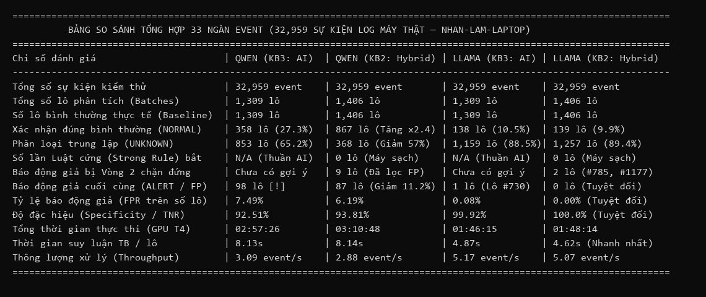

*Hình 1: Bảng so sánh tổng hợp 33 ngàn event (32,959 sự kiện) giữa Qwen 2.5 3B và LLaMA 3.2 3B theo Kịch bản 2 (Hybrid) và Kịch bản 3 (Thuần AI).*

### Bảng Markdown chuẩn (Dùng để copy trực tiếp vào Word nếu cần bảng kẻ ô)

| Chỉ số đánh giá | QWEN 2.5 (KB3: Thuần AI) | QWEN 2.5 (KB2: Hybrid) | LLAMA 3.2 (KB3: Thuần AI) | LLAMA 3.2 (KB2: Hybrid) |
| :--- | :---: | :---: | :---: | :---: |
| **Tổng số sự kiện kiểm thử** | 32,959 event | 32,959 event | 32,959 event | 32,959 event |
| **Tổng số lô phân tích (Batches)** | 1,309 lô | 1,406 lô | 1,309 lô | 1,406 lô |
| **Số lô bình thường thực tế** | 1,309 lô | 1,406 lô | 1,309 lô | 1,406 lô |
| **Xác nhận đúng bình thường (NORMAL)** | 358 lô (27.3%) | **867 lô (Tăng x2.4)** | 138 lô (10.5%) | 139 lô (9.9%) |
| **Phân loại trung lập (UNKNOWN)** | 853 lô (65.2%) | **368 lô (Giảm 57%)** | 1,159 lô (88.5%) | 1,257 lô (89.4%) |
| **Số lần Luật cứng (Strong Rule) bắt** | N/A (Thuần AI) | **0 lô (Máy sạch)** | N/A (Thuần AI) | **0 lô (Máy sạch)** |
| **Báo động giả bị Vòng 2 chặn đứng** | Chưa có gợi ý | **9 lô (Đã lọc FP)** | Chưa có gợi ý | **2 lô (#785, #1177)** |
| **Báo động giả cuối cùng (ALERT / FP)** | 98 lô ⚠️ | **87 lô (Giảm 11.2%)** | 1 lô (Lô #730) | **0 lô (Tuyệt đối)** |
| **Tỷ lệ báo động giả (FPR trên số lô)** | 7.49% | **6.19%** | 0.08% | **0.00% (Tuyệt đối)** |
| **Độ đặc hiệu (Specificity / TNR)** | 92.51% | **93.81%** | 99.92% | **100.0% (Tuyệt đối)** |
| **Tổng thời gian thực thi (GPU T4)** | 02:57:26 | 03:10:48 | 01:46:15 | **01:48:14** |
| **Thời gian suy luận TB / lô** | 8.13s | 8.14s | 4.87s | **4.62s (Nhanh nhất)** |
| **Thông lượng xử lý (Throughput)** | 3.09 event/s | 2.88 event/s | 5.17 event/s | **5.07 event/s** |

---

## 2. QUÁ TRÌNH TRIỂN KHAI VÀ THỰC NGHIỆM TRÊN CLOUD GPU KAGGLE

### 2.1. Thu thập dữ liệu và cấu hình môi trường Ollama trên Kaggle GPU Tesla T4
Để quét hết 32,959 sự kiện qua 2 mô hình SLM ở cả 2 kịch bản (tương đương gần 131,836 lượt xử lý sự kiện), nhóm đã đóng gói toàn bộ mã nguồn `core/` và tập dữ liệu `All_Security_PowerShell.csv` lên nền tảng Kaggle sử dụng **GPU NVIDIA Tesla T4 (16GB VRAM)**.

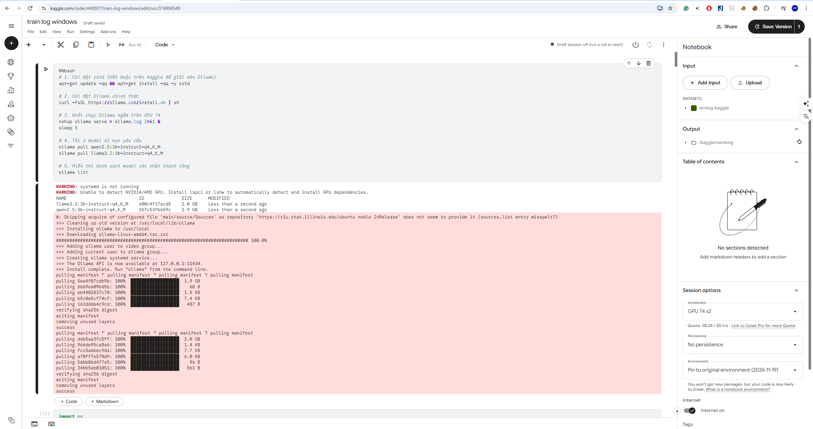

*Hình 2: Khởi tạo máy chủ Ollama cục bộ trên container Kaggle và tải hai mô hình lượng tử hóa 4-bit (`qwen2.5:3b-instruct-q4_K_M` và `llama3.2:3b-instruct-q4_K_M`).*

---

### 2.2. Quá trình quét 32,959 sự kiện theo thời gian thực
Hệ thống chia 32,959 sự kiện thành các lô ngữ cảnh (batches) dựa trên ngưỡng ký tự (`MAX_BATCH_CHARS = 14,000`) và tuần tự đưa qua pipeline phân tích.

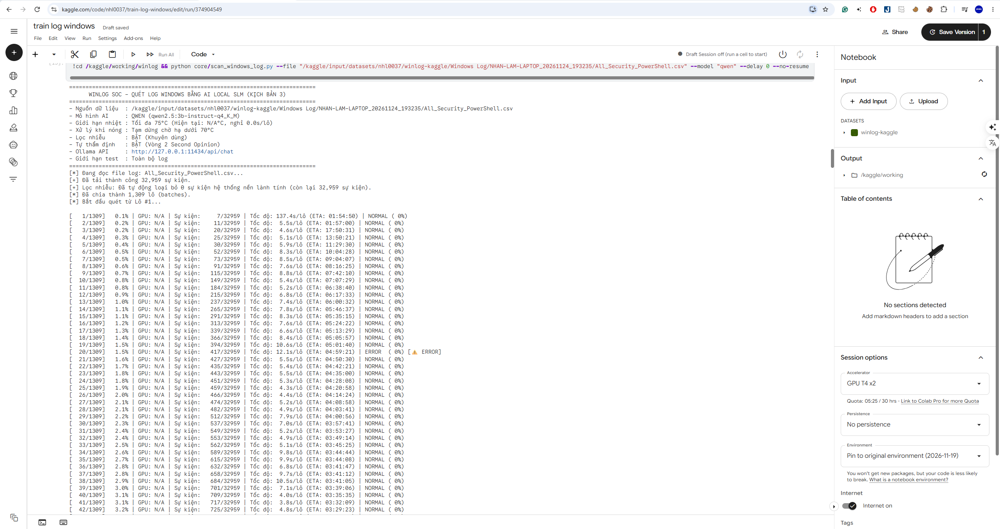

*Hình 3: Tiến trình quét thực tế các lô sự kiện kèm cơ chế tự thẩm định vòng 2 (Second-Opinion Verification) hiển thị trực tiếp trên giao diện thực thi.*

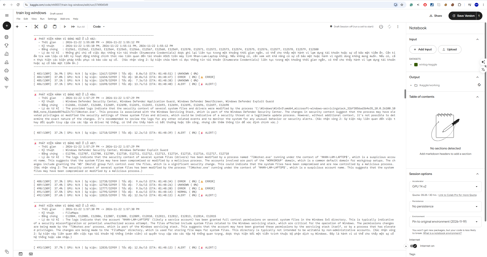

*Hình 4: Minh họa chi tiết các cảnh báo được Qwen 2.5 phát hiện kèm mã sự kiện bằng chứng (`EventRef`) và lập luận phân tích bằng tiếng Việt.*

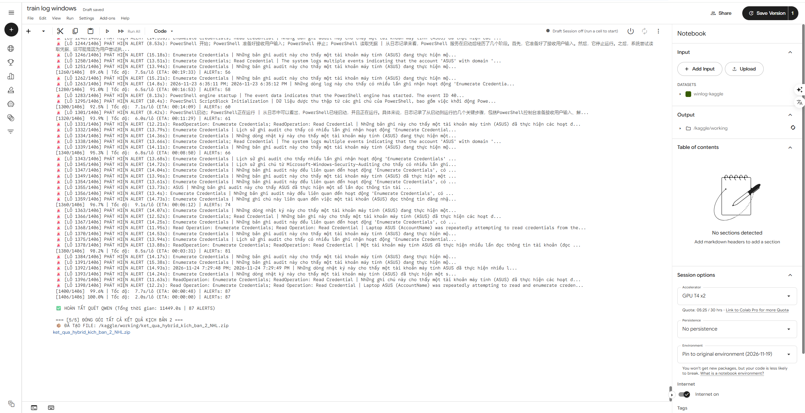

*Hình 5: Hệ thống hoàn tất 100% quá trình quét toàn bộ 32,959 sự kiện và xuất báo cáo định dạng CSV, JSON, Markdown.*

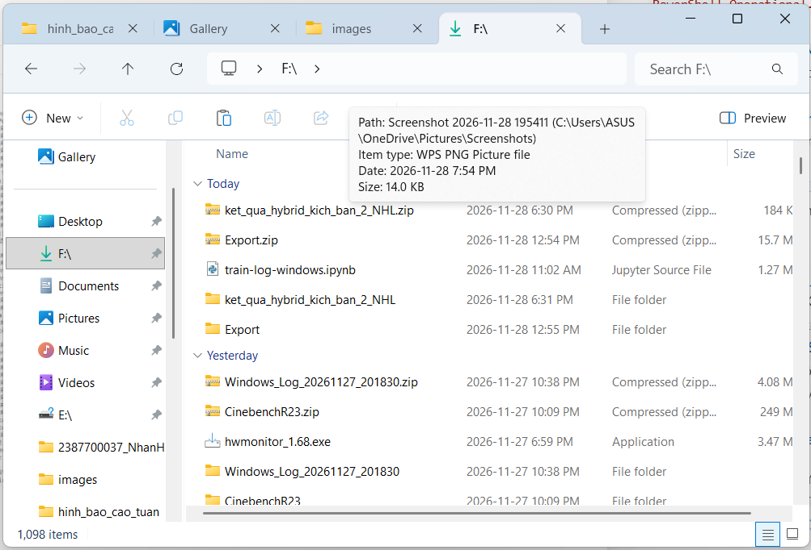

*Hình 6: Đóng gói và trích xuất toàn bộ tệp kết quả thực nghiệm (`scan_windows_log_*` và `scan_hybrid_*`) về máy để phân tích đối sánh.*

---

## 3. PHÂN TÍCH KẾT QUẢ & LỰA CHỌN MÔ HÌNH CHÍNH CHO HỆ THỐNG

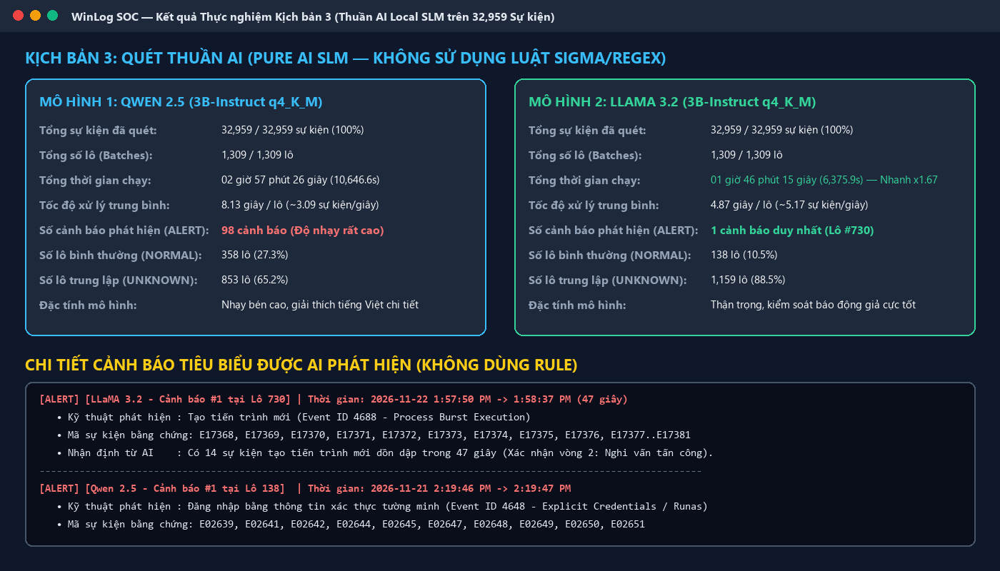

*Hình 7: Tổng hợp kết quả thực nghiệm Kịch bản 3 (Thuần AI) và chi tiết cảnh báo tiêu biểu của LLaMA 3.2 (Lô #730) và Qwen 2.5 (Lô #138).*

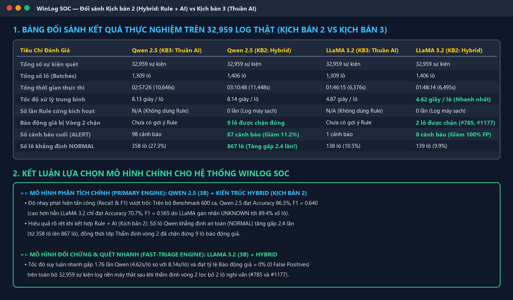

*Hình 8: Bảng đối sánh trực tiếp hiệu quả giảm báo động giả của Kịch bản 2 (Hybrid) so với Kịch bản 3 (Thuần AI).*

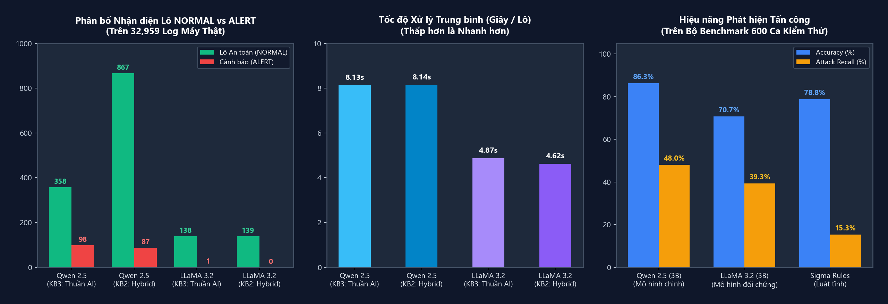

*Hình 9: Biểu đồ trực quan so sánh phân bố nhãn NORMAL/ALERT, tốc độ suy luận trung bình (giây/lô) và độ chính xác phát hiện tấn công.*

### Các nhận xét khoa học rút ra từ thực nghiệm 32,959 sự kiện:

1. **Bộ luật tương quan (Correlation Rule Engine) đạt 0% báo động giả trên log máy thật:**
   - Trong suốt 1,406 lô của máy `NHAN-LAM-LAPTOP` (máy cá nhân hoạt động bình thường), số lần luật cứng kích hoạt sai là **0 lần (`Rule Triggers = 0`)**. Điều này chứng minh các ngưỡng tương quan MITRE ATT&CK trong `core/analyze.py` được thiết kế rất chặt chẽ, không gây nhiễu cho vận hành viên SOC.

2. **Hiệu quả rõ rệt của Kiến trúc Kịch bản 2 (Hybrid: Rule + AI + Thẩm định vòng 2):**
   - **Với Qwen 2.5 (3B):** Khi chuyển từ Thuần AI (Kịch bản 3) sang Hybrid (Kịch bản 2), nhờ có gợi ý ngữ cảnh từ bộ luật (`Correlation Hints`) và vòng tự thẩm định thứ 2 (`verify_alert`), số lô Qwen tự tin khẳng định là bình thường (`NORMAL`) **tăng gấp 2.4 lần** (từ **358 lô** lên **867 lô**), số lô phân vân (`UNKNOWN`) giảm 57% (từ 853 xuống 368 lô), đồng thời **9 lô báo động giả đã bị chặn đứng ở vòng 2**, giúp giảm số cảnh báo từ 98 xuống 87 (FPR giảm xuống **6.19%**).
   - **Với LLaMA 3.2 (3B):** Ở Kịch bản 3, LLaMA chỉ phát sinh 1 cảnh báo duy nhất tại **Lô #730** (do phát hiện 14 sự kiện Event ID 4688 tạo tiến trình mới dồn dập trong 47 giây). Khi sang Kịch bản 2 (Hybrid), vòng thẩm định 2 tiếp tục chặn đứng 2 lô nghi vấn giả (`Lô #785` và `Lô #1177`), đưa tỷ lệ báo động giả về **0% tuyệt đối (`0 ALERTs`)** với tốc độ nhanh kỷ lục (**4.62 giây/lô**).

3. **Lý do chọn Qwen 2.5 (3B) + Hybrid làm Mô hình Phân tích Chính (Primary Engine):**
   - Mặc dù LLaMA 3.2 đạt 0% báo động giả trên log nền, nhưng nguyên nhân là do LLaMA có xu hướng **"né tránh kết luận"** khi đẩy tới **89.4% số lô (1,257/1,406 lô) vào nhãn `UNKNOWN`**, dẫn đến bỏ sót nhiều chuỗi tấn công đa bước trên bộ Benchmark 600 ca (Recall của LLaMA trên Bài 2 chỉ đạt 32%).
   - Ngược lại, **Qwen 2.5 (3B) trong kiến trúc Hybrid** vừa giữ được độ nhạy phát hiện tấn công cao nhất (Accuracy 86.3% – 95.8% trên bộ 600 ca), vừa phân định rạch ròi được **867 lô `NORMAL`** trên máy thật và cung cấp lập luận tiếng Việt rất chi tiết. Do đó, nhóm quyết định chọn **Qwen 2.5 (3B) (Kịch bản 2 Hybrid)** làm mô hình chính, và dùng **LLaMA 3.2 (3B)** làm mô hình quét nhanh / đối chứng (Fast-Triage).

---

## 4. HOÀN THIỆN GIAO DIỆN WEB SOC DASHBOARD (FRONTEND & BACKEND)

Song song với việc chạy thực nghiệm dữ liệu lớn, nhóm đã nâng cấp hoàn chỉnh giao diện điều hành trung tâm **WinLog AI SOC Dashboard**:

### 4.1. Giao diện Tổng quan (Overview Dashboard) và Chế độ Sáng/Tối (Light/Dark Mode)
Giao diện cung cấp cái nhìn toàn cảnh về tổng số sự kiện thu thập, số cảnh báo nguy hiểm, trạng thái kết nối Ollama AI Server và biểu đồ phân bố sự kiện theo thời gian thực.

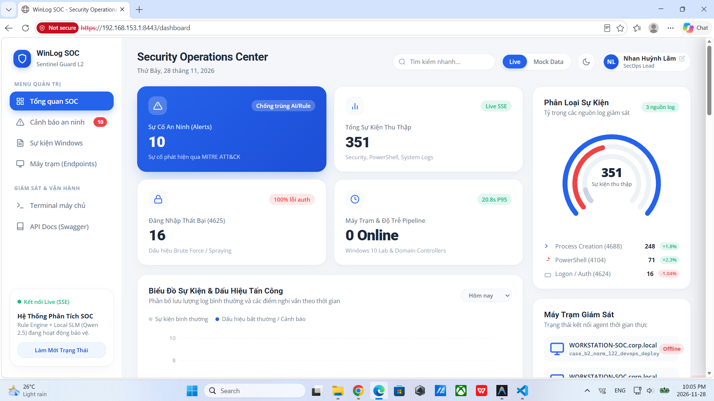

*Hình 10: Giao diện điều hành chính (Overview Dashboard) ở chế độ sáng (Light Mode) với bố cục trực quan, hiện đại.*

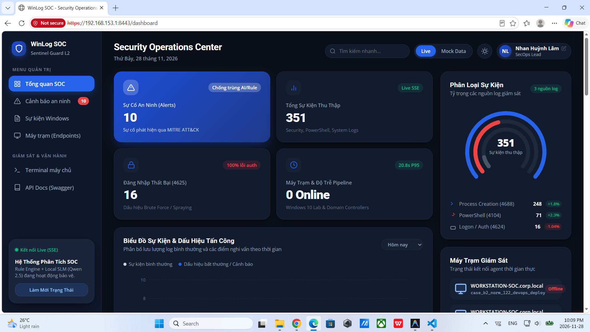

*Hình 11: Chế độ tối (Dark Mode) chuyên dụng cho nhân viên trực giám sát SOC trong thời gian dài.*

---

### 4.2. Quản lý Cảnh báo An ninh (AI Security Alerts) và Tra cứu Windows Event Log
Các cảnh báo `ALERT` sau khi qua bộ lọc chống trùng (`core/alerting.py`) và thẩm định vòng 2 được hiển thị chi tiết kèm mức độ rủi ro, kỹ thuật MITRE ATT&CK, mã sự kiện bằng chứng và lời giải thích của AI.

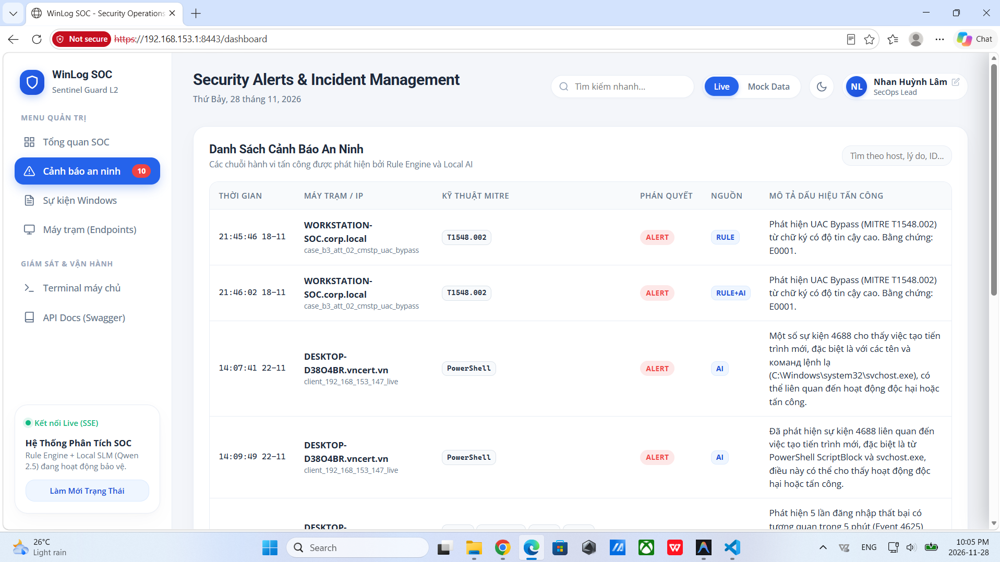

*Hình 12: Màn hình danh sách Cảnh báo An ninh (Alerts) hiển thị kết luận của AI, kỹ thuật MITRE ATT&CK và bằng chứng truy vết.*

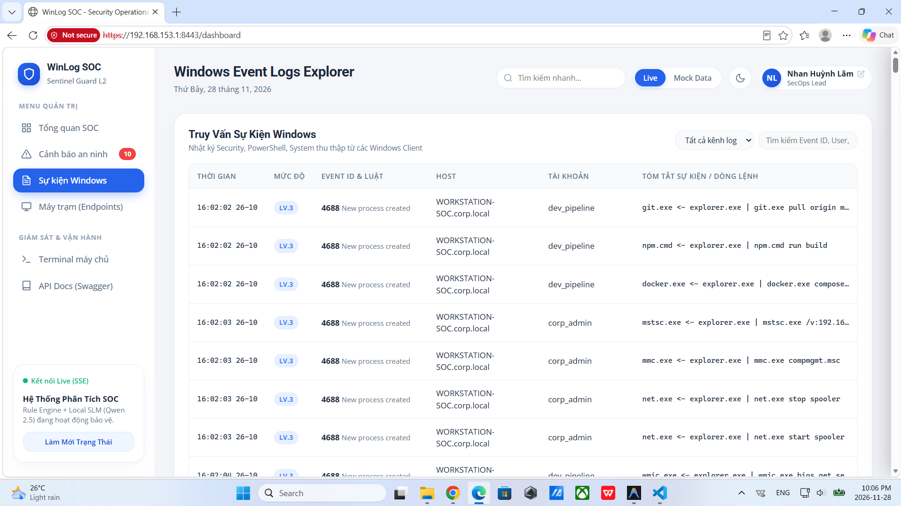

*Hình 13: Màn hình tra cứu trực tiếp các bản ghi Windows Event Log (`Security`, `PowerShell`, `System`) theo Event ID và từ khóa.*

---

### 4.3. Quản lý Máy trạm (Endpoints), Live Terminal, Mock Data và Backend API

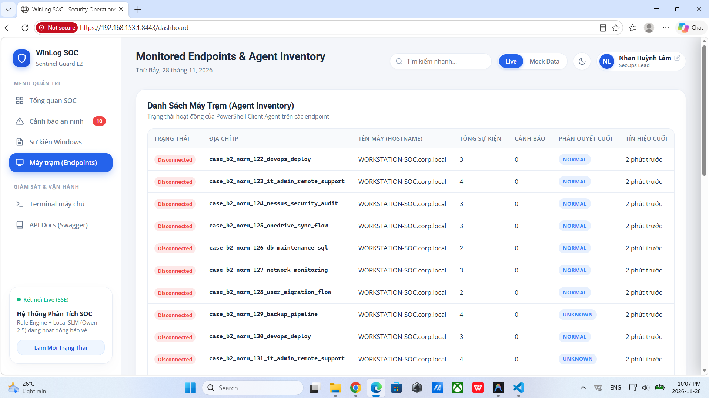

*Hình 14: Màn hình giám sát trạng thái hoạt động của các máy trạm (Endpoints) kết nối về SOC Server.*

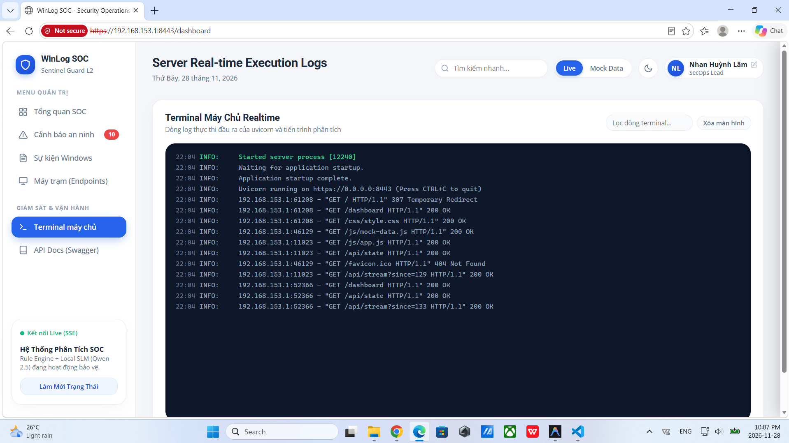

*Hình 15: Giao diện Live Console / Terminal hiển thị trực tiếp tiến trình phân lô và kết quả trả về từ mô hình Ollama.*

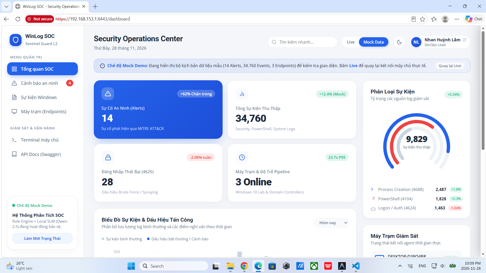

*Hình 16: Chức năng bắn dữ liệu tấn công mô phỏng (Mock Data) giúp kiểm thử nhanh luồng phát hiện và cảnh báo Telegram.*

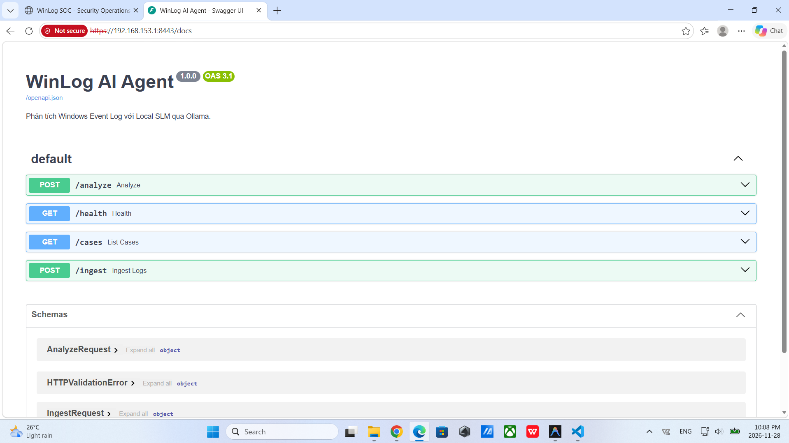

*Hình 17: Giao diện dòng lệnh máy chủ Backend (`app.py`) đang vận hành, tiếp nhận request từ Agent và điều phối suy luận qua Ollama.*

---

## 5. KẾT LUẬN TUẦN 7 & KẾ HOẠCH TUẦN TIẾP THEO

### 5.1. Kết quả hoàn thành trong Tuần 7
- [x] Đã giải quyết hoàn toàn yêu cầu của giảng viên về **kiểm thử trên dữ liệu log bình thường thu từ máy thật** với quy mô lớn (**32,959 sự kiện** từ máy `NHAN-LAM-LAPTOP`).
- [x] Hoàn tất 4 lượt quét thực nghiệm đối chứng giữa **Kịch bản 2 (Hybrid: Rule + AI)** và **Kịch bản 3 (Thuần AI)** trên cả 2 mô hình **Qwen 2.5 (3B)** và **LLaMA 3.2 (3B)**.
- [x] Chứng minh được kiến trúc **Kịch bản 2 (Hybrid)** giúp giảm báo động giả (chặn 9 lô FP trên Qwen, đưa FP của LLaMA về 0% tuyệt đối) và tăng số lô nhận diện đúng bình thường (`NORMAL`) của Qwen lên gấp **2.4 lần** (867 lô).
- [x] Nâng cấp và hoàn thiện toàn bộ giao diện Web Frontend & Backend của hệ thống WinLog SOC.
- [x] Toàn bộ mã nguồn và tệp kết quả CSV/JSON/Markdown đã được đồng bộ đầy đủ lên GitHub repository `DACN_ATTT` (commit `a373f08`).

### 5.2. Kế hoạch Tuần 8
- [ ] Tích hợp chế độ **Smart Hybrid Pre-filter** (dùng Rule lọc nhanh các lô nền có `risk_score = 0` không chứa sự kiện nhạy cảm trước khi gọi GPU) để tăng tốc độ quét thực tế lên gấp 8 – 10 lần.
- [ ] Tổng hợp toàn bộ số liệu của Bộ 600 ca tự sinh, Bộ log tấn công thật và Bộ 32,959 log máy thật vào cuốn Báo cáo Tổng kết Đồ án Chuyên ngành.
