# Nhật Ký Tuần 4

- **Thời gian thực hiện**: 02/11/2026 - 08/11/2026
- **Thành viên tham gia**: Lâm, Thắng

# BÁO CÁO BÀI THỰC HÀNH TUẦN 4

**Môn học:** Đồ Án Chuyên Ngành An Toàn Thông Tin

| **Họ và tên:** | Nhan Huỳnh Lâm Trần Minh Thắng | **MSSV:** | 2387700037 2387700063 |
| **Lớp:** | 23DATA1 | **Ngày thực hiện:** | 07/11/2026 |

---

## HỆ THỐNG GIÁM SÁT AN NINH WINDOWS EVENT LOG BẰNG AI LOCAL
### Triển khai và đánh giá Qwen 2.5 3B so với Llama 3.2 3B

### Tóm tắt

Đồ án xây dựng hướng giám sát an ninh dựa trên Windows Event Log, kết hợp xử lý bằng quy tắc và mô hình ngôn ngữ nhỏ chạy cục bộ. Log được thu thập trên client, chuẩn hóa, lọc nhiễu, tương quan và chia lô trước khi gửi đến mô hình. Kết quả gồm nhãn phân loại, lý do và mã bằng chứng; cảnh báo được chuyển đến người vận hành qua Telegram. n8n được sử dụng để điều phối webhook, gọi API và rẽ nhánh gửi thông báo.

Bộ đánh giá được mô tả gồm 40 ca: 25 ca tấn công và 15 ca bình thường. Đọc trực tiếp bảng từng ca của Qwen cho thấy 37 ca đúng, 3 cảnh báo sai và không có ca tấn công bị dự đoán NORMAL. Các giá trị này khớp accuracy 92,5%, precision 89,3%, recall 100% và F1 khoảng 0,943 trong bảng tổng hợp. Bảng Llama chứa nhiều dòng lặp; khi đối chiếu mã ca với Qwen, có 29 mã khác nhau nhìn thấy và 11 mã chưa xuất hiện. Do đó, accuracy 75% của Llama trong bảng tổng hợp chưa thể kiểm tra đầy đủ từ ảnh.

Báo cáo trình bày thiết kế, cách cấu hình, kịch bản thực nghiệm và đánh giá số liệu theo cùng một trình tự. Toàn bộ 22 ảnh của so_lieu(2).docx được đặt tại phần nội dung liên quan; token bot và Chat ID trong hai ảnh được che. Các ảnh về cấu hình được phân biệt với bằng chứng thực thi, và số liệu đọc trực tiếp được phân biệt với số liệu chỉ có trong bảng tổng hợp.

Bản cập nhật ngày 07/11/2026 bổ sung Chương 6 với 11 ảnh từ phiên lab HTTPS mới (Hình 23 đến 33): khởi động client/server, lỗi kết nối n8n tới API và dashboard WinLog SOC. Chương này liệt kê các lỗi vận hành mới gặp và kế hoạch sửa trong tuần tới.

### Phạm vi tư liệu

Nguồn chính là so_lieu(2).docx do người thực hiện cung cấp. Tài liệu không kèm EVTX, mã nguồn hoặc CSV kết quả để tái chạy; vì vậy báo cáo không xác nhận độc lập việc triển khai các hàm hoặc tính đúng của nhãn chuẩn. Tên hàm, mô hình và tham số được giữ theo nguồn; các phép tính trong phần đánh giá được thực hiện lại từ ảnh nhìn thấy.

---

## Mục lục

1. [Tổng quan và dữ liệu đánh giá](#1-tổng-quan-và-dữ-liệu-đánh-giá)
2. [Thiết kế và logic xử lý](#2-thiết-kế-và-logic-xử-lý)
3. [Cấu hình và triển khai](#3-cấu-hình-và-triển-khai)
4. [Thực nghiệm và kiểm tra hoạt động](#4-thực-nghiệm-và-kiểm-tra-hoạt-động)
5. [Phân tích số liệu và so sánh mô hình](#5-phân-tích-số-liệu-và-so-sánh-mô-hình)
6. [Cập nhật tuần: lab HTTPS, n8n và dashboard](#6-cập-nhật-tuần-lab-https-n8n-và-dashboard-giám-sát)
7. [Kết luận và hướng phát triển](#7-kết-luận-và-hướng-phát-triển)

---

## 1 Tổng quan và dữ liệu đánh giá

### Bài toán và mục tiêu

Windows tạo ra nhiều bản ghi về đăng nhập, tạo tiến trình và PowerShell. Một hành vi đáng ngờ thường thể hiện qua nhiều sự kiện: đăng nhập thất bại liên tiếp, đăng nhập thành công, tạo tiến trình hoặc thực thi script. Đọc từng dòng riêng lẻ dễ bỏ mất quan hệ; ghép mọi sự kiện gần nhau lại có nguy cơ tạo chuỗi tấn công không có thật. Hệ thống cần vừa giảm lượng dữ liệu đưa vào mô hình, vừa giữ những thuộc tính đủ để truy nguyên và đối chiếu.

Mục tiêu của đồ án là hỗ trợ phân tích và thông báo, với ba trạng thái: ALERT khi có bằng chứng cần điều tra, NORMAL khi phạm vi đã xét phù hợp hoạt động hợp lệ, UNKNOWN khi dữ liệu hoặc kết quả chưa đủ để kết luận. Người vận hành phải đọc lý do và sự kiện tham chiếu trước khi xử lý máy. Ba trạng thái này không nên được gọi là nhãn nhị phân như một câu trong tài liệu nguồn.

### Nguồn và cấu trúc bộ dữ liệu

Tài liệu dẫn kho EVTX-ATTACK-SAMPLES của Samir Bousseaden và mô tả dữ liệu trong data01/ được kế thừa, mở rộng từ data/. Chưa có danh mục liên kết từng ca với tệp EVTX hoặc phiên bản kho. Vì thế có thể xem đây là nguồn tham khảo được khai báo, nhưng chưa đủ căn cứ gọi toàn bộ 40 ca là một benchmark chuẩn hóa độc lập hay "tiêu chuẩn vàng".

| Nhóm | Số ca | Nhãn chuẩn theo mô tả | Mục đích |
|---|---|---|---|
| Bình thường | 10 | 10 NORMAL | Văn phòng, lập trình, sao lưu, dọn dẹp, đọc PDF. |
| Tấn công chuyên biệt | 10 | 10 ALERT | Đánh giá dấu hiệu từng kỹ thuật. |
| Tấn công phức hợp | 10 | 10 ALERT | Kiểm tra liên kết nhiều bước và dữ liệu pha trộn. |
| Ranh giới | 10 | 5 ALERT và 5 NORMAL | Thử khả năng phân biệt thao tác hợp lệ và dấu hiệu đáng ngờ. |

Bốn nhóm đều có 10 ca, nhưng số lượng theo nhãn là 25 ALERT và 15 NORMAL. Tỷ lệ tấn công trong tập là 62,5%; đây là đặc điểm thiết kế thử nghiệm, không phản ánh tỷ lệ tấn công thực tế. Khi diễn giải precision, cần lưu ý kết quả phụ thuộc vào thành phần tập kiểm thử.

### Nguồn sự kiện và giá trị bằng chứng

| Kênh | Event ID | Thông tin dùng trong phân tích |
|---|---|---|
| Security | 4624 / 4625 | Đăng nhập thành công / thất bại; cần tài khoản, nguồn và loại đăng nhập. |
| Security | 4648 | Sử dụng thông tin xác thực tường minh; cần ngữ cảnh tài khoản và tiến trình. |
| Security | 4688 | Tiến trình được tạo; CommandLine giúp xác định tham số thực thi. |
| PowerShell Operational | 4104 | Nội dung script block; có thể cần ghép các phần theo ScriptBlockId. |

Sự kiện 4688 không cho biết mọi lệnh bên trong tiến trình đã đạt mục đích. Tương tự, 4104 ghi nội dung script không đồng nghĩa với việc tải hay thực thi thành công mã từ xa. Các mô tả như tạo tài khoản quản trị, duy trì hiện diện hoặc trích xuất mật khẩu cần thêm bằng chứng về đối tượng thay đổi và kết quả thao tác. Với quản lý tài khoản, có thể đối chiếu 4720, 4732 hoặc trạng thái thực tế khi audit tương ứng được bật.

---

## 2 Thiết kế và logic xử lý

### Kiến trúc chức năng

Client PowerShell lấy Windows Event Log; ứng dụng máy chủ tiếp nhận và xử lý; Ollama cung cấp suy luận cục bộ bằng Qwen hoặc Llama. Kết quả được lưu hoặc chuyển tới đường thông báo. Workflow trong tệp dùng Webhook → HTTP Request → If → Telegram. Ảnh console cũng có thông báo ứng dụng gửi Telegram trực tiếp; chưa thể khẳng định hai cơ chế này chạy đồng thời hay thuộc hai phiên cấu hình. Khi triển khai, phải chọn rõ nơi phát cảnh báo để tránh gửi trùng.

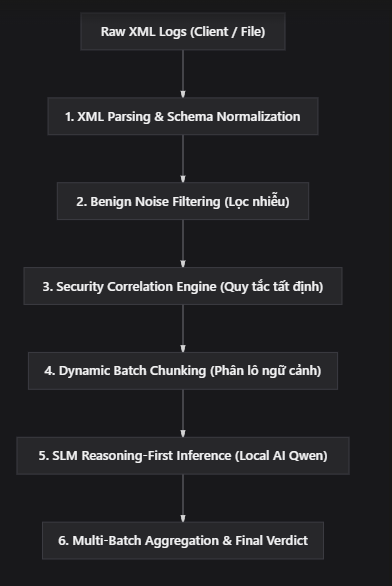

*Hình 1. Sáu bước xử lý dữ liệu theo thiết kế*

Sơ đồ mô tả thứ tự từ log XML đến kết luận cuối. Mỗi bước phải giữ được liên kết từ kết luận về sự kiện nguồn; tên hàm phía dưới được dẫn theo tài liệu và chưa được đối chiếu với mã thực thi.

### Chuẩn hóa và bảo toàn dữ liệu

Ứng dụng phân tích XML theo namespace http://schemas.microsoft.com/win/2004/08/events/event, chuẩn hóa TimeCreated sang ISO 8601 UTC, sắp xếp và gán mã E0001, E0002… Mã này là event_ref của ứng dụng, khác Event ID do Windows định nghĩa. Mỗi event_ref phải có ánh xạ tới host, channel, EventRecordID, thời gian và XML gốc. Khi EventRecordID có thể lặp do xóa log, cần lưu thêm ngữ cảnh phiên log hoặc định danh nguồn.

### Lọc nhiễu có kiểm soát

is_benign_noise() được mô tả lọc một số tiến trình nền, LogonType 5 và script nội bộ PowerShell. Lọc giảm kích thước đầu vào, nhưng tên tiến trình thông dụng không đủ để chứng minh vô hại. Cần xem đường dẫn, tham số, tài khoản, tiến trình cha và quan hệ với các dấu hiệu khác. Lưu bản ghi gốc và lý do loại để có thể kiểm toán trường hợp bỏ sót. Nguồn nêu mức giảm hơn 80% nhưng không có mẫu số và bảng trước/sau, nên chưa đưa con số này vào kết quả đã xác nhận.

### Tương quan sự kiện

correlate_security_events() tìm các mẫu như ít nhất ba lần 4625, lệnh quản lý tài khoản, DownloadString, Mimikatz, Registry Run và lệnh trinh sát. Ngưỡng số lần là điều kiện kích hoạt kiểm tra, cần đi cùng tài khoản đích, nguồn, host và cửa sổ thời gian. Ví dụ, năm lần lỗi của năm người khác nhau không tự tạo thành một cuộc dò mật khẩu. Nếu nối sang 4624, phải kiểm tra đúng chủ thể và nguồn thay vì chỉ chọn lần đăng nhập thành công gần nhất.

Với tiến trình, PID phải đi cùng host và khoảng đời vì Windows có thể sử dụng lại PID. Với PowerShell, cần ghép đúng các mảnh script block. Các mẫu DownloadString, Mimikatz và Registry Run thuộc các hành vi khác nhau; nhãn tổng hợp rộng trong ảnh không chứng minh chúng cùng xảy ra. Đầu ra nên phân biệt "quan sát thấy lệnh" với "đã xác nhận tác động".

### Phân lô và suy luận

split_event_batches() được mô tả giữ nguyên từng JSON sự kiện với MAX_BATCH_CHARS = 10.000. Ngưỡng ký tự không bằng số token; cần đo chiều dài thực tế của prompt và chừa dung lượng cho kết quả. Mỗi lô phải ghi danh sách event_ref; nếu lô có phần chồng lấn, giữ nguyên định danh để không đếm một sự kiện nhiều lần.

Prompt yêu cầu mô hình đưa ra lý do, detected_stages, evidence_refs và nhãn cuối. Schema/Pydantic kiểm tra hình dạng dữ liệu, nhưng không xác nhận nội dung kết luận đúng. temperature = 0,0 giảm biến thiên sinh văn bản, không loại bỏ hoàn toàn suy luận sai. Sau suy luận phải kiểm tra event_ref có tồn tại trong ca, thuộc đúng host và thực sự hỗ trợ lý do.

### Tổng hợp và quyết định gửi cảnh báo

combine_batch_results() được mô tả ưu tiên ALERT nếu một lô hoặc bộ quy tắc phát hiện dấu hiệu. Đây là chính sách kết hợp quy tắc và AI, nên chỉ số cuối đo toàn hệ thống chứ chưa tách riêng khả năng mô hình. Khi tất cả lô NORMAL, vẫn cần kiểm tra đủ dữ liệu và ngữ cảnh liên lô. Nếu một lô lỗi hoặc thiếu bằng chứng, giữ UNKNOWN hoặc trạng thái lỗi thay vì mặc định an toàn.

| Bước kiểm soát | Dữ liệu cần lưu | Mục đích |
|---|---|---|
| Tiếp nhận | batch_id, host, thời gian nhận, số sự kiện | Đối soát nhận và gửi lại. |
| Xử lý | event_ref, lô, bản ghi bị lọc và lý do | Tra nguyên nhân quyết định. |
| Suy luận | tag mô hình, prompt, trạng thái và kết quả | Tái lập và kiểm tra bằng chứng. |
| Thông báo | case_id, mã cảnh báo, phản hồi gửi | Chống lặp và nối đúng tin Telegram. |

---

## 3 Cấu hình và triển khai

Quy trình triển khai bắt đầu từ việc bảo đảm Windows tạo đủ log, tiếp đến chuẩn bị agent và server, sau đó cấu hình kênh cảnh báo và workflow. Các ảnh cấu hình xác nhận lựa chọn tại một thời điểm; phải có sự kiện thử hoặc lần thực thi thành công để xác nhận hiệu lực.

### Cấu hình nguồn log trên client

Mở secpol.msc bằng quyền quản trị, vào Advanced Audit Policy Configuration → System Audit Policies → Logon/Logoff → Audit Logon, bật Success và Failure. Việc bật cả hai cho phép đối chiếu chuỗi lỗi với đăng nhập thành công khi thực sự cùng ngữ cảnh.

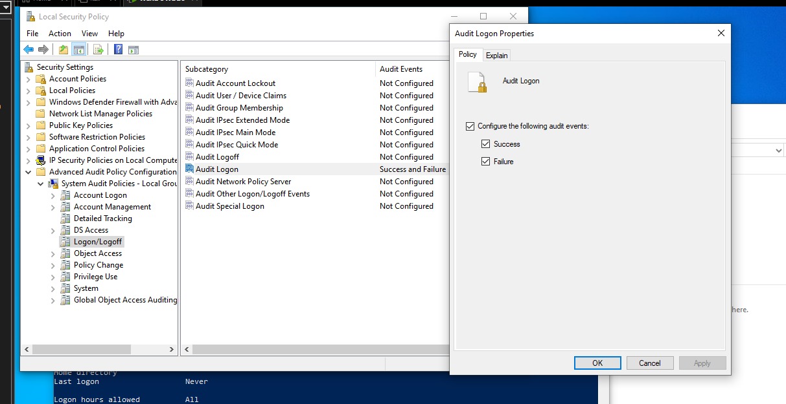

*Hình 2. Bật Audit Logon cho đăng nhập thành công và thất bại*

Sau khi lưu chính sách, tạo hoạt động thử và kiểm tra 4624/4625 trong Security. Nếu không có sự kiện, kiểm tra quyền đọc và chính sách có hiệu lực trên máy.

Trong Detailed Tracking, bật Audit Process Creation ở chế độ Success. Sau đó bật Include command line in process creation events trong Group Policy để 4688 có tham số thực thi, thay vì chỉ có tên chương trình.

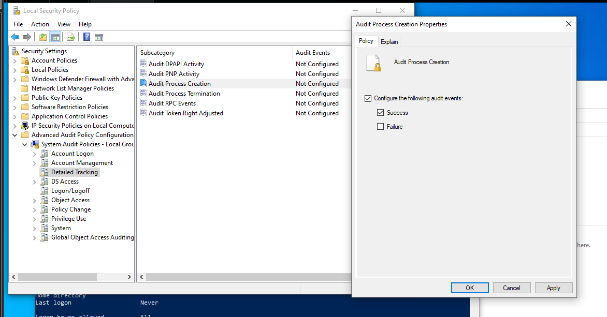

*Hình 3. Bật Audit Process Creation*

Cấu hình này tạo nền tảng ghi tiến trình mới. Nó cần kết hợp với chính sách dòng lệnh ở hình kế tiếp để phân biệt các lệnh PowerShell hoặc thao tác tài khoản.

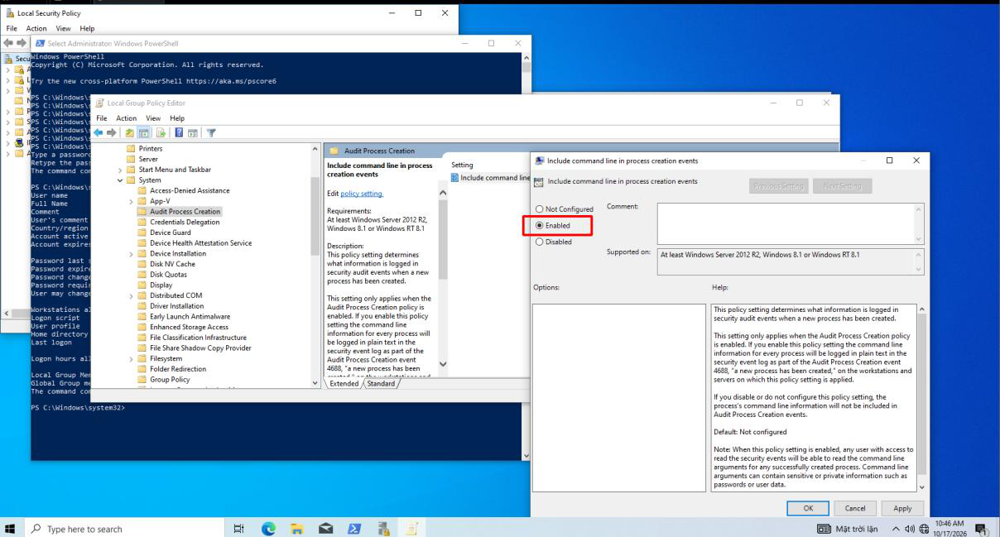

*Hình 4. Bổ sung dòng lệnh cho sự kiện 4688*

Thông tin CommandLine giúp kiểm tra cú pháp và tham số; riêng sự xuất hiện của lệnh không chứng minh thay đổi tài khoản hoặc tải nội dung đã thành công.

Trong Windows Components → Windows PowerShell, bật Turn on PowerShell Script Block Logging. Chạy gpupdate /force, mở phiên PowerShell mới và kiểm tra 4104 trong Microsoft-Windows-PowerShell/Operational. Nếu máy chịu Group Policy của domain, cần kiểm tra chính sách thực tế áp dụng.

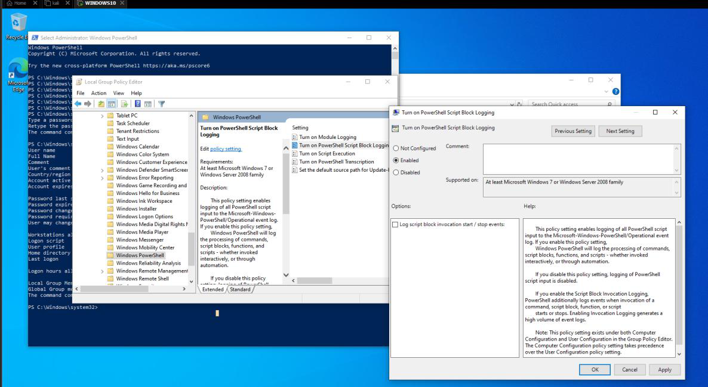

*Hình 5. Bật PowerShell Script Block Logging*

Ảnh xác nhận lựa chọn Enabled. Log cần được kiểm tra bằng nội dung script thử; không dùng chính sách đã bật để suy ra mọi hành vi PowerShell đều được ghi đầy đủ.

### Chuẩn bị chương trình client và server

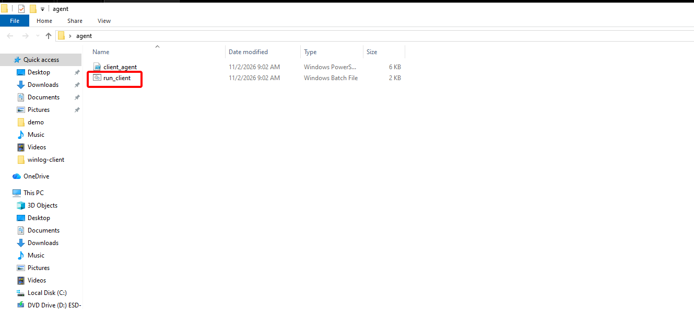

*Hình 6. Các tệp triển khai trên client*

Thư mục chứa client_agent, run_client và demo. Agent chịu trách nhiệm thu log; script demo dùng tạo dữ liệu thử. Cần bật hiển thị phần mở rộng và đọc nội dung batch trước khi chạy với quyền quản trị.

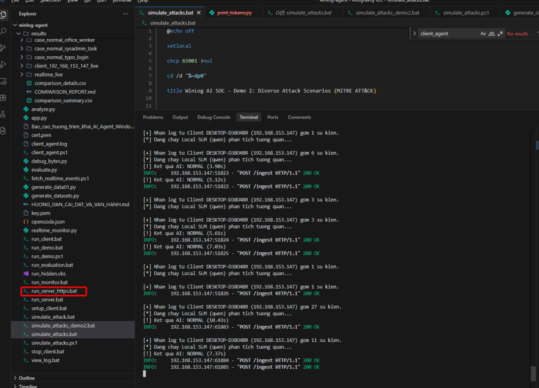

*Hình 7. Mã chương trình và thư mục kết quả trên server*

Ảnh cho thấy app.py, analyze.py, các thư mục ca và tệp comparison. Sự hiện diện của tệp không xác nhận nội dung. Các CSV được nhắc trong ảnh là dữ liệu cần bổ sung để tái tính kết quả ở Chương 5.

Trình tự chạy hợp lý là kiểm tra Ollama và mô hình, khởi động API, xác nhận client gọi được máy chủ, rồi chạy agent. Theo dõi một lô thật trước khi mở mô phỏng để biết nguồn log bình thường. Nguồn không cung cấp toàn bộ file cấu hình hoặc lệnh khởi động, vì vậy không thể tái dựng chính xác tên biến, cơ chế lưu và xác thực API chỉ từ ảnh.

### Tạo bot và cấu hình thông báo

Trong BotFather, gửi /newbot, đặt tên hiển thị và username của bot. Token được sử dụng làm credential khi gửi API hoặc trong n8n; Chat ID xác định nơi nhận. Token xuất hiện trong ảnh nguồn đã được che ở báo cáo và cần được đổi nếu từng chia sẻ ra ngoài.

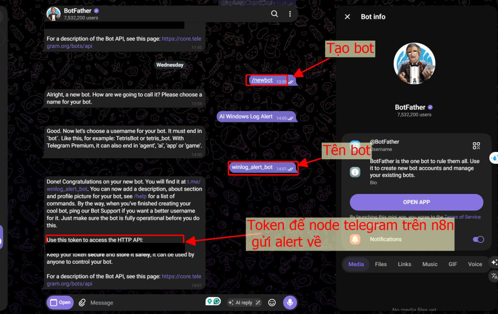

*Hình 8. Đăng ký bot Telegram với BotFather*

Ảnh giữ lại quy trình đặt tên và thông báo tạo thành công; hai vùng token đã được che. Tạo bot là bước chuẩn bị, cần một tin thử để xác nhận quyền và nơi nhận.

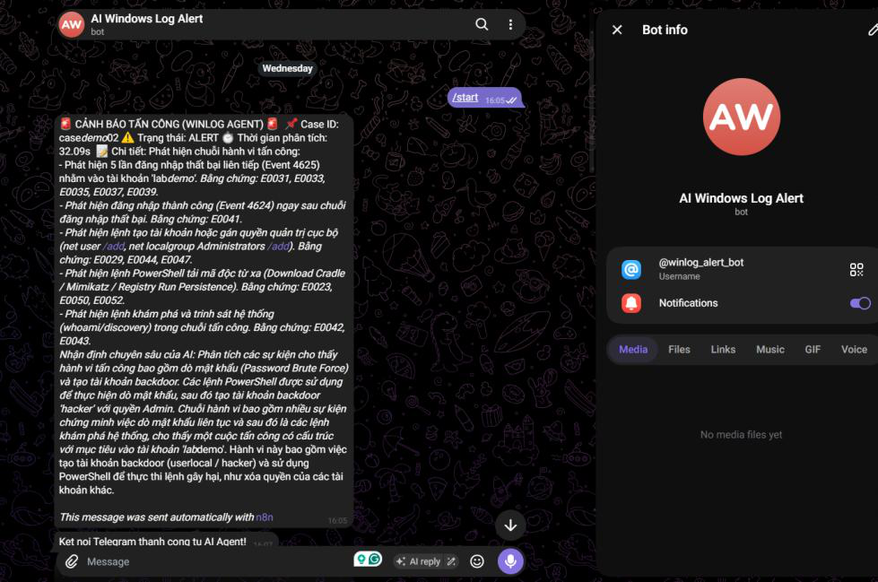

*Hình 9. Hội thoại và thông báo của bot đã tạo*

Tin hiển thị case_demo_02 và thời gian khoảng 32,09 giây. Đây là một lần phân tích riêng, không dùng thay cho thời gian trung bình trên 40 ca. Những mô tả tấn công trong tin phải đối chiếu với evidence_refs.

### Điều phối bằng n8n

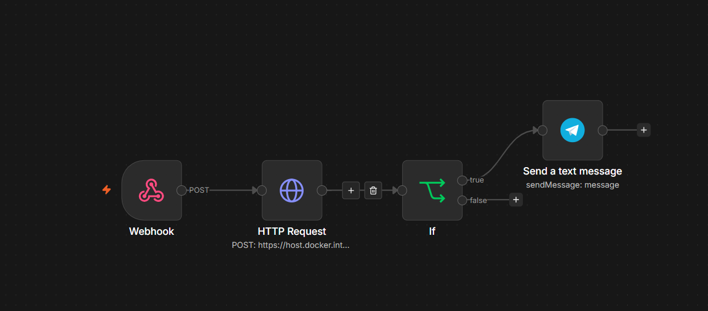

*Hình 10. Workflow Webhook đến HTTP Request rồi If và Telegram*

Webhook tiếp nhận kích hoạt, HTTP Request gọi máy chủ, If kiểm tra kết quả và Telegram gửi thông báo. Trước khi vận hành, cần chọn rõ ứng dụng hay n8n là nơi gửi chính để tránh cùng một kết quả có hai tin.

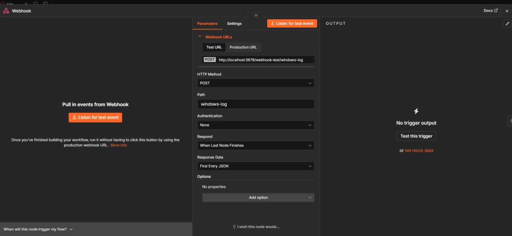

*Hình 11. Cấu hình Webhook với phương thức POST*

Ảnh có URL test và production, path windows-log. URL test phục vụ phiên kiểm thử; khi vận hành dùng production URL theo trạng thái workflow. Cách phản hồi When Last Node có thể khiến bên gửi chờ cả phân tích và gửi tin.

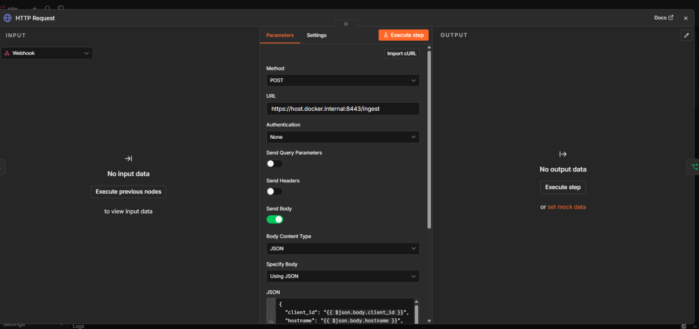

*Hình 12. HTTP Request chuyển dữ liệu đến API phân tích*

Địa chỉ trong ảnh là https://host.docker.internal:8443/ingest. Đây là thông số của phiên minh họa; cần kiểm tra chứng chỉ HTTPS, schema body và khả năng truy cập từ container. "No input data" cho biết ảnh cấu hình chưa có dữ liệu chạy tại thời điểm chụp.

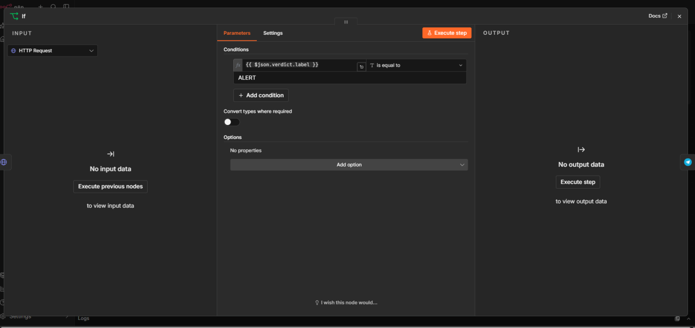

*Hình 13. Điều kiện If kiểm tra verdict.label bằng ALERT*

Kết quả ALERT đi nhánh gửi tin. Nên kiểm tra thêm analysis_status và lưu UNKNOWN/lỗi riêng; nhánh không gửi tin không đồng nghĩa client đã được xác nhận an toàn.

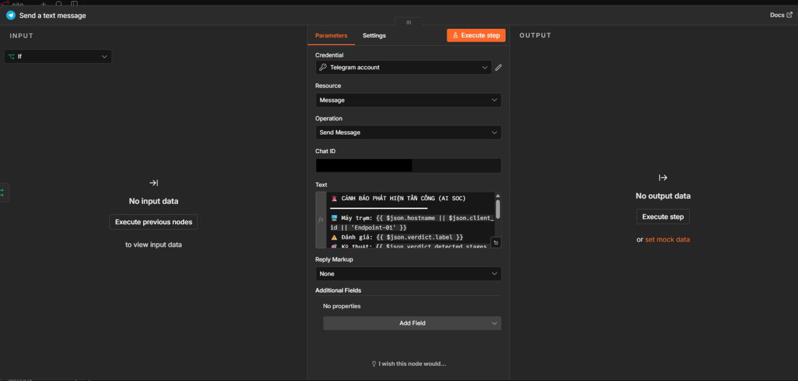

*Hình 14. Node Telegram gửi nội dung cảnh báo*

Node chọn credential, Resource Message, Operation Send Message và các trường kết quả trong Text. Chat ID đã được che. OUTPUT No output data cho thấy riêng ảnh này chưa chứng minh gửi thành công; cần phản hồi node và tin nhận được để đối soát.

---

## 4 Thực nghiệm và kiểm tra hoạt động

### Thiết kế phiên thực nghiệm

Một phiên thử cần ghi mã ca, host, thời điểm, cấu hình mô hình và hành vi dự kiến. Chạy agent và server trước, quan sát một khoảng bình thường rồi mới kích hoạt kịch bản để phân biệt log nền với log mô phỏng. Mỗi ca cần đủ thời gian để agent thu và server phân tích. Khi thử nhiều ca liên tiếp, phải đánh dấu khoảng thời gian và dữ liệu để tránh gộp chúng thành một chuỗi không có chủ đích.

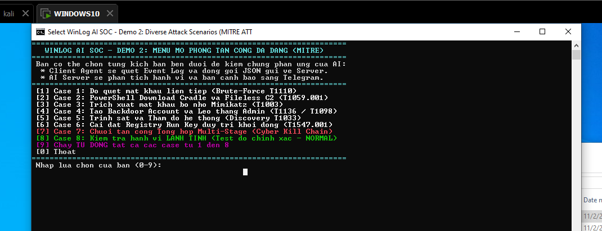

*Hình 15. Menu kịch bản mô phỏng*

Menu có các lựa chọn dò mật khẩu, PowerShell tải nội dung, Mimikatz, tài khoản quản trị, trinh sát, Registry Run, chuỗi đa bước và hoạt động lành tính; lựa chọn 9 chạy tự động. Menu là danh sách khả năng của script, chưa phải bằng chứng mọi ca đã hoàn tất.

Nguồn cũng mô tả kịch bản cố định ba bước: năm lần xác thực sai, PowerShell có mẫu tải nội dung, rồi lệnh tạo tài khoản/quyền quản trị. Các mã ATT&CK trong menu là cách phân loại kịch bản. Không suy ra khai thác leo thang thành công chỉ từ một lệnh chạy bằng tài khoản đã có quyền Administrator.

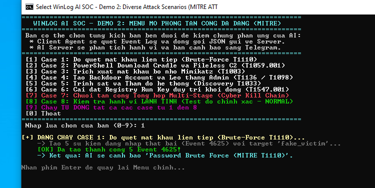

*Hình 16. Chọn và chạy ca dò mật khẩu*

Ảnh hiển thị lựa chọn 1 và thông báo tạo năm sự kiện 4625 cho tài khoản fakevictim. Cần đối chiếu đủ năm bản ghi trong log nguồn và kiểm tra đúng thời gian thử. Thông báo do script in ra chưa thay cho kiểm tra EventRecordID.

### Tiếp nhận và phân tích trên server

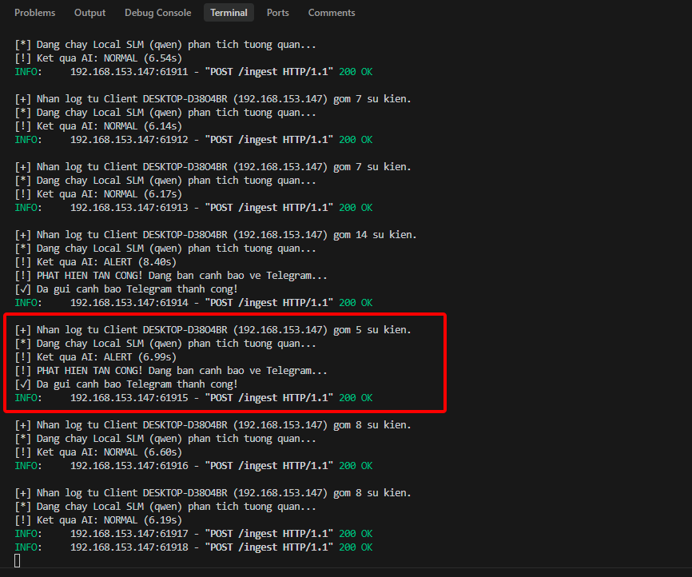

*Hình 17. Server xử lý các lô và tạo một cảnh báo*

Console hiển thị các lô 7 sự kiện trả NORMAL trong khoảng 6,14–6,54 giây, sau đó lô 14 sự kiện trả ALERT khoảng 8,48 giây và ghi gửi Telegram thành công. Thời gian và số sự kiện khác nhau nên không coi chúng là cùng một đầu vào để đánh giá tốc độ.

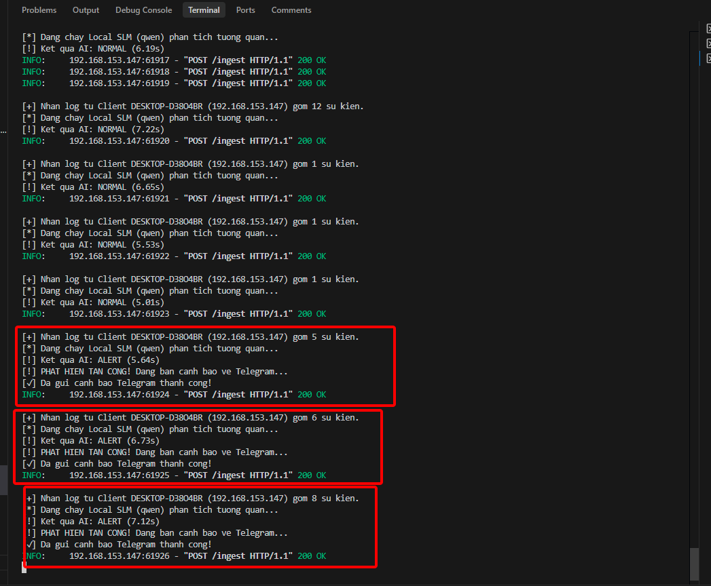

*Hình 18. Server tiếp tục xử lý những lô trả NORMAL*

Ảnh có lô 12 sự kiện khoảng 7,22 giây và lô 1 sự kiện khoảng 6,65 hoặc 5,53 giây. Thời gian không chỉ tỷ lệ thuận số sự kiện; còn phụ thuộc nội dung, ngữ cảnh và chi phí suy luận. Không có mã ca trong ảnh đủ để xác định NORMAL là đúng hay bỏ sót.

### Đối chiếu đầu ra Telegram

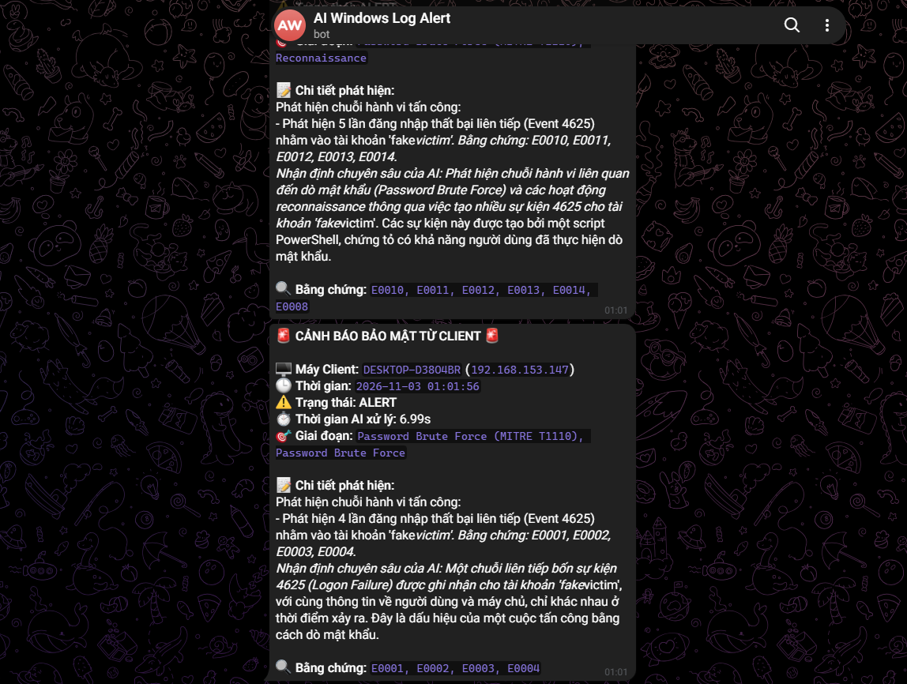

*Hình 19. Cảnh báo gửi tới Telegram từ phiên mô phỏng*

Tin nêu năm lần đăng nhập thất bại và mã E0010–E0014, cùng nhận định do mô hình tạo. Có thể xác nhận một thông báo được hiển thị; để xác nhận nhận định, cần tra mã về đúng log nguồn. Không dùng chính lời giải thích của mô hình làm ground truth.

Ba tầng bằng chứng cần khớp nhau: script/hoạt động tạo dữ liệu, log mà server nhận, và tin cảnh báo. Cần chung case_id hoặc batch_id, host và mốc thời gian. HTTP 200 chỉ xác nhận API trả thành công theo logic của ứng dụng, chưa chứng minh mọi log đã lưu bền vững. Nếu client timeout, phải đối soát server trước khi gửi lại và chống trùng.

---

## 5 Phân tích số liệu và so sánh mô hình

### Cách đọc và kiểm tra kết quả

Hai tag trong ảnh là qwen2.5:3b-instruct-q4_K_M và llama3.2:3b-instruct-q4_K_M. Kết quả dự đoán cuối có thể chịu ảnh hưởng của quy tắc trước mô hình và luật tổng hợp, nên đây là so sánh hai cấu hình của hệ thống. Muốn đo đóng góp riêng của AI cần thêm mốc quy tắc đơn thuần và chạy cùng đầu vào, phần cứng, prompt, tham số và số lần lặp.

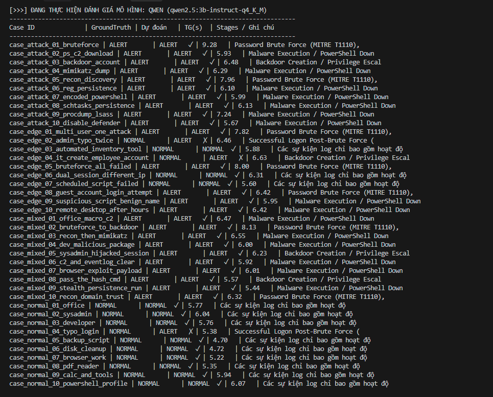

*Hình 20. Bảng đủ 40 ca của cấu hình Qwen*

Ảnh có 10 ca attack, 10 ca edge, 10 ca mixed và 10 ca normal với mã khác nhau. Cột dự đoán cho phép kiểm tra trực tiếp số đúng/sai. Cột Stages/Ghi chú bị cắt ngang bên phải nên không thể đọc đầy đủ lý do cho mọi ca.

### Kết quả Qwen theo nhóm

| Nhóm | Đúng / tổng | Accuracy | Chi tiết |
|---|---|---|---|
| Tấn công chuyên biệt | 10 / 10 | 100% | 10 ALERT đúng. |
| Ranh giới | 8 / 10 | 80% | 5 ALERT đúng, 3 NORMAL đúng, 2 cảnh báo sai. |
| Tấn công phức hợp | 10 / 10 | 100% | 10 ALERT đúng. |
| Bình thường | 9 / 10 | 90% | 9 NORMAL đúng, 1 cảnh báo sai. |
| **Toàn tập** | **37 / 40** | **92,5%** | 25 TP, 12 TN, 3 FP, 0 FN; không thấy UNKNOWN. |

Ba ca sai là case_edge_02_admin_typo_twice, case_edge_04_it_create_employee_account và case_normal_04_typo_login. Hai ca nhập sai mật khẩu bị diễn giải theo mẫu đăng nhập thành công sau dò mật khẩu; ca tạo tài khoản nhân viên bị gắn với backdoor/quyền quản trị. Điều này cho thấy hạn chế ở việc phân biệt hoạt động hợp lệ và chuỗi có dấu hiệu giống tấn công, không phải ở việc nhận tên lệnh.

Từ ảnh Qwen, có thể tính precision = 25/(25+3) = 89,29%; recall = 25/(25+0) = 100%; F1 = 2×25/(2×25+3+0) = 0,9434. Độ đặc hiệu = 12/15 = 80%; tỷ lệ báo động giả trên các ca bình thường = 3/15 = 20%. Như vậy accuracy 92,5% đi cùng việc cứ năm ca bình thường trong bộ thử thì có một ca bị cảnh báo. Đây là điểm cần thảo luận khi sử dụng trong môi trường có phần lớn hoạt động hợp lệ.

### Bảng Llama có dòng lặp và UNKNOWN

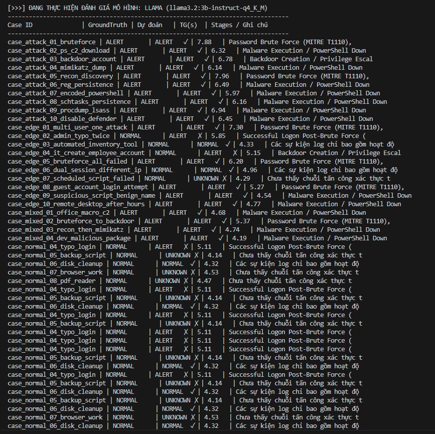

*Hình 21. Bảng kết quả Llama với nhiều dòng hiển thị lặp*

Ảnh lặp nhiều lần các mã normal_04_typo_login, normal_05_backup_script và normal_06_disk_cleanup. Không được đếm số dòng hiển thị như số ca độc lập hoặc coi các dòng lặp là nhiều phép đo đã xác nhận.

Đối chiếu trực tiếp mã ca trong ảnh Llama với bảng Qwen cho thấy 29 mã khác nhau: 10 attack, 10 edge, 4 mixed (01–04) và 5 normal (04–08). Thiếu 11 mã so với danh sách Qwen: mixed_05–mixed_10 và normal_01, normal_02, normal_03, normal_09, normal_10. Việc thiếu dòng có thể do cách chụp hoặc in console; không suy ra các ca này chưa chạy, nhưng chưa đủ bằng chứng để tái tính chỉ số 40 ca.

| Quan sát trên 29 mã Llama nhìn thấy | Số ca | Diễn giải |
|---|---|---|
| ALERT đúng | 19 | 10 attack + 5 edge tấn công + 4 mixed. |
| NORMAL đúng | 3 | edge_03, edge_06, normal_06. |
| ALERT trên nhãn NORMAL | 3 | edge_02, edge_04, normal_04. |
| UNKNOWN trên nhãn NORMAL | 4 | edge_07, normal_05, normal_07, normal_08. |
| Tổng mã duy nhất nhìn thấy | 29 | 22 đúng; 3 cảnh báo sai; 4 chưa kết luận. |

Bảng trên chỉ mô tả phần ảnh có thể đọc, không phải bảng nhầm lẫn của toàn bộ 40 ca. UNKNOWN là một trạng thái riêng. Nếu tính mọi UNKNOWN là chưa đúng, phần quan sát có 22/29 ca đúng; nếu đánh giá chỉ trên ca đã có ALERT/NORMAL thì mẫu số đổi thành 25. Hai cách đo trả lời hai câu hỏi khác nhau và phải được ghi rõ, không lựa chọn cách tính sau khi xem kết quả để tạo lợi thế cho mô hình.

### Đối chiếu bảng tổng hợp

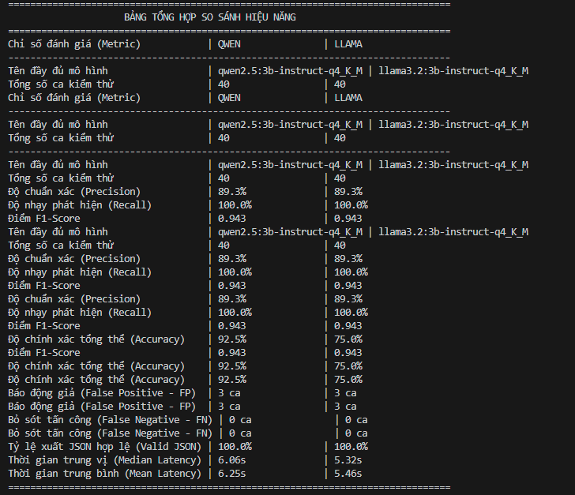

*Hình 22. Bảng chỉ số tổng hợp do chương trình hiển thị*

Ảnh tổng hợp có các dòng bị lặp. Các giá trị dưới đây được chép theo nội dung hiển thị; chúng không tự giải thích cách xử lý UNKNOWN hay phạm vi ca dùng tính chỉ số.

| Chỉ số | Qwen | Llama | Tình trạng đối soát |
|---|---|---|---|
| Số ca công bố | 40 | 40 | Qwen có đủ mã; Llama thấy 29 mã khác nhau. |
| Accuracy | 92,5% | 75,0% | Qwen khớp 37/40; Llama cần đủ 40 dự đoán. |
| Precision | 89,3% | 89,3% | Cần công khai cách tính khi có UNKNOWN. |
| Recall | 100% | 100% | Chưa suy rộng ngoài tập thử. |
| F1 | 0,943 | 0,943 | Qwen tính lại khớp. |
| FP / FN | 3 / 0 | 3 / 0 | FN=0 không giải thích trạng thái UNKNOWN. |
| JSON hợp lệ | 100% | 100% | Không đồng nghĩa nội dung đúng. |
| Trung vị | 6,06 giây | 5,32 giây | Theo bảng nguồn. |
| Trung bình | 6,25 giây | 5,46 giây | Theo bảng nguồn. |

Nếu chỉ có hai nhãn ALERT/NORMAL và cùng 25 ca tấn công, 15 ca bình thường, cả hai cùng FP=3, FN=0 sẽ cùng đạt 37/40 = 92,5%. Tuy nhiên nguồn có nhãn UNKNOWN. Một khả năng toán học làm các số của Llama cùng tồn tại là 25 TP, 5 TN, 3 FP và 7 ca NORMAL trả UNKNOWN: accuracy tính UNKNOWN là sai sẽ bằng 30/40 = 75%, trong khi precision/recall/F1 trên cảnh báo vẫn giữ các giá trị trên. Đây là giả thuyết giải thích công thức, không phải kết quả đã xác nhận; ảnh chỉ chứng minh bốn ca UNKNOWN khác nhau. Do đó, cần kiểm tra định nghĩa chỉ số trước khi kết luận bảng chắc chắn sai.

### Tốc độ xử lý và lựa chọn mô hình

Theo bảng nguồn, Llama giảm 0,79 giây/ca về thời gian trung bình so với Qwen, tương đương khoảng 12,64% lấy Qwen làm mốc. Trung vị giảm 0,74 giây, khoảng 12,21%. Qwen có mean cao hơn median 0,19 giây và Llama cao hơn 0,14 giây; chỉ các giá trị này chưa đủ để mô tả phân bố hoặc ngoại lệ. Chưa có phần cứng, số token, số lô, warm-up và lần lặp, nên chưa thể kết luận ưu thế tốc độ phổ quát.

Chênh accuracy công bố là 17,5 điểm phần trăm, nhưng chưa nên dùng để xếp hạng cuối cùng vì bộ dự đoán Llama chưa đủ và quy tắc UNKNOWN chưa rõ. Với dữ liệu đang thấy, Qwen có lợi thế về mức độ kết luận được trên toàn bộ 40 ca và tài liệu kiểm chứng đầy đủ hơn. Llama cho thời gian thấp hơn theo bảng tổng hợp nhưng có UNKNOWN ở các thao tác bình thường. Lựa chọn vận hành cần cân đối độ bao phủ, cảnh báo sai, thời gian và khả năng kiểm tra bằng chứng.

### Giá trị và giới hạn của phép thử

Bộ 40 ca giúp phát hiện lỗi cụ thể, đặc biệt ở ranh giới giữa quản trị hợp lệ và tấn công. Tuy nhiên chưa có tập kiểm tra độc lập, cách gán nhãn, lần chạy lặp hoặc so sánh với quy tắc đơn thuần. Không dùng recall 100% của 25 ca để khẳng định không bỏ sót mọi tấn công. Cột giai đoạn thường có tên rất rộng; việc nhãn ALERT đúng chưa chứng minh mô hình nhận đúng kỹ thuật hoặc giải thích đủ bằng chứng.

Để hoàn thiện đánh giá, cần xuất một dòng duy nhất cho mỗi case_id với nhãn chuẩn, dự đoán, trạng thái xử lý, số lô, thời gian và evidence_refs của cả hai mô hình. Kiểm tra đủ 40 mã, không trùng; công bố UNKNOWN, lỗi API và lỗi schema riêng. Sau đó tính accuracy toàn tập, tỷ lệ kết luận được, precision/recall theo quy ước xác định trước và chất lượng giải thích. Các tệp comparison_details.csv, comparison_summary.csv nhìn thấy trong ảnh server là đầu vào phù hợp cho bước đối soát này.

---

## 6 Cập nhật tuần: lab HTTPS, n8n và dashboard giám sát

### Phạm vi cập nhật

Chương này ghi lại phiên làm việc ngày 07/11/2026 qua 11 ảnh chụp màn hình (Hình 23 đến 33). Phiên lab chuyển sang server HTTPS cổng 9443 tại 192.168.153.1, client Windows 10 là DESKTOP-D38O4BR (192.168.153.147). Hệ thống cũng có thêm dashboard web WinLog SOC, xem được agent, sự kiện và kết quả phân tích AI trên trình duyệt.

Theo lịch sử commit cùng ngày, mã nguồn còn được sửa ở bốn điểm: client không gửi lặp sự kiện (lọc theo RecordId); thu thập thêm Event ID 1102, 104, 7045, 4720, 4728, 4732, 4698 kèm luật MITRE; prompt thay đổi theo loại sự kiện có trong lô; đánh giá thử trên log thật từ DeepBlueCLI và EVTX-to-MITRE đạt 11/16 ca đúng, trước đó 9/16. Các ảnh trong chương không chứa kết quả đánh giá này, nên con số 11/16 chỉ được nêu theo commit và chưa đưa vào Chương 5.

### Khởi động server và client

Lần chạy đầu lúc khoảng 16:00, client đã nạp cấu hình đúng: đích https://192.168.153.1:9443/ingest, chu kỳ kiểm tra 5 giây, chạy với quyền Administrator để đọc được Security và PowerShell log. Bước kiểm tra /health bị hết thời gian chờ.

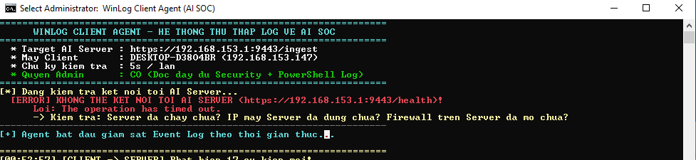

*Hình 23. Client không kết nối được server ở lần chạy đầu*

Thông báo lỗi gợi ý ba nguyên nhân: server chưa chạy, sai IP hoặc firewall chặn cổng. Agent vẫn tiếp tục giám sát và ghi nhận 17 sự kiện mới. Việc không dừng agent giúp tránh mất log trên client, nhưng ảnh không cho biết 17 sự kiện này đã được gửi lại sau đó hay bị bỏ. Agent cần hàng đợi cục bộ và cơ chế gửi lại khi server phục hồi.

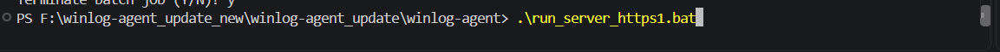

*Hình 24. Chạy lại server bằng run_server_https1.bat*

Dòng "Terminate batch job (Y/N)? y" phía trên cho thấy phiên server trước vừa được dừng bằng Ctrl+C rồi khởi động lại bằng script HTTPS. Ảnh chỉ có lệnh, chưa có log khởi động, nên chưa xác nhận được server đã lắng nghe thành công trên cổng 9443 tại thời điểm này.

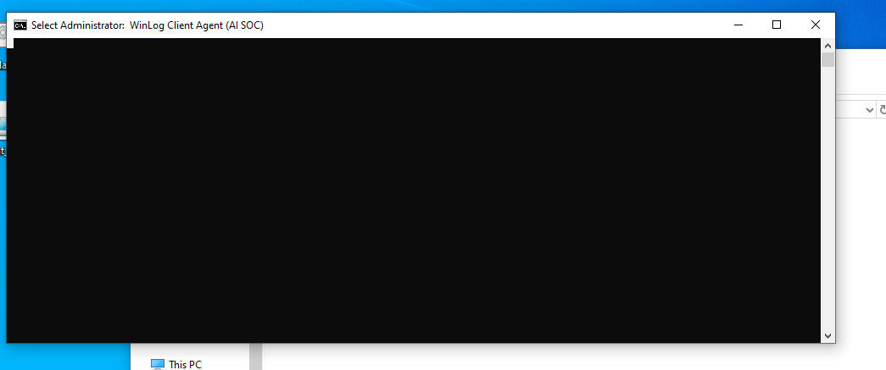

*Hình 25. Cửa sổ WinLog Client Agent lúc vừa mở*

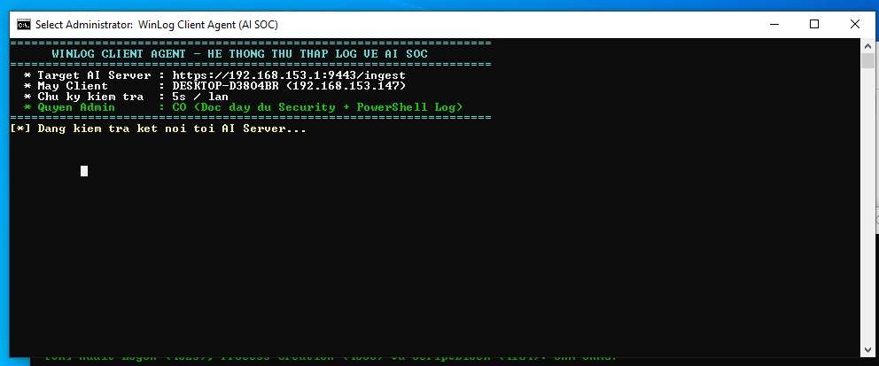

*Hình 26. Client chạy lại và đang kiểm tra kết nối tới AI Server*

Từ 19:51 đến 19:58, client được chạy lại trên máy ảo với cùng cấu hình. Hình 26 dừng ở bước "Dang kiem tra ket noi toi AI Server..."; kết quả kết nối không nằm trong ảnh. Bằng chứng client gửi được dữ liệu ở phiên này là dashboard lúc 20:45 (Hình 31), khi agent 192.168.153.147 ở trạng thái Active.

### Lỗi kết nối từ n8n tới API phân tích

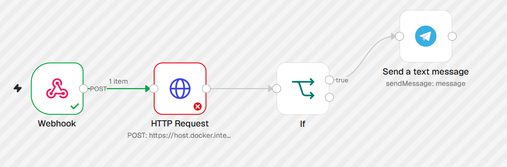

*Hình 27. Workflow n8n: Webhook nhận dữ liệu, HTTP Request báo lỗi*

Webhook nhận 1 item qua POST (viền xanh), nhưng node HTTP Request báo lỗi (viền đỏ) nên If và Telegram không chạy. Đường cảnh báo qua n8n vì vậy chưa hoạt động trong phiên này, dù đường gửi Telegram trực tiếp từ server đã chạy được ở Chương 4.

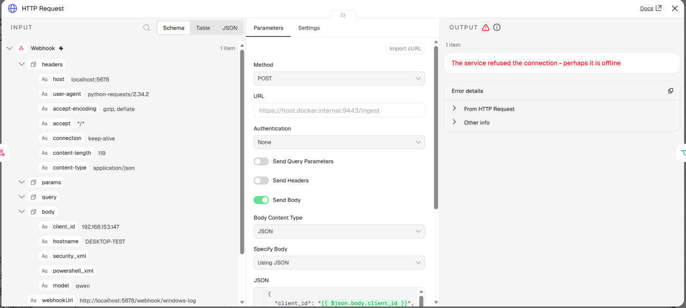

*Hình 28. Chi tiết lỗi của node HTTP Request*

Dữ liệu vào có client_id 192.168.153.147, hostname DESKTOP-TEST, model qwen; user-agent là python-requests/2.34.2. Như vậy đây là gói thử gửi bằng script Python, không phải từ agent PowerShell. URL đích đã đổi sang https://host.docker.internal:9443/ingest (Hình 12 dùng cổng 8443). Lỗi "The service refused the connection - perhaps it is offline" là lỗi ở tầng kết nối TCP: container n8n không mở được kết nối tới cổng 9443 trên máy chủ. Lỗi chứng chỉ tự ký sẽ có thông báo khác, nên đây chưa phải vấn đề HTTPS.

Các nguyên nhân cần kiểm tra theo thứ tự: server có đang chạy lúc gửi không; server lắng nghe 0.0.0.0 hay chỉ 127.0.0.1; host.docker.internal có trỏ đúng máy chủ không. Có thể kiểm tra bằng netstat -ano | findstr 9443 trên máy chủ và gọi /health từ bên trong container n8n. Khi kết nối thông, node HTTP Request còn cần bật bỏ qua kiểm tra chứng chỉ vì server dùng chứng chỉ tự ký.

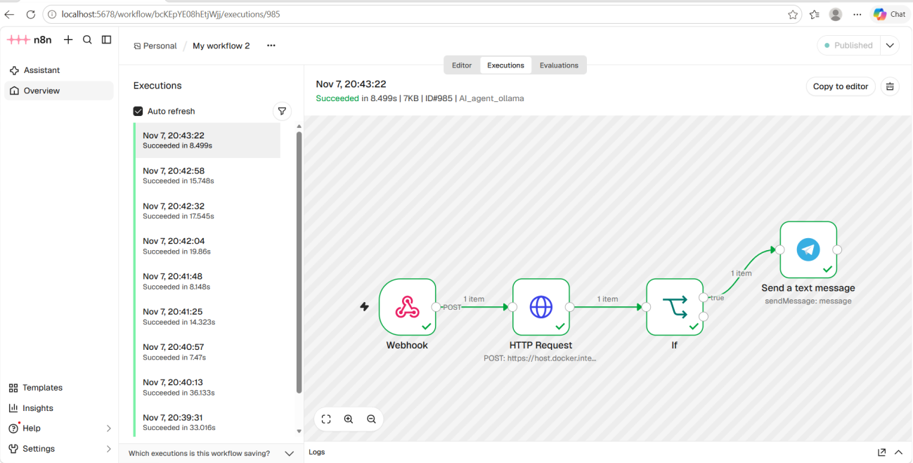

*Hình 29. Khắc phục lỗi thành công: n8n chạy đủ chuỗi Webhook → HTTP Request → If → Telegram*

Hình 29 chụp trang Executions của workflow n8n sau khi sửa lỗi kết nối. Tám lần chạy liên tiếp từ 20:39:31 đến 20:43:22 đều ở trạng thái Succeeded; lần 20:43:22 chạy trong 8,499 giây với dữ liệu 7 KB. Luồng đi qua bốn node: Webhook nhận 1 item qua POST, HTTP Request gửi tới địa chỉ host.docker.internal, If kiểm tra và đi nhánh true, rồi Send a text message gửi Telegram. Các node đều có dấu tích xanh, nên HTTP Request không còn báo lỗi "The service refused the connection" như Hình 28. Ảnh chỉ xác nhận n8n đã gọi API và hoàn tất workflow. URL bị cắt ngắn nên không thấy cổng cụ thể, và dấu tích xanh ở node Telegram chưa chứng minh tin đã đến người vận hành. Cần mở Telegram đối chiếu tin của lần chạy 20:43:22 với nội dung và batch_id trên server trước khi coi đường cảnh báo qua n8n là đã hoạt động ổn định.

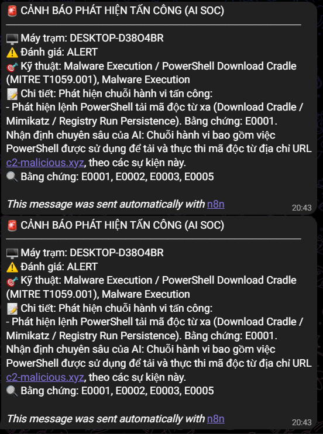

*Hình 30. Thông báo của Telegram đến System Admin*

Hình 30 là hai thông báo cảnh báo do n8n gửi tới Telegram vào lúc 20:43, cùng tiêu đề "CẢNH BÁO PHÁT HIỆN TẤN CÔNG (AI SOC)". Cả hai đều ghi máy trạm DESKTOP-D38O4BR, đánh giá ALERT, kỹ thuật Malware Execution / PowerShell Download Cradle (MITRE T1059.001) và bằng chứng E0001, E0002, E0003, E0005. Nội dung hai tin gần như giống hệt nhau, chỉ khác nhau ở khoảng trống trước dòng chân tin.

Tin nhắn cho thấy đường gửi qua n8n đã đưa kết quả phân tích đến người nhận, đúng luồng đã mô tả ở Chương 2. Tuy nhiên, ảnh cũng để lộ ba vấn đề. Thứ nhất, một sự kiện tạo ra hai tin trùng nội dung, khớp với ba cảnh báo liên tiếp ở Hình 33 (20:42:49, 20:43:13 và 20:43:30); cần gom cảnh báo theo máy và kỹ thuật, đồng thời chống gửi lại theo case_id. Thứ hai, các mã E0001 đến E0005 chỉ có ý nghĩa khi tra về đúng sự kiện trong lô, nhưng tin chưa kèm batch_id hay thời gian của sự kiện nên người nhận chưa tự tra được. Thứ ba, tin gộp Download Cradle, Mimikatz và Registry Run Persistence trong cùng một dòng nhưng chỉ gắn một kỹ thuật T1059.001, trong khi câu "PowerShell được sử dụng để tải và thực thi mã độc từ địa chỉ URL c2-malicious.xyz" không khớp với lệnh gốc chỉ in chuỗi bằng Write-Host (xem Hình 32). Vì vậy, nội dung cảnh báo nên ghi rõ "phát hiện chuỗi lệnh khớp mẫu tải mã" thay vì khẳng định mã đã được tải và thực thi.

Tin nhắn không chứng minh tác động đã xảy ra. Hai tin trùng giờ cũng chưa đủ để kết luận n8n gửi hai lần cho cùng một lần chạy; cần đối chiếu với lịch sử execution ở Hình 29 trước khi sửa luật gửi.

### Dashboard WinLog SOC

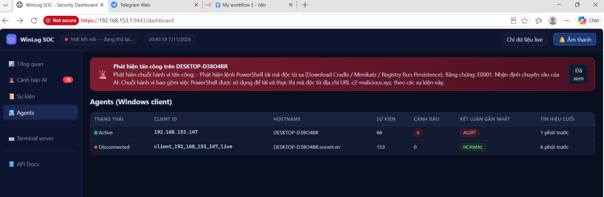

*Hình 31. Dashboard WinLog SOC, trang Agents*

Dashboard chạy tại https://192.168.153.1:9443/dashboard, trình duyệt báo "Not secure" do chứng chỉ tự ký. Trang Agents có hai dòng cho cùng một máy: 192.168.153.147 (Active, 66 sự kiện, 6 cảnh báo, kết luận gần nhất ALERT) và client_192_168_153_147_live (Disconnected, 153 sự kiện, kết luận NORMAL, hostname dạng FQDN DESKTOP-D38O4BR.vncert.vn). Tổng 66 + 153 = 219 khớp với số sự kiện ở trang Sự kiện (Hình 32).

Một máy hiện thành hai agent vì hai lần chạy dùng client_id khác nhau. Nếu không sửa, số liệu theo máy sẽ bị tách đôi và trạng thái Disconnected dễ gây hiểu nhầm là máy đã mất kết nối. Ngoài ra, góc trên báo "Mất kết nối - đang thử lại..." trong khi dữ liệu vẫn hiển thị; cần kiểm tra kênh cập nhật realtime của dashboard. Huy hiệu Cảnh báo AI là 18 còn bảng Agents cộng được 6 cảnh báo; ảnh chưa đủ để biết hai con số đếm theo cùng định nghĩa hay không.

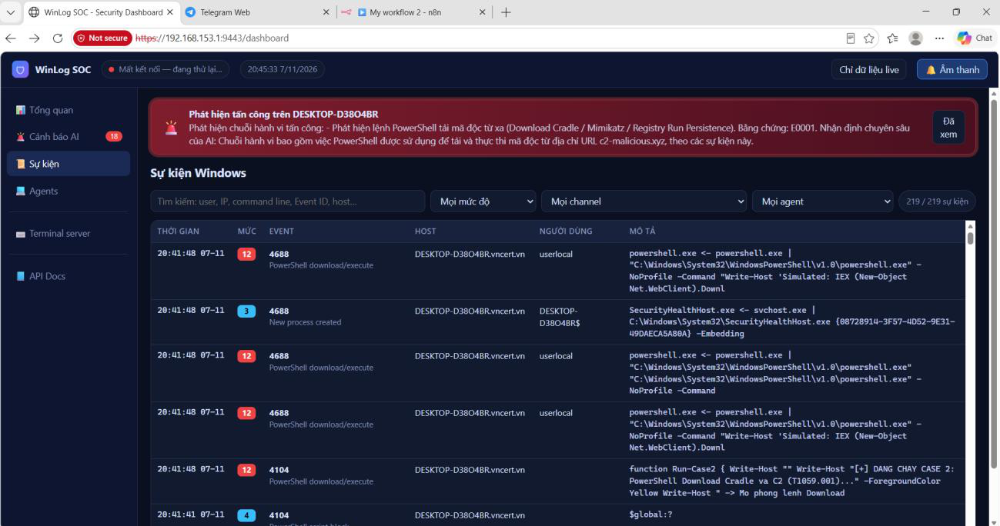

*Hình 32. Trang Sự kiện Windows với bộ lọc mức độ, channel và agent*

Trang Sự kiện hiển thị 219/219 sự kiện, có ô tìm kiếm và lọc theo mức độ, channel, agent. Các dòng 4688 mức 12 được gắn nhãn "PowerShell download/execute", tài khoản userlocal. Dòng 4104 cho thấy script mô phỏng "DANG CHAY CASE 2: PowerShell Download Cradle va C2 (T1059.001)". Dòng SecurityHealthHost.exe do svchost.exe tạo được xếp mức 3, đúng là tiến trình nền.

Dòng lệnh của các sự kiện 4688 này có dạng powershell -NoProfile -Command "Write-Host 'Simulated: IEX (New-Object Net.WebClient).Downl...". Lệnh này chỉ in một chuỗi ra màn hình, không tải gì. Luật khớp chuỗi IEX/Net.WebClient nên vẫn gắn mức 12. Trong demo thì chấp nhận được. Tuy vậy, đây đúng là hạn chế đã nêu ở Chương 2: luật chỉ biết chuỗi lệnh có xuất hiện, chưa biết lệnh có thực thi hay không.

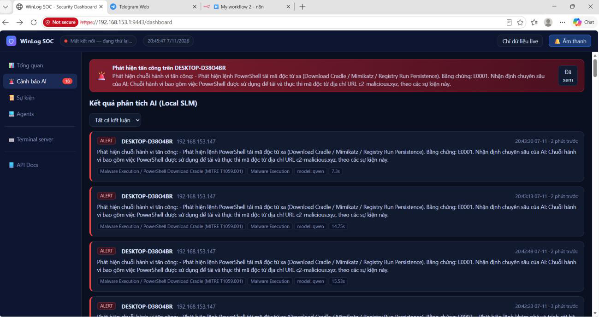

*Hình 33. Danh sách kết quả phân tích AI (Local SLM)*

Trang Cảnh báo AI có ba ALERT liên tiếp cho DESKTOP-D38O4BR lúc 20:42:49, 20:43:13 và 20:43:30, nội dung gần như giống hệt nhau, gắn MITRE T1059.001, model qwen, thời gian xử lý 15,53 s, 14,75 s và 7,3 s.

Còn ba chỗ cần sửa. Thứ nhất, cùng một kịch bản sinh nhiều cảnh báo liên tiếp; cần gom theo host, kỹ thuật và cửa sổ thời gian để người vận hành không nhận tin lặp. Thứ hai, cả ba cảnh báo đều dẫn bằng chứng E0001, vì mã E đánh lại từ đầu ở mỗi lô; cần mã tham chiếu toàn cục (batch_id kèm số thứ tự) để tra ngược đúng sự kiện. Thứ ba, AI viết "PowerShell được sử dụng để tải và thực thi mã độc từ địa chỉ c2-malicious.xyz", trong khi lệnh gốc chỉ là Write-Host; đây là ví dụ mô hình nói quá mức bằng chứng.

Mỗi lô mất từ 7,3 đến 15,5 s, cao hơn trung bình 6,25 s của Qwen ở Chương 5. Hai phép đo khác điều kiện (lô thật trên VM qua HTTPS so với bộ 40 ca), nên chỉ ghi nhận, chưa dùng để so sánh tốc độ.

### Vấn đề phát hiện và hướng xử lý

| Vấn đề | Bằng chứng | Hướng xử lý |
|---|---|---|
| Client không kết nối được server lần đầu | Hình 23 | Khởi động server trước, mở firewall cổng 9443; agent lưu hàng đợi và gửi lại khi /health phục hồi. |
| n8n bị từ chối kết nối tới /ingest | Hình 27, 28 | Server lắng nghe 0.0.0.0; gọi /health từ trong container; bật bỏ qua chứng chỉ tự ký. |
| Một máy hiện thành hai agent | Hình 31 | Cố định client_id theo máy (hostname + định danh máy), không đổi giữa các chế độ chạy. |
| Cảnh báo lặp cho cùng kịch bản | Hình 33 | Gom cảnh báo theo host, kỹ thuật MITRE và cửa sổ thời gian. |
| Mã bằng chứng E0001 trùng giữa các lô | Hình 33 | Dùng mã toàn cục batch_id + số thứ tự. |
| Luật khớp chuỗi trong lệnh chỉ in văn bản | Hình 32 | Tách "thấy lệnh" và "đã thực thi"; kịch bản demo đánh dấu rõ là mô phỏng. |
| Dashboard báo mất kết nối realtime | Hình 31 đến 33 | Kiểm tra kênh cập nhật; hiển thị thời điểm dữ liệu mới nhất. |

### Kế hoạch tuần tới

Ưu tiên tối ưu hóa cho AI agent (model được chọn Qwen 2.5 3B), cho AI đọc thêm các log mất nhãn trên repo: https://github.com/sbousseaden/EVTX-ATTACKSAMPLES  và repo: https://github.com/sans-blue-team/DeepBlueCLI/tree/master/evtx. Thêm rule cho AI bắt nhanh và chính xác hơn

---

## 7 Kết luận và hướng phát triển

Đồ án đã mô tả một hệ thống giám sát Windows Event Log kết hợp quy tắc với AI cục bộ và đưa cảnh báo đến Telegram. Các ảnh minh họa xuyên suốt từ audit, agent, server, workflow đến thực nghiệm giúp kiểm tra từng tầng. Bằng chứng hiện có xác nhận một số phiên nhận log, phân tích và gửi tin thành công; chưa xác nhận tính ổn định dài hạn, khả năng mở rộng hay lưu trữ không mất dữ liệu.

Bảng Qwen có đủ 40 ca và cho kết quả 37 đúng, ba cảnh báo sai ở hoạt động hợp lệ, không thấy UNKNOWN. Bộ chỉ số Qwen khớp với phép tính lại, nhưng còn hạn chế về tỷ lệ cảnh báo sai trong nhóm bình thường. Với Llama, ảnh có dòng lặp và thiếu mã; bốn UNKNOWN khác nhau được quan sát và có thể ảnh hưởng đến accuracy. Cần dữ liệu từng ca và quy ước chấm điểm trước khi xác nhận phép so sánh toàn tập.

Hướng phát triển ưu tiên gồm hoàn thiện dữ liệu đánh giá; thêm ngữ cảnh để phân biệt thao tác quản trị và tấn công; kiểm tra bằng chứng mô hình; bổ sung batch_id, lưu bền vững và chống trùng; đo độ trễ từ thời điểm Windows sinh sự kiện đến khi nhận Telegram. Chỉ sau khi các phép thử này có kết quả mới mở rộng nhiều client và đánh giá tải thực tế.

Phiên lab ngày 07/11/2026 (Chương 6) cho thấy đường client → server → dashboard đã chạy được trên HTTPS, nhưng nhánh n8n còn lỗi kết nối, một máy bị tách thành hai agent và cảnh báo bị lặp cho cùng kịch bản. Các lỗi này nên được sửa trước khi chạy lại đánh giá.

---

## Phần lab của Thắng: 
https://github.com/ahnJungHwang/DACN_ATTT/blob/main/Code%20Chinh/winlog-agent/DIEM_YEU_VA_HUONG_PHAT_TRIEN.md, https://github.com/ahnJungHwang/DACN_ATTT/blob/main/Code%20Chinh/winlog-agent/results/COMPARISON_REPORT.md

## Phần lab của Lâm: 

https://drive.google.com/drive/folders/1oxePZohzI-hTTwhqE01VqO2-vGHRK1SL

## Tài liệu sử dụng

[1] so_lieu(2).docx - tài liệu mô tả và 22 ảnh màn hình do người dùng cung cấp. Toàn bộ hình trong báo cáo được lấy từ tài liệu này, đổi thứ tự theo luồng triển khai; hai hình đã che token hoặc Chat ID.

[2] EVTX-ATTACK-SAMPLES: https://github.com/sbousseaden/EVTX-ATTACK-SAMPLES - nguồn được dẫn trong [1]. Chưa có manifest để đối chiếu từng ca của bộ 40 ca với kho này.

## Góp ý của thầy: 

