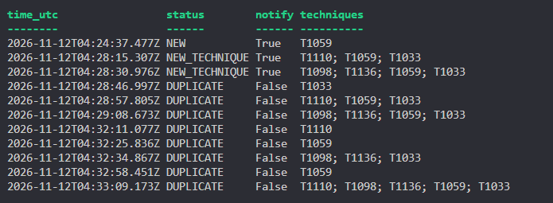
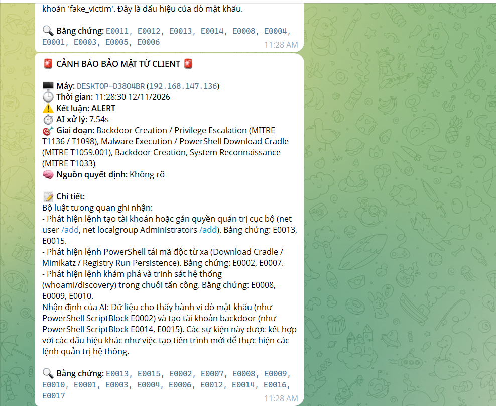
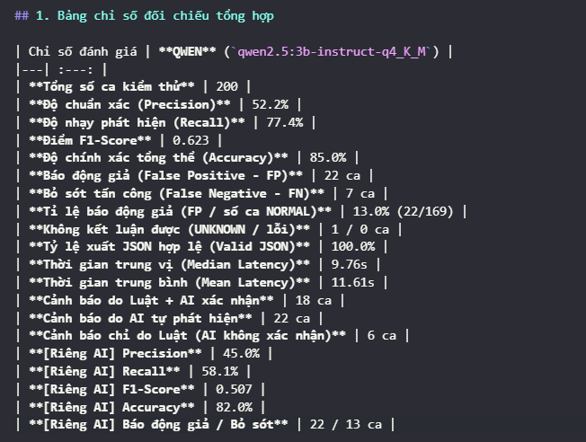
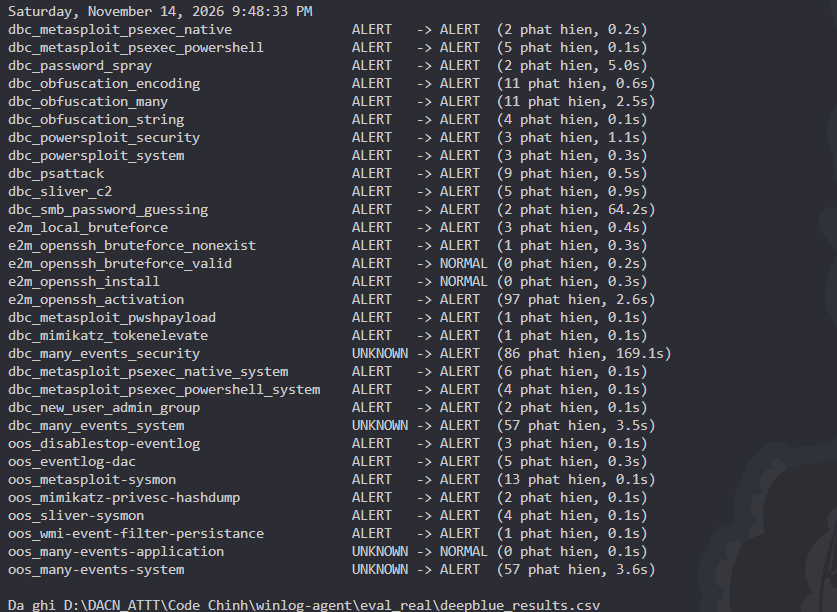
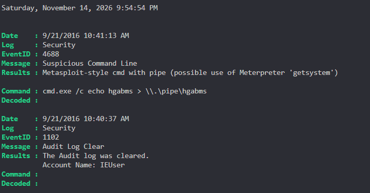
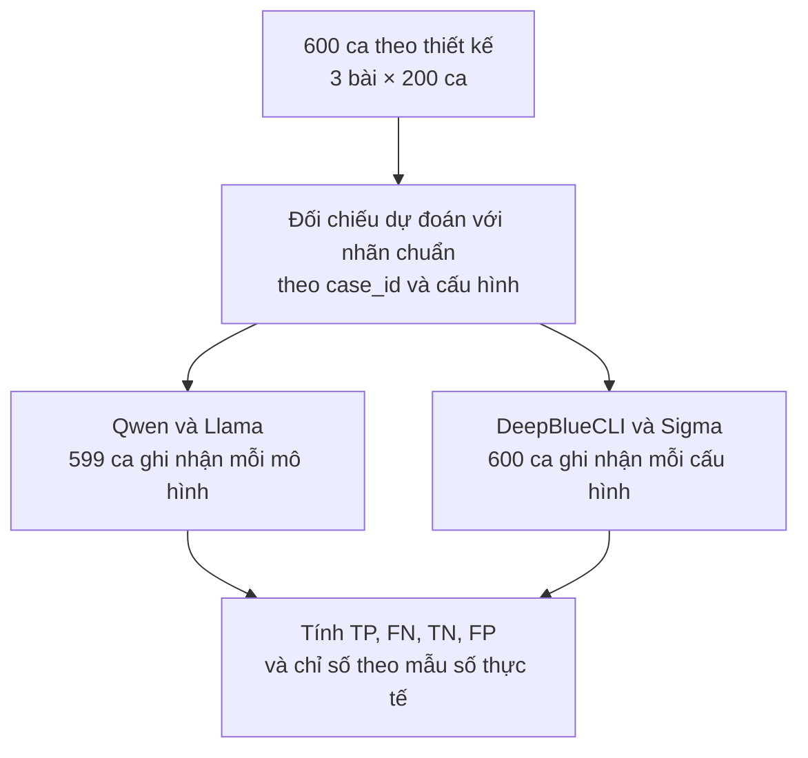
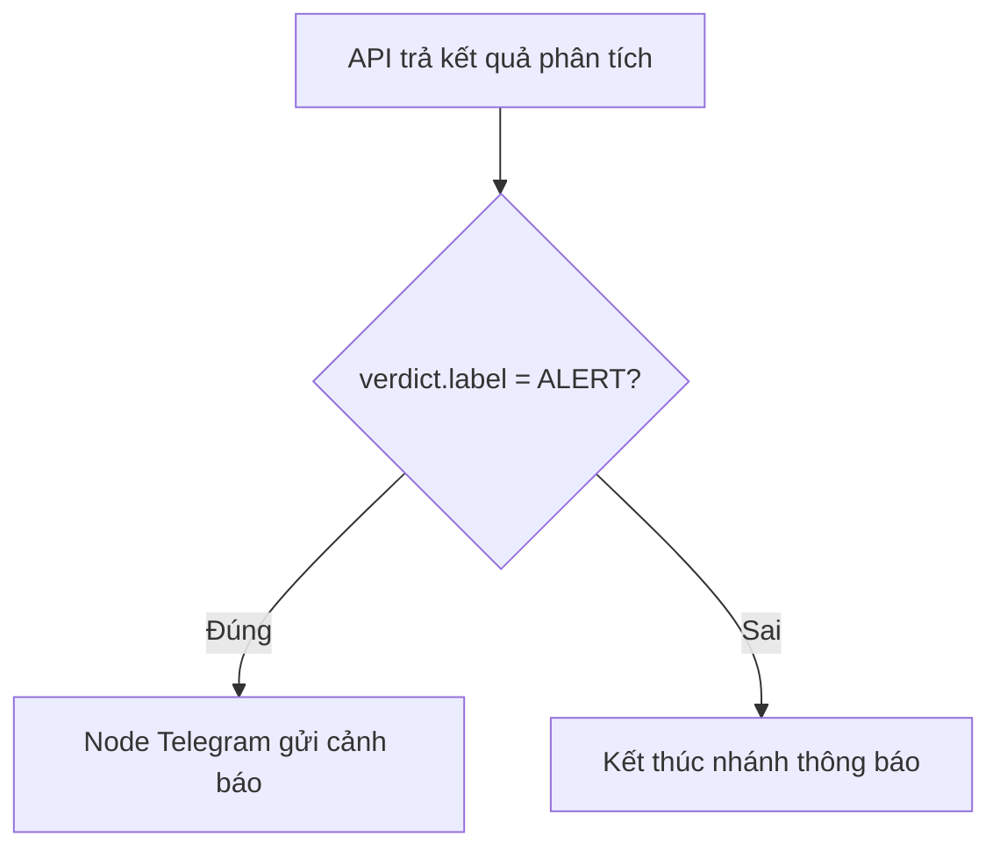

# BÁO CÁO BÀI THỰC HÀNH TUẦN 5
**Môn học:** Đồ Án Chuyên Ngành An Toàn Thông Tin

| Họ và tên: | Nhan Huỳnh Lâm Trần Minh Thắng | MSSV: | 2387700037 2387700063 |
| :--- | :--- | :--- | :--- |
| **Lớp:** | 23DATA1 | **Ngày thực hiện:** | 14/11/2026 |

---

# HỆ THỐNG GIÁM SÁT AN NINH WINDOWS EVENT LOG BẰNG AI LOCAL
### Triển khai và đánh giá Qwen 2.5 3B so với Llama 3.2 3B

---

# Phần làm của Thắng:

## Tóm tắt

Tuần này nhóm làm theo góp ý của thầy. Các việc đã làm gồm: gỡ thư mục môi trường ảo khỏi repo, sửa lỗi gửi trùng cảnh báo, tạo bộ đánh giá có phần lớn là log bình thường kèm file CSV nhãn từng ca, đưa DeepBlueCLI (công cụ không dùng AI) vào để so sánh, và lập bảng so sánh Qwen, Llama, DeepBlueCLI trên log tấn công thật.

**Kết quả đạt được:**
- **Chống trùng cảnh báo:** trên lab, 11 lần hệ thống kết luận ALERT chỉ sinh 3 tin Telegram, 8 lần còn lại được nhận ra là trùng. Lần chạy kịch bản thứ hai không gửi thêm tin nào.
- **Bộ 200 ca (169 bình thường, 31 tấn công):** Qwen bắt được 24/31 ca tấn công (Recall 77,4%) nhưng báo động giả 22/169 ca bình thường (13,0%). Precision chỉ còn 52,2%, thấp hơn nhiều so với bộ cũ có ít ca bình thường.
- **Log tấn công thật:** DeepBlueCLI bắt được 13/16 ca, Llama 10/14, Qwen 9/14. Hai mô hình AI bắt được 2 ca OpenSSH mà DeepBlueCLI bỏ sót.

**Phần chưa làm được:** chưa có log hoạt động bình thường thu từ máy thật, nên chưa đo được tỉ lệ báo động giả của ba công cụ trên log thật. Số đo độ trễ từ lúc sinh sự kiện tới lúc nhận Telegram mới có 13 mẫu (trung vị 23,7 giây, lớn nhất 33,9 giây) và chưa đo lại sau khi sửa chống trùng.

Số ở phần này khác phần của Lâm vì đo trên hai bộ dữ liệu khác nhau. Qwen báo động giả 22/169 ca ở bộ 200 ca nhưng 0/450 ca ở bộ 600 ca. DeepBlueCLI ở đây là công cụ gốc chạy trên file .evtx thật, còn trong bộ 600 ca là luật regex mô phỏng. Độ trễ 23,7 giây ở đây đo trên lab, còn 7,82 giây/ca của bộ 600 ca là số ước lượng.

---

## 1. Góp ý của giảng viên và tình trạng thực hiện

| STT | Yêu cầu | Đã làm trong tuần | Tình trạng |
| :---: | :--- | :--- | :--- |
| 1 | Lấy Security log làm nguồn chính, tập trung vào vận hành cảnh báo từ Windows tới Telegram | Giữ nguyên luồng Windows → server → n8n → Ollama → Telegram, chạy lại trên lab với máy ảo Win10 | Đang làm |
| 2 | Pipeline chạy ổn định, không gửi trùng cảnh báo | Sửa bộ chống trùng, viết 7 bài kiểm thử, chạy thử trên lab | Xong phần code |
| 3 | Dữ liệu đánh giá phần lớn là log bình thường | Tạo bộ 200 ca, 84,5% là ca bình thường, chạy Qwen. Phần của Lâm có thêm bộ 600 ca, 75% là ca bình thường | Xong hai bộ tự sinh, thiếu log bình thường thật |
| 4 | Bộ đánh giá có nhãn, lưu CSV từng ca trong repo | File labels.csv cho 4 bộ dữ liệu, kèm CSV kết quả từng ca | Xong |
| 5 | Bảng so sánh Qwen, Llama và một công cụ không dùng AI | Chạy DeepBlueCLI, Qwen, Llama trên cùng bộ log tấn công thật (mục 5.4). Phần của Lâm so sánh thêm trên 600 ca tự sinh | Xong Recall trên log thật và bảng trên 600 ca tự sinh, thiếu báo động giả trên log bình thường thật |
| 6 | Số đo độ trễ từ lúc sinh sự kiện tới lúc nhận cảnh báo | Đã có báo cáo độ trễ với 13 mẫu (Qwen), trung vị 23,7 giây | Cần đo lại, thêm mẫu |
| 7 | Dọn repo cho gọn, code để ở một thư mục chính | Gỡ khoảng 11 nghìn file .venv. Code chính nằm ở “Code Chinh/winlog-agent” | Còn file thừa |

---

## 2. Dọn repo

- Gỡ thư mục môi trường ảo .venv (khoảng 11 nghìn file) khỏi phần Git theo dõi bằng lệnh `git rm -r --cached`.

Còn lại: các file `app1.py`, `app2.py`, `app3.py`, `app_origin.py`, thư mục `scratch`, hai file workflow n8n trùng nhau và README chưa cập nhật theo cấu trúc mới.

---

## 3. Sửa lỗi gửi trùng cảnh báo

### 3.1. Nguyên nhân

Bộ chống trùng gom cảnh báo theo cặp (máy, kỹ thuật MITRE) trong cửa sổ 10 phút. Lỗi nằm ở cách xác định kỹ thuật:
- Luật trả về mã MITRE, còn AI thường tự đặt tên bằng chữ. Hai cách gọi của cùng một hành vi bị coi là hai kỹ thuật khác nhau nên gửi hai tin.
- Các mã con của cùng một kỹ thuật cũng bị tách thành hai sự cố.
- Mã sự cố được đánh số theo số phần tử đang lưu, nên có thể trùng số sau khi sự cố cũ hết hạn.

### 3.2. Cách sửa được áp dụng

- Gom theo mã MITRE cha (T1059.001 → T1059). Riêng Password Spraying (T1110.003) giữ khoá riêng vì khác bản chất với dò mật khẩu một tài khoản.
- Mở rộng bảng từ khoá quy tên do AI tự đặt về mã MITRE, từ 16 lên 20 mục. Tên không quy được thì dồn vào một khoá chung, trước đây mỗi tên thành một khoá riêng.
- Mã sự cố lấy số lớn nhất đã dùng cộng một.

File sửa: `core/alerting.py`. Bài kiểm thử: `test_alerting.py` (7 bài, đều đạt).

### 3.3. Kết quả

Chạy lại 37 dòng ALERT của phiên ngày 11/11 qua bộ chống trùng mới: số tin phải gửi giảm từ 14 xuống 11.

*Hình 1: kết quả chạy 37 dòng ALERT của phiên ngày 11/11*

Chạy trên lab ngày 12/11 (máy ảo Win10, chạy kịch bản tấn công hai lần liên tiếp): 11 lần kết luận ALERT, 3 tin Telegram, 8 lần bị chặn vì trùng. Lần chạy thứ hai không gửi tin nào.

**Hạn chế:** trong 3 tin có 1 tin gửi ngay lúc agent khởi động, nhiều khả năng là báo động giả của AI. AI vẫn được tự đặt tên kỹ thuật, nên nếu một tên lạ đến trước mã của luật thì vẫn có thể ra 2 tin.

*Hình 2: Tin cảnh báo trên Telegram và log chống trùng results/alerts_log.csv*

---

## 4. Bộ đánh giá có phần lớn là log bình thường

### 4.1. Cách tạo

- Dùng `core/generate_data100.py` với tỉ lệ ca tấn công 15%, sinh 200 ca: 169 ca bình thường, 31 ca tấn công. Thư mục: `data_normal_heavy`.
- Mỗi ca có file `manifest.json` ghi nhãn. Script `core/export_labels.py` gom nhãn thành một file `labels.csv` cho mỗi bộ dữ liệu (`data`, `data01`, `data100`, `data_normal_heavy`).
- Kết quả từng ca của mô hình nằm ở file `comparison_details.csv` trong `data_normal_heavy`.
- `evaluate.py` được bổ sung hai chỉ số: tỉ lệ báo động giả và số ca mô hình không kết luận được.

### 4.2. Kết quả của Qwen 2.5 3B

| Chỉ số | Cả hệ thống (luật + AI) | Riêng AI |
| :--- | :--- | :--- |
| Bắt đúng tấn công (Recall) | 24/31 = 77,4% | 18/31 = 58,1% |
| Báo động giả trên ca bình thường | 22/169 = 13,0% | 22/169 = 13,0% |
| Precision | 52,2% | 45,0% |
| F1 | 0,623 | 0,507 |
| Accuracy | 85,0% | 82,0% |
| Không kết luận được (UNKNOWN) | 1 ca | 1 ca |

### 4.3. Nhận xét

Trên bộ data01 cũ (40 ca, 25 ca tấn công) hệ thống đạt Precision khoảng 96%. Sang bộ đa số bình thường, Precision giảm còn 52,2%. Đúng như giảng viên nhận xét: bộ có ít ca bình thường không làm lộ ra vấn đề báo động giả.

Cả 22 ca báo động giả đều do AI tự kết luận, không ca nào do luật. Nhóm mở lại một số ca để kiểm tra nhãn và thấy đều là hoạt động bình thường: svchost.exe khởi chạy dịch vụ, script sao lưu dùng Compress-Archive, nạp module Active Directory. Mô hình có xu hướng báo động khi thấy tạo tiến trình mới hoặc PowerShell chạy script.

7 ca bỏ sót đều là đoạn log lấy từ mẫu tấn công thật: di chuyển ngang qua scheduled task và WMI, pass-the-hash, NTLM relay, đọc SAM từ xa qua registry, giả mạo sAMAccountName (CVE-2021-42287), webshell chạy tiến trình bằng tài khoản khác (RunAs), lừa lấy mật khẩu bằng PowerShell. Luật chưa có cho 6 ca. Ca còn lại (`case_rnd_123_alert`) luật chỉ thấy dấu hiệu yếu T1078 và AI bác bỏ.

Chênh lệch với bộ 600 ca của Lâm (Qwen 0/450) chưa rõ do dữ liệu hay do code, vì `core/analyze.py` cũng được sửa ngày 15/11.

**Giới hạn:** 169 ca bình thường được ghép từ 27 khối log nền nên nhiều ca gần giống nhau. Đây là dữ liệu tự sinh, chưa thay được log bình thường thu từ máy thật. Llama chưa chạy trên bộ 200 ca này. Kết quả Llama trên bộ 600 ca nằm ở phần của Lâm: bắt 149/149 ca tấn công, báo động giả 329/450 ca bình thường.

*Hình 3: Kết quả chạy core/evaluate.py trên bộ data_normal_heavy*

---

## 5. Công cụ không dùng AI: DeepBlueCLI

### 5.1. Lý do chọn

DeepBlueCLI là công cụ mã nguồn mở của SANS, viết bằng PowerShell, dò dấu hiệu tấn công trong Windows Event Log bằng luật và biểu thức chính quy, không dùng AI. Công cụ đọc trực tiếp file .evtx nên chạy được trên đúng bộ log tấn công thật mà nhóm đang dùng để đánh giá.

### 5.2. Cách triển khai

- `run_deepblue.ps1`: đọc danh sách ca và nhãn từ labels.json, gọi DeepBlue.ps1 trên từng file .evtx, ghi số phát hiện, nội dung phát hiện và thời gian chạy vào deepblue_results.csv. File có từ 1 phát hiện trở lên được tính là ALERT.
- Phạm vi: 31 file, gồm 23 ca đang dùng cho hệ thống và 8 file thuộc loại log mà agent của nhóm không thu (6 file có tấn công, 2 file chưa gán nhãn).
- `compare_tools.py`: chấm điểm và sinh bảng so sánh `SO_SANH_CONG_CU.md` từ hai file kết quả, không sửa tay.
- Đo báo động giả: script nhận thêm thư mục `eval_real/normal_evtx/`. Mỗi file .evtx trong đó được coi là một phiên bình thường. Thư mục này hiện chưa có dữ liệu.

DeepBlueCLI chỉ đọc file log, không thực thi nội dung trong log. Mã nguồn công cụ không đưa vào repo của nhóm; hướng dẫn tải nằm trong `HUONG_DAN_SU_DUNG_eval_real.md`.

### 5.3. Quy tắc chấm để so sánh công bằng

Các file mẫu thường bắt đầu bằng sự kiện xoá log do người tạo mẫu dọn log trước khi ghi lại tấn công. Hệ thống của nhóm đã loại sự kiện này từ tuần trước để Recall không tăng ảo. Vì vậy với DeepBlueCLI, ca nào mà mọi phát hiện chỉ là “Log Clear” thì được tính là không bắt được. Có 3 ca như vậy. Bảng kết quả vẫn in thêm cột số “thô” để đối chiếu.

*Hình 4: Chạy eval_real/run_deepblue.ps1 trên 31 file EVTX*

*Hình 5: Đầu ra gốc của DeepBlue.ps1 trên một file mẫu*

### 5.4. Kết quả trên log tấn công thật

| Công cụ | Bắt được ca tấn công | Ghi chú |
| :--- | :--- | :--- |
| DeepBlueCLI | 13/16 = 81% | Bỏ sót 3 ca OpenSSH. Tính cả ca chỉ có “Log Clear” thì là 14/16 |
| Llama 3.2 3B (luật + AI) | 10/14 = 71% | Riêng AI 9/14, chỉ luật 5/14 |
| Qwen 2.5 3B (luật + AI) | 9/14 = 64% | Riêng AI 8/14, chỉ luật 5/14 |

Mẫu số của Qwen và Llama là 14 vì 2 ca làm rối lệnh (obfuscation) không chạy được qua hệ thống: file XML bị Microsoft Defender cách ly. Hai mô hình bắt được 2 ca dò mật khẩu OpenSSH mà DeepBlueCLI bỏ sót. DeepBlueCLI thì bắt được 4 ca Qwen bỏ sót: 2 ca Metasploit PsExec, ca Sliver C2 và ca bật dịch vụ OpenSSH (Qwen trả UNKNOWN). Bảng chỉ có ca tấn công nên chưa cho biết báo động giả. Kết quả từng ca nằm ở `eval_real/SO_SANH_CONG_CU.md`.

Dòng DeepBlueCLI 23/150 ở bộ 600 ca của Lâm là bộ luật regex mô phỏng (`core/rule_baselines.py`) chạy trên ca tự sinh, nên không so trực tiếp với 13/16 ở đây.

---

## 6. Hạn chế và kế hoạch tuần tới

- Thu log hoạt động bình thường từ máy ảo (khoảng 10 phiên), đo báo động giả cho Qwen, Llama và DeepBlueCLI. Đây là phần còn thiếu của yêu cầu 3 và 5.
- Giảm báo động giả của AI: giới hạn AI chọn kỹ thuật trong một danh sách cố định, kiểm tra chéo kết luận của AI với dữ liệu.
- Đo lại độ trễ từ lúc sinh sự kiện tới lúc nhận Telegram sau khi sửa chống trùng, tăng số mẫu, đo thêm với Llama.
- Dọn tiếp repo: bỏ các file app thừa, thư mục scratch, cập nhật README.
- Chạy Qwen và Llama bằng cùng một phiên bản code trên cả bộ 200 ca và bộ 600 ca, để biết vì sao báo động giả của Qwen là 13,0% ở bộ này và 0% ở bộ kia.

---
---

# Phần làm của Lâm:

# BÁO CÁO NGHIÊN CỨU THỰC NGHIỆM
### Đánh giá mô hình ngôn ngữ nhỏ trong giám sát nhật ký Windows
**So sánh Qwen 2.5 3B Instruct, Llama 3.2 3B Instruct, DeepBlueCLI và Sigma Rules trên 600 ca kiểm thử.**

---

## Tóm tắt

Đề tài đánh giá khả năng phát hiện tấn công từ Windows Event Logs bằng mô hình nhỏ chạy cục bộ và n8n. Benchmark có ba bài, mỗi bài thiết kế 200 ca. Bảng kết quả ghi nhận 599 ca cho mỗi mô hình và 600 ca cho mỗi cấu hình luật.

Phần đầu trình bày benchmark 600 ca. Phần sau mô tả cấu hình Windows, tiếp nhận log, n8n và minh chứng cảnh báo Telegram.

Đề xuất chọn Qwen 2.5 3B Instruct (Q4_K_M) cho phân tích ngữ cảnh. Qwen phát hiện 124/149 ca tấn công, đạt F1 = 0,908 và ghi nhận 0/450 báo giả. Llama phát hiện 149/149 ca nhưng báo giả 329/450 ca. Hai cấu hình luật cùng phát hiện 23/150 ca.

Độ trễ toàn trình tổng hợp từ ảnh theo bài là khoảng 7,82 giây/ca với Qwen và 3,68 giây/ca với hai cấu hình luật. Bài 1 cần ưu tiên rà soát vì chiếm 19 trong 25 ca tấn công Qwen bỏ sót.

---

## Mục lục

- [Nguồn dữ liệu và phương pháp đánh giá](#nguồn-dữ-liệu-và-phương-pháp-đánh-giá)
- [Thiết kế và kiểm soát phân chia dữ liệu](#thiết-kế-và-kiểm-soát-phân-chia-dữ-liệu)
- [Thu thập và gom log theo thời gian](#thu-thập-và-gom-log-theo-thời-gian)
- [Logic đối soát và chấm benchmark](#logic-đối-soát-và-chấm-benchmark)
- [Kết quả tổng hợp trên 600 ca](#kết-quả-tổng-hợp-trên-600-ca)
- [Bài 1 Sự kiện đơn lẻ và chữ ký tĩnh](#bài-1-sự-kiện-đơn-lẻ-và-chữ-ký-tĩnh)
- [Bài 2 Chuỗi sự kiện liên hoàn](#bài-2-chuỗi-sự-kiện-liên-hoàn)
- [Bài 3 Ca biên và hành vi quản trị](#bài-3-ca-biên-và-hành-vi-quản-trị)
- [Lựa chọn Qwen và kiến trúc tích hợp](#lựa-chọn-qwen-và-kiến-trúc-tích-hợp)
- [Độ tin cậy và kết luận](#độ-tin-cậy-và-kết-luận)
- [Công thức và cách diễn giải kết quả](#công-thức-và-cách-diễn-giải-kết-quả)
- [Tổng quan hệ thống và logic xử lý](#tổng-quan-hệ-thống-và-logic-xử-lý)
- [Cấu hình nguồn nhật ký trên Windows](#cấu-hình-nguồn-nhật-ký-trên-windows)
- [Cấu hình dòng lệnh và PowerShell](#cấu-hình-dòng-lệnh-và-powershell)
- [Triển khai client và máy chủ phân tích](#triển-khai-client-và-máy-chủ-phân-tích)
- [Cấu hình tiếp nhận và chuyển dữ liệu trong n8n](#cấu-hình-tiếp-nhận-và-chuyển-dữ-liệu-trong-n8n)
- [Toàn cảnh workflow n8n](#toàn-cảnh-workflow-n8n)
- [Điều kiện thông báo và kiểm tra kết quả](#điều-kiện-thông-báo-và-kiểm-tra-kết-quả)
- [Logic quyết định và gửi cảnh báo](#logic-quyết-định-và-gửi-cảnh-báo)
- [Minh chứng vận hành từ phiên demo](#minh-chứng-vận-hành-từ-phiên-demo)
- [Phụ lục ảnh kết quả tổng hợp](#phụ-lục-ảnh-kết-quả-tổng-hợp)

---

## Nguồn dữ liệu và phương pháp đánh giá

### Nguồn và đơn vị đánh giá

EVTX-ATTACK-SAMPLES của sbousseaden là kho mẫu sự kiện Windows/Sysmon phục vụ phát triển phát hiện và điều tra số. README mô tả các mẫu được ánh xạ ở cấp kỹ thuật MITRE ATT&CK. Đề tài sử dụng kho này làm nguồn tham chiếu cho dữ liệu tấn công. Quy mô 600 ca dưới đây là quy mô benchmark của đề tài. Muốn truy vết từng ca về dữ liệu gốc cần bảng ánh xạ tệp EVTX, commit, phạm vi bản ghi và nguồn tạo ca lành tính. [1, 12]

**Bảng 1. Phân bố ca. TC TK / MH là ca tấn công theo thiết kế / ghi nhận ở mỗi mô hình. [12, 13]**

| Bài | Đối tượng đánh giá | TC TK / MH | Lành tính | Thiết kế | Tỷ trọng |
| :---: | :--- | :---: | :---: | :---: | :---: |
| 1 | Sự kiện đơn lẻ và chữ ký tĩnh | 50 / 49 | 150 | 200 | 33,33% |
| 2 | Chuỗi sự kiện và công cụ sẵn có | 50 / 50 | 150 | 200 | 33,33% |
| 3 | Ca biên và hành vi dễ gây báo giả | 50 / 50 | 150 | 200 | 33,33% |
| **Tổng** | **Toàn bộ benchmark** | **150 / 149** | **450** | **600** | **100%** |

Đơn vị chấm là một ca, có thể gồm một hoặc nhiều sự kiện liên quan. Các kênh minh họa gồm Windows Security (4624, 4625, 4688, 4720, 1102) và PowerShell Operational (4104). Khi nhiều sự kiện thuộc cùng ca, hệ thống nhận một nhãn ở cấp ca. Các bản ghi trong cùng ca cần được giữ cùng nhau khi phân tập.

### Đối tượng so sánh và môi trường

Hai SLM là Qwen 2.5 3B Instruct và Llama 3.2 3B Instruct qua Ollama, cùng cấu hình lượng tử hóa Q4_K_M theo tài liệu thực nghiệm. Hai đối chứng dựa trên luật là DeepBlueCLI và Sigma Rules. Cấu hình được mô tả gồm Windows 11 x64, Intel Core i7, RTX 3050 với 4 GB VRAM và 16 GB RAM. [2, 3, 5, 6, 7]

### Chỉ số và quy tắc tổng hợp

TP là ca tấn công được phát hiện, FN là ca tấn công bị bỏ sót, TN là ca lành tính được phân loại đúng và FP là ca lành tính bị báo động. Recall = TP/(TP+FN), Precision = TP/(TP+FP), F1 = 2TP/(2TP+FP+FN), Accuracy = (TP+TN)/tổng số ca, Specificity = TN/(TN+FP) và FPR = FP/(TN+FP).

Chỉ số toàn tập được tính từ tổng TP, FN, TN và FP. Thời gian suy luận hoặc so khớp và độ trễ toàn trình được lấy từ từng ảnh, sau đó tính trung bình có trọng số theo số ca ghi nhận của từng bài và từng cấu hình. Đây là số xấp xỉ vì số đo hiển thị đã được làm tròn.

---

## Thiết kế và kiểm soát phân chia dữ liệu

### Mục đích của từng nhóm ca

Nhóm ca tấn công dùng để đo độ nhạy, còn ca lành tính gồm tác vụ văn phòng, phát triển phần mềm, quản trị và tình huống dễ gây báo giả. Tỷ lệ thiết kế là 25% tấn công và 75% lành tính. Ba bài có cùng quy mô 200 ca để khảo sát dấu hiệu đơn lẻ, chuỗi hành vi và ca biên. [12]

Tài liệu cập nhật mô tả phiên gồm 5 đến 30 sự kiện và hơn 10.000 bản ghi Windows XML. Cần bảng kê theo ca để xác nhận số bản ghi và mức độ bao phủ ATT&CK. Đơn vị chấm vẫn là ca kiểm thử. [12]

### Quy tắc phân bổ và nhãn chuẩn

Theo thiết kế, mỗi case_id chỉ thuộc một trong ba bài. Mỗi ca có manifest.json chứa ground_truth (ALERT hoặc NORMAL), mitre_technique, actions và expected_stages. Khi chấm, giữ các trường nhãn và đáp án ngoài đầu vào mô hình. Có thể dùng case_id để nối manifest, dự đoán và bằng chứng nguồn. Mã ca riêng kiểm soát trùng mã, còn trùng nội dung cần kiểm tra theo tệp EVTX và họ kỹ thuật. [9, 12]

### Tập chỉnh cấu hình và tập đánh giá

**Bảng bổ sung A. Phạm vi dữ liệu theo mục đích sử dụng.**

| Mục đích | Quy mô ghi nhận | Điều kiện kiểm chứng |
| :--- | :--- | :--- |
| Đánh giá bốn cấu hình | 600 ca thiết kế, 599–600 ca ghi nhận | Đối chiếu manifest, tệp nguồn và dự đoán theo case_id. |
| Chỉnh prompt hoặc tham số | Chưa ghi số ca hoặc danh sách ca | Xác nhận ca nào đã được xem khi chọn prompt và cấu hình. |
| Tinh chỉnh trọng số | Chưa ghi nhận trong quy trình mô tả | Thực nghiệm mô tả suy luận trên các mô hình Instruct có sẵn. |

Nếu xây dựng tập đánh giá độc lập, chia ở cấp ca theo tệp nguồn hoặc họ kỹ thuật, giữ các ca gần trùng trong cùng một tập và khóa prompt trước khi chấm. Tài liệu hiện có chưa xác nhận 600 ca được giữ riêng khỏi quá trình chỉnh prompt. Chỉ áp dụng kết luận về tập kiểm thử độc lập khi có danh sách đối chiếu.

### Ranh giới của ca trong benchmark

Dùng manifest và bản ghi nguồn để lưu sự kiện đầu, sự kiện cuối và căn cứ ghép sự kiện. Cửa sổ của pipeline trực tuyến được mô tả ở trang tiếp theo. Cần kiểm tra script benchmark trước khi quy cùng cửa sổ thời gian đó cho 600 ca. [12]

---

## Thu thập và gom log theo thời gian

Theo mô tả triển khai, `client_agent.ps1` đọc sự kiện mới từ Windows Event Log, gộp XML và gửi JSON tới `/ingest` trên mạng LAN. Agent khởi tạo mốc thời gian lùi 2 giây, dùng mốc này làm StartTime khi truy vấn và cập nhật mốc sau HTTP 200. Khi gửi lỗi, agent giữ mốc để thử lại. Việc lưu mốc qua khởi động lại và hành vi với nhiều sự kiện cùng thời điểm cần được kiểm tra riêng. [9, 12]

**Bảng bổ sung B. Thông số thu thập, tương quan và phân lô theo mô tả triển khai [9, 12].**

| Thông số | Giá trị | Vai trò |
| :--- | :--- | :--- |
| IntervalSeconds | 5 giây mặc định, có thể đặt 3 giây | Chu kỳ client truy vấn sự kiện mới. |
| MAX_XML_CHARS | 1.000.000 ký tự | Giới hạn XML tại đầu vào máy chủ. |
| EventStore window_seconds | 600 giây | Cửa sổ trượt SQLite tính theo mốc sự kiện mới nhất. Khử trùng bằng client_id, channel và event_key. |
| CORRELATION_WINDOW_SECONDS | 300 giây | Cảnh báo nghi dò mật khẩu khi có ít nhất 3 lỗi đăng nhập mạng hoặc 5 lỗi tương tác (4625) trong cửa sổ. |
| POST_BRUTE_SUCCESS_WINDOW_SECONDS | 600 giây | Tìm đăng nhập thành công (4624) cùng người dùng và IP sau chuỗi lỗi để chuyên viên xác minh. |
| MAX_BATCH_CHARS | 14.000 ký tự | Ngưỡng chia log thành các lô suy luận tuần tự. |

### Cửa sổ gom log và giới hạn ngữ cảnh

Chu kỳ quét quyết định thời điểm lấy log. Cửa sổ lưu trữ và các cửa sổ tương quan quyết định sự kiện còn sẵn và thời gian để ghép tín hiệu. Nếu dấu vết chuỗi lỗi hết hạn trước lúc đối chiếu đăng nhập thành công, cần kiểm thử khả năng duy trì trạng thái tương quan qua các lần quét. Tín hiệu 4624 sau chuỗi lỗi hỗ trợ điều tra. Kết luận tài khoản bị chiếm cần thêm bằng chứng.

Bộ lọc `is_benign_noise` loại bớt log tiến trình định kỳ trước khi phân lô bằng `split_event_batches`. Mức giảm 70% và quy đổi khoảng 3.000 token là số liệu mô tả trong tài liệu bổ sung. Cần đo lại trên đầu vào thực tế và ghi num_ctx của Qwen và Llama, ngân sách token đầu ra, cách xử lý một sự kiện quá dài và cách gộp kết quả nhiều lô. Ngưỡng ký tự và giới hạn ngữ cảnh theo token là hai thông số riêng. [9, 12]

---

## Logic đối soát và chấm benchmark

Mỗi ca có một mã định danh và một nhãn chuẩn. Đối chiếu nhãn dự đoán với nhãn chuẩn theo từng cấu hình để xác định TP, FN, TN hoặc FP. Số ca ghi nhận quyết định mẫu số của mỗi chỉ số.

![Hình 1. Quy trình chấm benchmark và đối soát số ca ghi nhận. [12, 13]](images/imageLam/hinh1.png)

*Hình 1. Quy trình chấm benchmark và đối soát số ca ghi nhận. [12, 13]*

Ở Bài 1, bảng kết quả ghi 49 ca tấn công cho mỗi mô hình và 50 ca cho mỗi cấu hình luật. Chưa xác định được hai mô hình có thiếu cùng case_id hay vì sao ca đó chưa xuất hiện. Báo cáo dùng mẫu số ghi nhận để tính chỉ số và cần đối chiếu danh sách dự đoán từng ca trước khi so sánh theo cặp.

---

## Kết quả tổng hợp trên 600 ca

**Bảng 2. Kết quả tổng hợp tính từ ba ảnh theo bài. Số ca ghi nhận lần lượt là 599, 599, 600 và 600. [13]**

| Chỉ số | Qwen 2.5 3B | Llama 3.2 3B | DeepBlueCLI | Sigma Rules |
| :--- | :---: | :---: | :---: | :---: |
| TP | 124 | 149 | 23 | 23 |
| FN | 25 | 0 | 127 | 127 |
| TN | 450 | 121 | 450 | 450 |
| FP | 0 | 329 | 0 | 0 |
| Precision | 100,0% | 31,2% | 100,0% | 100,0% |
| Recall | 83,2% | 100,0% | 15,3% | 15,3% |
| F1 | 0,908 | 0,475 | 0,266 | 0,266 |
| Accuracy | 95,8% | 45,1% | 78,8% | 78,8% |
| Specificity | 100,0% | 26,9% | 100,0% | 100,0% |
| FPR | 0,0% | 73,1% | 0,0% | 0,0% |
| Xử lý trung bình (s) | 4,142 | 4,299 | 0,002 | 0,001 |
| Toàn trình trung bình (s) | 7,82 | 7,98 | 3,68 | 3,68 |

### Ý nghĩa đối với vận hành SOC

Qwen có F1 cao nhất (0,908) và ghi nhận 0 báo giả trên 450 ca lành tính. Llama có Recall cao nhất (100,0% trên 149 ca tấn công), với FPR 73,1%. Hai cấu hình luật có Recall 15,3% và Accuracy 78,8%. Mức Accuracy của cách gán mọi ca là lành tính vào khoảng 75%.

Độ trễ toàn trình tính theo số ca ghi nhận khoảng 7,82 giây với Qwen, 7,98 giây với Llama và 3,68 giây với mỗi cấu hình luật. Chênh lệch giữa Qwen và luật khoảng 4,14 giây/ca. Các ảnh chưa có dữ liệu thời gian từng ca để tính p95 hoặc đối chiếu các mốc đo.

### Đối soát mẫu số và thời gian

Bài 1 ghi 49 ca tấn công cho mỗi mô hình và 50 cho mỗi cấu hình luật. Accuracy tính trên số ca có kết quả: Qwen 574/599 = 95,8% và Llama 270/599 = 45,1%. Bảng 2 dùng chỉ số tính lại từ bộ đếm và độ trễ tổng hợp từ ba ảnh theo bài. Ảnh tổng hợp gốc dùng cách tổng hợp khác. [12, 13]

---

## Bài 1 Sự kiện đơn lẻ và chữ ký tĩnh

### Sự kiện có dấu hiệu trực tiếp

Bài 1 thiết kế 50 ca tấn công và 150 ca lành tính. Hai mô hình có kết quả cho 49 ca tấn công và đủ 150 ca lành tính. Nhóm này đánh giá các dấu hiệu hiện rõ trong một sự kiện.

![Hình 2. Ảnh nguồn Bài 1. Dùng Accuracy tính lại theo số ca có kết quả ở Bảng 3. [13]](images/imageLam/hinh2.png)

*Hình 2. Ảnh nguồn Bài 1. Dùng Accuracy tính lại theo số ca có kết quả ở Bảng 3. [13]*

**Bảng 3. Chỉ số tính từ bộ đếm Bài 1. [13]**

| Chỉ số | Qwen 2.5 3B | Llama 3.2 3B | DeepBlueCLI | Sigma Rules |
| :--- | :---: | :---: | :---: | :---: |
| TP | 30 | 49 | 16 | 16 |
| FN | 19 | 0 | 34 | 34 |
| TN | 150 | 48 | 150 | 150 |
| FP | 0 | 102 | 0 | 0 |
| Precision | 100,0% | 32,5% | 100,0% | 100,0% |
| Recall | 61,2% | 100,0% | 32,0% | 32,0% |
| F1 | 0,759 | 0,490 | 0,485 | 0,485 |
| Accuracy | 90,5% | 48,7% | 83,0% | 83,0% |
| Xử lý trung bình (s) | 4,412 | 4,198 | 0,002 | 0,001 |
| Toàn trình trung bình (s) | 8,09 | 7,88 | 3,68 | 3,68 |

### Phân tích kết quả

Qwen phát hiện 30/49 ca (61,2%), bỏ sót 19 ca và ghi nhận 0 báo giả. Llama phát hiện 49/49 ca và báo giả 102/150 ca. Mỗi cấu hình luật phát hiện 16/50 ca. Qwen có F1 cao nhất (0,759), đồng thời đạt Recall thấp nhất trong ba bài của chính mô hình.

Ưu tiên đối chiếu 19 ca bỏ sót với trường log, bước lọc và đầu vào thực tế của mô hình. Cần xác định ca tấn công thiếu trong bảng và kiểm tra hai mô hình có thiếu cùng case_id hay không.

---

## Bài 2 Chuỗi sự kiện liên hoàn

### Liên kết sự kiện theo ngữ cảnh

Bài 2 gồm 50 ca tấn công và 150 ca lành tính. Dấu hiệu phân bố qua nhiều bước, chẳng hạn lỗi đăng nhập, đăng nhập thành công rồi thay đổi tài khoản. Các ca lành tính gồm sao lưu, bảo trì và quản trị mạng.

![Hình 3. Kết quả Bài 2 trên benchmark mở rộng. [13]](images/imageLam/hinh3.png)

*Hình 3. Kết quả Bài 2 trên benchmark mở rộng. [13]*

**Bảng 4. Chỉ số tính từ bộ đếm Bài 2. [13]**

| Chỉ số | Qwen 2.5 3B | Llama 3.2 3B | DeepBlueCLI | Sigma Rules |
| :--- | :---: | :---: | :---: | :---: |
| TP | 48 | 50 | 6 | 6 |
| FN | 2 | 0 | 44 | 44 |
| TN | 150 | 50 | 150 | 150 |
| FP | 0 | 100 | 0 | 0 |
| Precision | 100,0% | 33,3% | 100,0% | 100,0% |
| Recall | 96,0% | 100,0% | 12,0% | 12,0% |
| F1 | 0,980 | 0,500 | 0,214 | 0,214 |
| Accuracy | 99,0% | 50,0% | 78,0% | 78,0% |
| Xử lý trung bình (s) | 4,208 | 4,513 | 0,002 | 0,002 |
| Toàn trình trung bình (s) | 7,89 | 8,19 | 3,68 | 3,68 |

### Phân tích kết quả

Qwen phát hiện 48/50 ca (96,0%), bỏ sót 2 ca và giữ F1 cao nhất (0,980). Llama phát hiện 50/50 ca và báo giả 100/150 ca. Mỗi cấu hình luật phát hiện 6/50 ca. Cần đọc lại hai ca Qwen bỏ sót để kiểm tra độ đầy đủ của ngữ cảnh.

Sigma có đặc tả tương quan. Mức bao phủ quan sát phản ánh bộ luật và backend đã chạy. [5]

---

## Bài 3 Ca biên và hành vi quản trị

### Phân biệt hành vi nghi vấn và thao tác hợp lệ

Bài 3 gồm 50 ca tấn công và 150 ca lành tính khó phân biệt. Ví dụ âm tính gồm nhập sai mật khẩu, kiểm tra chứng chỉ, quản trị tài khoản và thay đổi cấu hình hợp lệ.

![Hình 4. Kết quả Bài 3 trên benchmark mở rộng. [13]](images/imageLam/hinh4.png)

*Hình 4. Kết quả Bài 3 trên benchmark mở rộng. [13]*

**Bảng 5. Chỉ số tính từ bộ đếm Bài 3. [13]**

| Chỉ số | Qwen 2.5 3B | Llama 3.2 3B | DeepBlueCLI | Sigma Rules |
| :--- | :---: | :---: | :---: | :---: |
| TP | 46 | 50 | 1 | 1 |
| FN | 4 | 0 | 49 | 49 |
| TN | 150 | 23 | 150 | 150 |
| FP | 0 | 127 | 0 | 0 |
| Precision | 100,0% | 28,2% | 100,0% | 100,0% |
| Recall | 92,0% | 100,0% | 2,0% | 2,0% |
| F1 | 0,958 | 0,441 | 0,039 | 0,039 |
| Accuracy | 98,0% | 36,5% | 75,5% | 75,5% |
| Xử lý trung bình (s) | 3,808 | 4,184 | 0,002 | 0,001 |
| Toàn trình trung bình (s) | 7,49 | 7,86 | 3,68 | 3,68 |

### Phân tích kết quả

Qwen phát hiện 46/50 ca (92,0%), bỏ sót 4 ca và ghi nhận 0 báo giả. Llama phát hiện 50/50 ca và báo giả 127/150 ca (84,7%). Mỗi cấu hình luật phát hiện 1/50 ca. Qwen đạt F1 = 0,958.

Bài 3 có mức báo giả cao nhất của Llama. Để xác định nguyên nhân, cần kiểm tra dự đoán, lý do và mã bằng chứng của từng ca âm tính bị gắn cờ.

---

## Lựa chọn Qwen và kiến trúc tích hợp

### Mô hình cho nguyên mẫu

Chọn Qwen2.5-3B-Instruct (Q4_K_M qua Ollama) cho tầng phân tích ngữ cảnh. Qwen đạt F1 cao nhất trên cả ba bài và trên toàn bộ số ca ghi nhận. Mức Recall 83,2% và 25 ca bỏ sót cần được theo dõi riêng, đặc biệt ở Bài 1. Llama ưu tiên độ nhạy trong cấu hình đã thử, với chi phí rà soát lớn hơn do 329 báo giả.

Model card công bố 3,09 tỷ tham số, ngữ cảnh tối đa 32.768 token ở bản 3B, hỗ trợ tiếng Việt và đầu ra có cấu trúc. Các tính năng này phù hợp với yêu cầu đọc log đã chuẩn hóa và tạo cảnh báo tiếng Việt cho n8n. Đối chiếu giới hạn công bố với num_ctx thực tế và ngân sách token của từng lần chạy. Bộ kết quả hiện có chưa định lượng chất lượng tiếng Việt, tỷ lệ JSON hợp lệ, mức dùng VRAM hay tỷ lệ trích dẫn bằng chứng chính xác. [2, 4]

Bản 3B dùng Qwen Research License. Phạm vi sử dụng theo giấy phép công bố là nghiên cứu hoặc đánh giá phi thương mại, với cơ chế xin giấy phép riêng cho sử dụng thương mại. Lựa chọn này áp dụng cho nguyên mẫu nghiên cứu của đề tài. [2]

### Quy trình giám sát và thông báo

**Bảng 6. Các bước tích hợp đề xuất.**

| Bước | Xử lý | Đầu ra hoặc kiểm soát |
| :--- | :--- | :--- |
| **1. Thu thập** | Thu thập theo chu kỳ và chuẩn hóa thời gian, máy, tài khoản, mã bản ghi. | Lưu log gốc và khóa truy vết. |
| **2. Đối chiếu luật** | Chạy Sigma hoặc DeepBlueCLI. Phát cảnh báo sớm với mẫu rõ ràng. | Chuyển ca cần phân tích theo tín hiệu, nhóm sự kiện hoặc chính sách lấy mẫu. |
| **3. Phân tích Qwen** | Chọn sự kiện liên quan, phân lô và gửi ngữ cảnh cục bộ qua Ollama. | Trả nhãn, tóm tắt tiếng Việt, tham chiếu bằng chứng và trạng thái thiếu dữ liệu. |
| **4. Điều phối n8n** | Xác thực schema, đối chiếu mã sự kiện, khử trùng và ghi kết quả. | Thông báo SOC. Ca lỗi hoặc thiếu bằng chứng đi vào hàng đợi rà soát. |

Đầu ra đề xuất gồm `case_id`, `verdict`, `summary_vi`, `evidence_ids` và `attack_technique_ids` nếu có bằng chứng. Đầu vào log được xử lý như dữ liệu. Quy trình tự động hóa chỉ dùng các trường đã xác thực, và chuyên viên SOC phê duyệt hành động ảnh hưởng hệ thống. Nếu dùng Telegram, chỉ gửi tóm tắt đã lược thông tin nhạy cảm và mã ca.

Cần thử nghiệm nhánh chuyển ca riêng. Điều kiện chỉ chuyển ca khớp luật có thể làm mất các tình huống Qwen có khả năng phát hiện. Đánh giá toàn trình phải đo recall sau định tuyến, tỷ lệ ca được chuyển, độ trễ p50/p95 và tải xử lý.

---

## Độ tin cậy và kết luận

### Độ tin cậy của kết quả

**Bảng 7. Khoảng tin cậy Wilson 95% cho Qwen trên bộ ca đã đánh giá.**

| Chỉ số | Tử số và mẫu số | Ước lượng | Khoảng tin cậy |
| :--- | :---: | :---: | :---: |
| Accuracy | 574/599 ca | 95,8% | 93,91% đến 97,16% |
| Recall | 124/149 ca | 83,2% | 76,40% đến 88,37% |
| FPR | 0/450 ca | 0,0% | 0,00% đến 0,85% |

Khoảng Wilson mô tả độ bất định của tỷ lệ khi xem các ca là quan sát độc lập. Với 0 báo giả trên 450 ca lành tính, cận trên FPR khoảng 0,85%. Nếu nhiều ca dùng lại cùng nguồn EVTX hoặc họ kỹ thuật, cần xem xét sự phụ thuộc. Precision quan sát được cũng phụ thuộc tỷ lệ tấn công của benchmark.

Quy mô thiết kế tăng lên 200 ca mỗi bài để mở rộng đánh giá theo nhóm hành vi. Các khoảng tin cậy dùng mẫu số theo chỉ số và số ca ghi nhận. Cần đối chiếu dự đoán theo case_id để xác minh ca thiếu và thực hiện so sánh ghép cặp trên cùng tập.

### Hồ sơ cần có để tái lập

Ghi manifest với case_id, nhãn, nhóm, nguồn EVTX, commit, SHA-256, phạm vi bản ghi, cách tạo ca âm tính và căn cứ gán nhãn. Loại nhãn và tên tệp gợi nhãn khỏi đầu vào. Tách tập dùng chỉnh prompt khỏi tập đánh giá theo tệp nguồn hoặc họ kỹ thuật để giảm rò rỉ.

Khóa phiên bản Ollama, định danh bản lượng tử, prompt, tham số sinh, cách cắt ngữ cảnh, phiên bản công cụ và tập luật. Lưu dự đoán theo ca, số lần thử, timeout, lỗi JSON, token và thời gian từng bước. Kiểm tra lặp lại 25 ca Qwen bỏ sót, các ca Llama báo giả và ca mô hình đưa ra tham chiếu sai. Hồ sơ thực nghiệm cần kèm các tệp `scenario_1_details.csv` đến `scenario_3_details.csv`, `comparison_details.csv`, `comparison_summary.csv` và `run_scenarios.bat` để phục vụ đối chiếu.

### Kết luận

Qwen 2.5 3B Instruct phù hợp nhất trong các cấu hình đã đánh giá cho tầng phân tích ngữ cảnh của nguyên mẫu, với 124/149 ca tấn công được phát hiện, F1 = 0,908 và 0/450 báo giả quan sát được. Cấu hình luật có độ trễ thấp hơn và hỗ trợ cảnh báo sớm. Trước khi mở rộng, cần đối soát ca thiếu ở Bài 1, điều tra các ca bỏ sót và đo hiệu quả của quy trình lai.

---

## Công thức và cách diễn giải kết quả

### Chỉ số phân loại ở cấp ca

TP là ca tấn công được phát hiện, FN là ca tấn công bị bỏ sót, TN là ca lành tính được phân loại đúng, FP là ca lành tính bị báo giả. $N = TP + FN + TN + FP$ là tổng số ca có kết quả của cấu hình đang xét.

$$Precision = \frac{TP}{TP + FP}$$
*Tỷ lệ cảnh báo đúng trong số ca được gắn ALERT.*

$$Recall = \frac{TP}{TP + FN}$$
*Tỷ lệ ca tấn công được phát hiện.*

$$F1 = \frac{2TP}{2TP + FP + FN}$$
*Trung bình điều hòa của Precision và Recall.*

$$Accuracy = \frac{TP + TN}{N}$$
*Tỷ lệ ca được phân loại đúng.*

$$FPR = \frac{FP}{FP + TN}$$
*Tỷ lệ báo giả trong số ca lành tính.*

$$Specificity = \frac{TN}{TN + FP}$$
*Tỷ lệ ca lành tính được nhận diện đúng.*

Với Qwen, $TP = 124$, $FN = 25$, $TN = 450$ và $FP = 0$. Recall = 124/149 ≈ 83,2%, F1 = 248/273 ≈ 0,908 và Accuracy = 574/599 ≈ 95,8%.

### Sai số lấy mẫu và khoảng tin cậy

MoE là biên sai số. $\hat{p}$ là tỷ lệ quan sát, $z$ là phân vị chuẩn (1,96 ở mức 95%), $N$ là số ca dùng cho tỷ lệ. Với Qwen, $N = 599$ cho Accuracy, 149 cho Recall và 450 cho FPR.

$$MoE = z \times \sqrt{\frac{\hat{p}(1 - \hat{p})}{N}}$$

Đây là biên sai số xấp xỉ theo Wald. Với $N = 599$ và $z = 1,96$, tại $\hat{p} = 0,5$, $MoE \approx 4,00$ điểm phần trăm. Thay $\hat{p} = 574/599$ cho $MoE \approx 1,60$ điểm phần trăm. Bảng 7 dùng khoảng Wilson. [10]

$$CI_{Wilson} = \frac{\hat{p} + z^2/(2N) \pm z\sqrt{\hat{p}(1 - \hat{p})/N + z^2/(4N^2)}}{1 + z^2/N}$$

CI là khoảng tin cậy. Trong công thức Wilson, dấu $-$ cho cận dưới và dấu $+$ cho cận trên.

Với Qwen, khoảng Wilson 95% là 93,91% đến 97,16% cho Accuracy và 76,40% đến 88,37% cho Recall. Mẫu số tương ứng là toàn bộ ca có kết quả và số ca tấn công có kết quả.

### So sánh theo cặp

Chênh lệch Recall thô giữa Qwen và mỗi cấu hình luật là khoảng 67,9 điểm phần trăm, với mẫu số 149 và 150. Để kiểm định McNemar, cần ghép dự đoán theo case_id trên các ca tấn công chung và đếm hai nhóm bất đồng. Bảng tổng hợp chưa cung cấp dữ liệu ghép cặp.

---

## Tổng quan hệ thống và logic xử lý

### Bài toán và đầu ra

Đồ án xây dựng nguyên mẫu giám sát Windows Event Log bằng quy tắc phát hiện và mô hình ngôn ngữ nhỏ chạy cục bộ. Agent PowerShell thu thập sự kiện, máy chủ chuẩn hóa và tương quan dữ liệu, Ollama suy luận, còn n8n điều phối thông báo. Đầu ra gồm nhãn ALERT, NORMAL hoặc UNKNOWN, lý do, giai đoạn hành vi và mã bằng chứng để chuyên viên rà soát. [11]

### Chuẩn hóa và kiểm tra bằng chứng

Ứng dụng đọc XML, chuẩn hóa TimeCreated về UTC, sắp xếp theo thời gian và cấp mã tham chiếu E0001, E0002… Mã tham chiếu của ứng dụng cần ánh xạ về máy, kênh, EventRecordID, thời gian và XML gốc. Các nguồn chính gồm 4624/4625 cho đăng nhập, 4648 cho thông tin xác thực tường minh, 4688 cho tạo tiến trình và 4104 cho nội dung PowerShell. Các sự kiện này hỗ trợ điều tra khi được đối chiếu đúng chủ thể và phiên. [11]

### Lọc nhiễu và tương quan

`is_benign_noise()` giảm bản ghi nền trước khi suy luận. Căn cứ lọc cần xét thêm đường dẫn, tham số và tài khoản. `correlate_security_events()` nhóm các tín hiệu theo máy, tài khoản, nguồn và thời gian. Sự kiện tạo tiến trình và script block cho biết nội dung được ghi nhận. Kết luận về tác động cần đối chiếu thêm bằng chứng như thay đổi tài khoản hoặc nhóm quyền. [11]

### Phân lô và tổng hợp

Tài liệu demo ghi MAX_BATCH_CHARS = 10.000 ký tự và temperature = 0,0. Tài liệu triển khai benchmark ghi MAX_BATCH_CHARS = 14.000 ký tự. Chưa có cấu hình lần chạy để xác nhận giá trị áp dụng. Giới hạn ký tự của lô và context window tính theo token là hai thông số riêng. [11, 12]

Theo tài liệu demo, `combine_batch_results()` ưu tiên ALERT nếu luật hoặc một lô phát hiện dấu hiệu. Kết quả phản ánh cấu hình tích hợp. Schema kiểm tra cấu trúc phản hồi, còn mã bằng chứng có thể được đối chiếu với bản ghi gốc khi đánh giá. [11]

### Truy vết kết quả

Lưu batch_id, máy, thời điểm nhận, các mã sự kiện, lý do lọc, định danh mô hình, kết quả từng lô và mã thông báo. Dùng cùng case_id để đối chiếu giữa nguồn log, phân tích và cảnh báo.

---

## Cấu hình nguồn nhật ký trên Windows

Bật Audit Logon cho cả đăng nhập thành công và thất bại, sau đó đối chiếu Security Event ID 4624 và 4625 bằng hoạt động kiểm thử. Bật Audit Process Creation ở chế độ Success để ghi sự kiện 4688. [11]

![Hình 5. Bật Audit Logon cho đăng nhập thành công và thất bại. [11]](images/imageLam/hinh5.png)

*Hình 5. Bật Audit Logon cho đăng nhập thành công và thất bại. [11]*

![Hình 6. Bật Audit Process Creation. [11]](images/imageLam/hinh6.png)

*Hình 6. Bật Audit Process Creation. [11]*

Ảnh cấu hình ghi lại lựa chọn tại thời điểm chụp. Kiểm tra chính sách có hiệu lực và bản ghi phát sinh trên client trước khi tiến hành thử nghiệm.

---

## Cấu hình dòng lệnh và PowerShell

Bật chính sách Include command line in process creation events để 4688 có trường CommandLine. Bật Turn on PowerShell Script Block Logging và kiểm tra 4104 trong Microsoft-Windows-PowerShell/Operational. [11]

![Hình 7. Bổ sung dòng lệnh cho sự kiện 4688. [11]](images/imageLam/hinh7.png)

*Hình 7. Bổ sung dòng lệnh cho sự kiện 4688. [11]*

![Hình 8. Bật PowerShell Script Block Logging. [11]](images/imageLam/hinh8.png)

*Hình 8. Bật PowerShell Script Block Logging. [11]*

Nếu máy nhận chính sách từ domain, kiểm tra chính sách thực tế đã áp dụng. Bản ghi dòng lệnh và nội dung script cung cấp dấu vết để đối chiếu với phiên thực thi.

---

## Triển khai client và máy chủ phân tích

Ảnh minh họa thư mục agent trên client và máy chủ có app.py, analyze.py cùng các tệp kết quả. Trình tự xác nhận gồm kiểm tra mô hình trong Ollama, khởi động API, kiểm tra kết nối từ client và đối soát một lô log thử trên server. [11]

![Hình 9. Các tệp triển khai trên client. [11]](images/imageLam/hinh9.png)

*Hình 9. Các tệp triển khai trên client. [11]*

![Hình 10. Mã chương trình và thư mục kết quả trên server. [11]](images/imageLam/hinh10.png)

*Hình 10. Mã chương trình và thư mục kết quả trên server. [11]*

Dùng phản hồi API, số sự kiện và batch_id để đối chiếu lần tiếp nhận. Với lô gửi lại, kiểm tra việc khử trùng trước khi ghi nhận kết quả mới.

---

## Cấu hình tiếp nhận và chuyển dữ liệu trong n8n

Workflow demo dùng Webhook để tiếp nhận yêu cầu và HTTP Request để chuyển dữ liệu đến API phân tích. Ảnh cấu hình ghi nhận phương thức POST, path windows-log và endpoint /ingest trong phiên minh họa. [11]

![Hình 11. Cấu hình Webhook tiếp nhận yêu cầu POST. [11]](images/imageLam/hinh11.png)

*Hình 11. Cấu hình Webhook tiếp nhận yêu cầu POST. [11]*

![Hình 12. Cấu hình HTTP Request gửi dữ liệu đến API phân tích. [11]](images/imageLam/hinh12.png)

*Hình 12. Cấu hình HTTP Request gửi dữ liệu đến API phân tích. [11]*

Cấu hình node cho biết cách kết nối đã được thiết lập. Bản ghi thực thi và phản hồi API là căn cứ để xác nhận lô dữ liệu đã đi qua workflow.

---

## Toàn cảnh workflow n8n

Ảnh cấu hình trong phiên demo cho thấy chuỗi Webhook → HTTP Request → If → Telegram. Webhook nhận yêu cầu, HTTP Request gọi API phân tích, If đọc verdict.label và nhánh ALERT chuyển kết quả tới node Telegram. [11]

![Hình 13. Workflow n8n trong phiên demo. [11]](images/imageLam/hinh13.png)

*Hình 13. Workflow n8n trong phiên demo. [11]*

Để đối soát một lần gửi, nối bản ghi thực thi n8n với kết quả API bằng case_id hoặc batch_id, rồi kiểm tra phản hồi node Telegram và tin nhận được. Mục minh chứng vận hành trình bày ảnh console và tin cảnh báo của phiên demo.

---

## Điều kiện thông báo và kiểm tra kết quả

Node If xét verdict.label. Nhánh ALERT chuyển đến node Telegram. Tài liệu demo cũng ghi nhận dấu hiệu gửi Telegram trực tiếp từ ứng dụng. Khi tái lập, xác định thành phần chịu trách nhiệm gửi để tránh thông báo lặp. [11]

![Hình 14. Điều kiện phân nhánh theo verdict.label. [11]](images/imageLam/hinh14.png)

*Hình 14. Điều kiện phân nhánh theo verdict.label. [11]*

![Hình 15. Cấu hình node Telegram gửi thông báo. [11]](images/imageLam/hinh15.png)

*Hình 15. Cấu hình node Telegram gửi thông báo. [11]*

Đối soát cùng mã ca giữa log phân tích và tin Telegram. Token bot và Chat ID được quản lý dưới dạng thông tin cấu hình, ngoài nội dung báo cáo.

---

## Logic quyết định và gửi cảnh báo

Sơ đồ mô tả điều kiện gửi Telegram trong workflow n8n của bản demo. Sau khi HTTP Request nhận kết quả từ API, node If so sánh verdict.label với ALERT. [11]

![Hình 16. Điều kiện gửi cảnh báo Telegram trong workflow n8n. [11]](images/imageLam/hinh16.png)

*Hình 16. Điều kiện gửi cảnh báo Telegram trong workflow n8n. [11]*

Khi điều kiện trả về sai, workflow kết thúc nhánh thông báo. NORMAL và UNKNOWN đều đi theo nhánh này nếu API trả về các nhãn đó. Sơ đồ thể hiện bước rẽ nhánh sau khi API đã trả kết quả.

---

## Minh chứng vận hành từ phiên demo

Ảnh console hiển thị các lô 7 sự kiện trả NORMAL trong khoảng 6,14–6,54 giây. Một lô 14 sự kiện trả ALERT khoảng 8,48 giây và có thông báo gửi Telegram. Các số đo này mô tả từng lô trong phiên demo. [11]

![Hình 17. Console máy chủ hiển thị kết quả phân tích từng lô. [11]](images/imageLam/hinh17.png)

*Hình 17. Console máy chủ hiển thị kết quả phân tích từng lô. [11]*

![Hình 18. Thông báo Telegram ghi nhận trong phiên demo. [11]](images/imageLam/hinh18.png)

*Hình 18. Thông báo Telegram ghi nhận trong phiên demo. [11]*

Tin cảnh báo tham chiếu E0010–E0014. Cần truy về bản ghi Windows theo mã sự kiện của ứng dụng để xác minh lời giải thích đi kèm.

---

## Phụ lục ảnh kết quả tổng hợp

Ảnh nguồn được giữ để đối chiếu. Bảng 2 là bộ số dùng trong báo cáo, với Accuracy tính theo số ca có kết quả và độ trễ lấy trung bình có trọng số từ ba ảnh theo bài.

![Hình 19. Ảnh tổng hợp được cung cấp cùng benchmark mở rộng. [13]](images/imageLam/hinh19.png)

*Hình 19. Ảnh tổng hợp được cung cấp cùng benchmark mở rộng. [13]*
